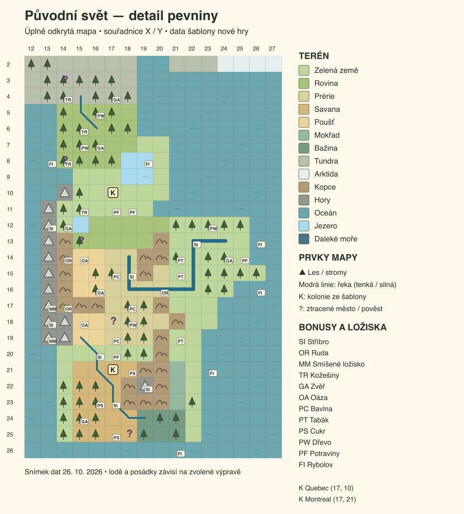
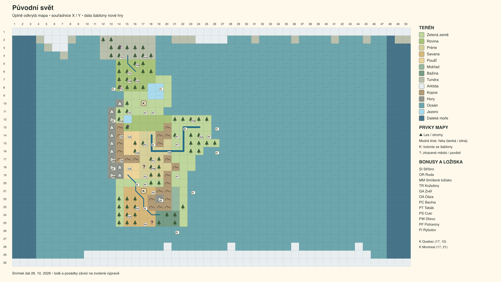
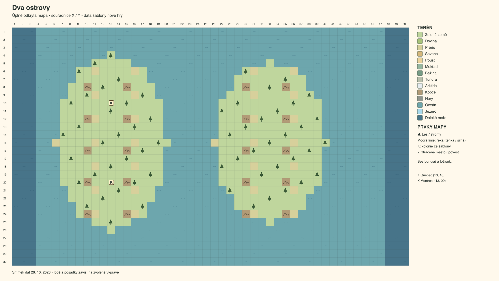
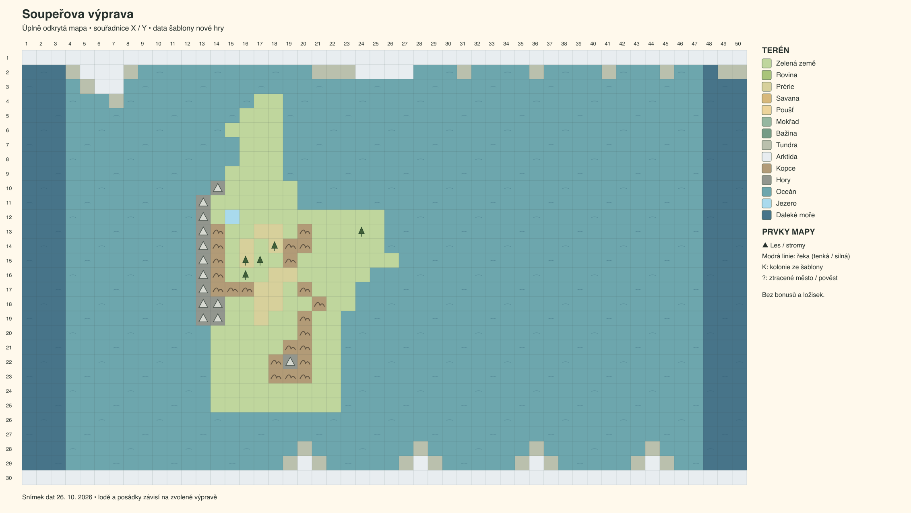
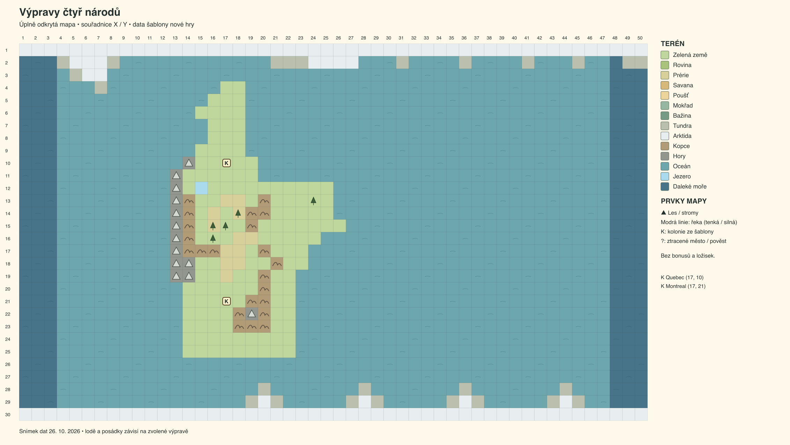

# Mapy volné hry

Čtyři pevné mapy v nabídce **New free game / Nová volná hra**, v pořadí nabídky.
Náhledy z 26. října 2026 jsou vykreslené přímo z dat šablon: ukazují celý terén,
řeky, lesy, ložiska, bonusy, pověsti a kolonie. Lodě a posádky závisejí na zvolené
výpravě. Barvy a symboly jsou vysvětlené v legendě, souřadnice začínají v levém
horním rohu. Jde o datové diagramy, nikoli snímky herní grafiky.

[R-0302](requirements/done/R-0302.md) rozšiřuje pravidlo vnitrozemských řek i na pevné
mapy. Řeka nesmí vést přes kopce ani hory nebo sousedit s vodou, a to ani
rohem. Jezera jsou oddělená od oceánu souvislou pevninou. Oprava platí pro nově
zahájené hry; uložené rozehrané pozice se nepřepisují. Ověření je vedené v
[testové evidenci](functional-tests.md#r-0302-bundled-map-geography-2026-10-26).

Výjimka z 27. října 2026: [R-0313](requirements/R-0313.md) prodlužuje velkou
řeku Původního světa z (24, 13) na pobřežní (25, 13), aby bylo možné posuzovat
její vzhled. Výjimka platí jen pro toto pole; generované řeky se nemění.
Testy této změny nebyly na výslovné přání uživatele spuštěny.

## 1. Původní svět

Pět nových pobřežních polí uzavírá jezero na souřadnicích X=18–19, Y=8–9.
Samostatná vnitrozemská voda na (15, 12) je správně označená jako jezero.
Tři samostatné řeky mají 3, 13 a 7 polí. Ložiska a bonusy byly podle potřeby
přesunuty, jejich počet a konečné zásoby zůstaly zachované. Kolonie i běžné
vylodění u (25, 14) zůstávají na místě.

Následující diagramy zachycují stav z 26. října 2026, před přidáním pole (25, 13).

## 2. Dva ostrovy

Dva oddělené ostrovy, výchozí francouzské kolonie Quebec a Montreal.
Šablona nemá řeky, jezera ani zvláštní surovinové bonusy; vodní pravidla
nevyžadují změnu jejího terénu.

## 3. Soupeřova výprava

Pevný kontinent pro střet výprav, bez řek a zvláštních bonusů. Vnitrozemská
voda na (15, 12) je opravená z oceánu na jezero. Osádky se sestaví při založení partie.

## 4. Výpravy čtyř národů

Sdílí geografii předchozí varianty; nastavení výpravy a účastníků je samostatné.
Šablona rovněž nemá řeky ani zvláštní bonusy; voda na (15, 12) je opravená na jezero.
Značky K ukazují kolonie obsažené v základní šabloně.

## Vygenerovaný nový svět

Pátá volba vytváří mapu podle semínka, klimatu a množství pevniny, takže nemá
jeden pevný obrázek. Její říční pravidlo popisuje
[R-0301](requirements/done/R-0301.md). Výše jsou všechny čtyři pevné šablony.
