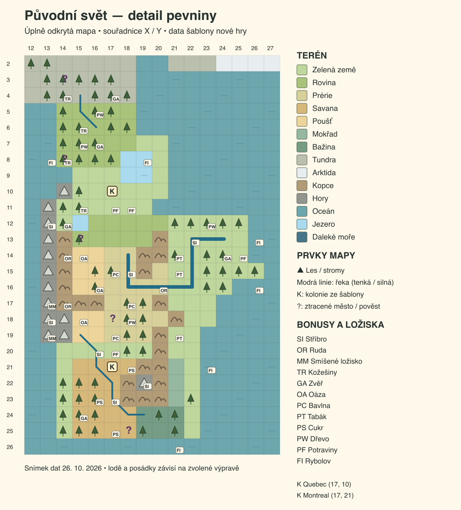
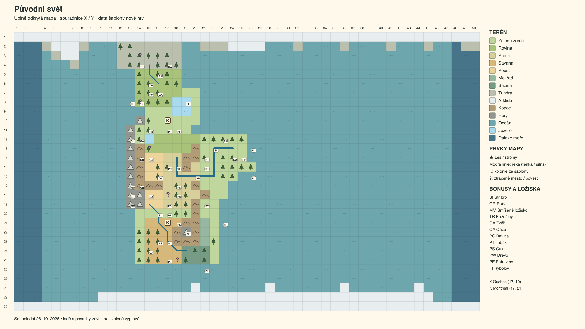
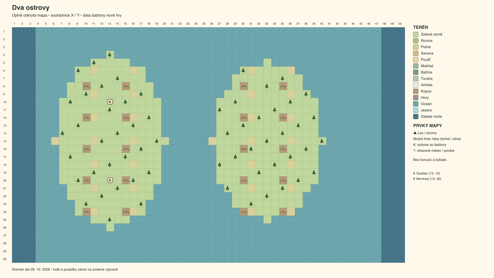
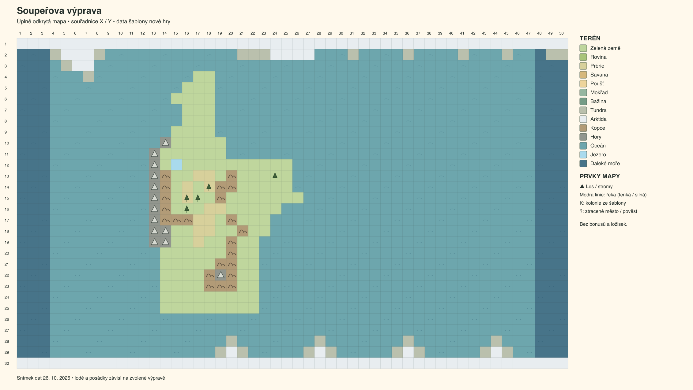
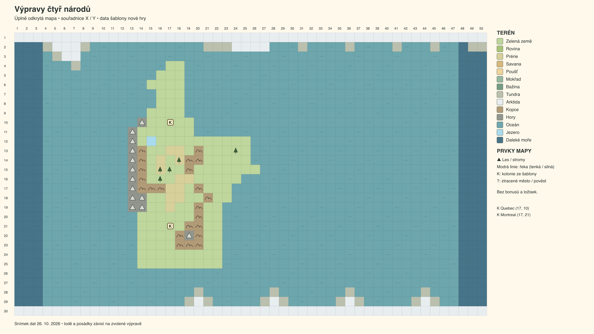

# Mapy volné hry

## Cíle a konec volné hry

Dohoda z **16. listopadu 2026**: průvodce má kroky **Svět → Hráč → Cíle**.
Svět vybírá mapu, její parametry a seed; Hráč jméno, národ a obtížnost.
Ve třetím kroku lze nezávisle zapnout následující cíle. Výchozí je pouze
Nezávislost. Volba je součástí uložené partie a během hraní se nemění.

1. **Nezávislost:** vyhlásit samostatnost a vyhrát revoluci. Samotné vyhlášení
   nestačí. Platí společné podmínky [revoluce](gap-analysis.md#revolution-and-intervention),
   včetně osvobození přeživších kolonií a nejvýše dvou živých pozemních
   jednotek krále napříč rezervou, přepravou a pevninou.
2. **Úplný kongres:** získat všech 25 členů kongresu.
3. **Nadvláda:** vyřadit všechny ostatní kolonizační národy. Domorodé národy
   a králové nejsou soupeři pro tento cíl. Národ je vyřazen ztrátou poslední
   kolonie po prvním založení nebo získání kolonie; úvodní výprava bez kolonie
   není vyřazena. Vyřazení se ukládá a národ už nedostává další tahy.
   Bez soupeřů nemůže být nadvláda splněna.
4. Stačí splnit **kterýkoli zapnutý cíl**. Stejné cíle platí pro soupeře;
   vítězství soupeře ukončí lidskou partii porážkou. Vyhodnocení používá
   dokončené modelové akce a přípravy tahu. Porážka má přednost před vítězstvím.
   Při současném splnění více cílů jedním národem vznikne jediný výsledek se
   všemi splněnými zapnutými cíli. Pořadí při stejné hranici je stabilní pořadí
   národů; nezávislost nadále uchovává pořadí skutečných dokončení revoluce.
5. **Žádné časové limity:** roky 1600, 1800 ani 1850 nevyřazují národ,
   neuzavírají skóre, neblokují vyhlášení samostatnosti a neukončují freegame.
   Formulář nenabízí časový limit. Kalendář a jeho zobrazení zůstávají;
   vlastní lhůty scénářů kampaně tato změna neruší.
6. Vypnutí všech cílů znamená **volné budování bez cílového vítězství a bez
   časového limitu**. Pravidla porážky a dobrovolné ukončení stále platí.
7. Obrazovka Cíle od prvního tahu ukazuje zapnuté cíle a jejich postup:
   podporu samostatnosti, po vyhlášení okupované kolonie a zbývající královské
   pozemní jednotky, členy kongresu a zbývající soupeře.
8. Síň slávy uchovává cíl či cíle vítězného národa, vítěze, tah dokončení,
   zapnuté cíle a stávající skóre s rozpisem, obtížností a identitou hráče.
   Skórovací vzorec včetně bonusů za nezávislost se touto změnou nepřebalancovává.
   Výsledek se uzavře jednou; načtení, opětovné otevření ani pokračování bez
   bodování jej nepřepočítají a nevytvoří duplicitu.
9. Vítěz může z okna výsledku pokračovat bez bodování. Zavření výsledku tuto
   možnost neaktivuje. Další hraní nemění původní výsledek; uložená pokračující
   partie tento stav zachová.

Implementace a přejímka: změna je rozpracovaná; ověření bude zaznamenáno ve
[funkční evidenci](functional-tests.md#free-play-objectives-2026-11-16).

## Editor map

1. Schválené zadání z 9. listopadu 2026, implementace a místní přejímka dokončené: [R-0435](requirements/done/R-0435.md). Samostatný editor je dostupný tlačítkem **Map editor** napravo od **Settings** pouze v developer mode; používá mapový pohled a pravý panel nástrojů.
2. **Nová mapa** v horním menu vyžádá šířku a výšku a vytvoří svět vyplněný oceánem. Nástroje mění terén a podporované atributy polí, včetně hor, řek, bonusů a domorodých osad. První verze nezakládá evropské kolonie.
3. Autor vybírá národ hráče, počáteční jednotky, jejich pozice a nalodění posádky. Domorodým osadám vybírá kmen a vlastnosti podporované stávající hrou. Platí současná pravidla terénu, kapacity, identity a názvů; editor nezavádí jiné herní účinky.
4. **Uložit** uchovává i nehotový návrh jako scénář; **Otevřít mapu** jej znovu zpřístupní k úpravám. Spuštění nové hry samostatně kontroluje hratelnost, vypíše konkrétní chyby a neplatný scénář nespustí. Platný scénář zachová autorem určený svět a výpravu. Scénář se samotným spuštěním nepřepíše a není uloženou rozehranou pozicí.
5. Nová mapa, otevření jiné mapy a odchod chrání neuložené změny volbami uložit, zahodit nebo zrušit. Zrušení a selhání načtení či uložení zachovávají rozpracovaný návrh. Ovládání používá společné mapové konvence a anglické i české texty.

### Ovládání editoru — 18. listopadu 2026

1. Pohled se posouvá touchpadem či kolečkem v obou osách, tažením pravým
   tlačítkem a stejnými nastavitelnými klávesami jako ve hře (výchozí WASD).
   Klávesy fungují při zaměření mapy; formuláře si ponechávají vlastní vstup.
   Uvolnění klávesy, ztráta zaměření mapy nebo odchod z editoru posun zastaví.
   Rychlost a citlivost přebírají nastavení hry. Šipky nadále vybírají pole,
   pokud nejsou přemapované na posun; Enter/mezerou se použije nástroj.
2. Pravý panel má svislý posuvník. Autor vybere nástroj a variantu terénu,
   bonusu, řeky, sídla či jednotky a klikne do mapy. Alternativně nejprve
   označí pole nástrojem Výběr a poté použije tlačítko **Použít na vybrané pole**.
   Bez vybraného pole nebo s nástrojem Výběr je tlačítko neaktivní.
   Les a obdělání se přepínají; odstranění objektů zůstává v detailu pole.
3. Samotná volba nástroje návrh nemění. Model odmítne nepovolenou kombinaci
   bez částečných změn a panel vypíše důvod. Odchod dál chrání neuložený návrh.
   Jde o implementované ovládání, nikoli hráčskou studii; skutečné výsledky
   ověření vlastní [funkční evidence](functional-tests.md#map-editor-controls-2026-11-18).

### Implementační volby editoru (R-0435, 9. listopadu 2026, místní přejímka dokončená)

1. Rozměry: šířka i výška jsou celá čísla od 10 do 100 polí (`ScenarioDraft.MIN_SIDE`/`MAX_SIDE`). Horní mez odpovídá největšímu dodávanému světu 100 × 80; mimo rozsah se svět nevytváří. Nový návrh je oceán pro nizozemský národ bez osad a jednotek; editor bez otevřeného souboru ukazuje oceán 40 × 30.
2. Úpravy: každá změna se provede na kopii a ověří pravidly `WorldMap`; odmítnutí vypíše důvod a pole a nic nezmění. Malování oceánu odstraní les, pole, cestu, zvěst, řeku a bonus, které moře nenese; osada či jednotka, která by na novém terénu nemohla stát, změnu odmítne. Nová řeka se spojí se sousedními říčními poli.
3. Domorodé osady přebírají výchozí hodnoty generátoru (třída kmene, poklad, trh a vyučovaná dovednost podle okolí); formulář mění kmen, hlavní město a dovednost. Účastník kmene vzniká a zaniká s jeho osadami; editor nepřidává bojovníky. Kmen s osadami potřebuje právě jedno hlavní město, druhé se odmítne hned, chybějící až při spuštění.
4. Výprava: jednotky lze umístit jen na terén, po kterém se mohou pohybovat, a ne do osady; na loď se přidávají noví cestující podle počtu nákladových míst. Odebraná loď odebere i cestující. Změna národa přejmenuje hráče, korunu a vlastníky jednotek.
5. Uložení zapíše scénář atomicky do zvoleného souboru přes `GameModelPoDao.saveScenarioToFile`; zrušení nebo chyba zachová návrh i předchozí soubor. Otevření ověřuje jen strukturu, takže lze otevřít i nehratelný návrh; běžné načítání her a uložených pozic se nemění.
6. **Hrát** nejprve vypíše všechny problémy hratelnosti s poli (bez výpravy, kmen bez hlavního města, odmítnutí modelem) a označí první pole. Platný návrh spustí `GameModelDao.createAuthoredScenario` přesně tak, jak je: bez generované výpravy, dalších národů a bojovníků; zdrojový soubor se nezmění. **Zahodit** v ochraně změn zahazuje neuložené úpravy až při odchodu z editoru nebo spuštění hry.
7. Vývojářská cesta držené **S** při načtení otevírá vybraný scénář v editoru jen v developer mode, a to přes stejnou strukturální kontrolu.
8. Otevřený scénář s existujícím stavem: pole kolonie nepřijme změnu terénu, osadu ani jednotku. Národ hráče nelze změnit, pokud scénář obsahuje kolonie nebo jiný koloniální národ (jejich záznamy národ jmenují); jinak se přejmenují hráč, koruna a jednotky a domorodé vztahy se přesunou k novému národu. Úprava osady zachová identitu, trh, poklad, mise a historii a její bojovníci přejdou s ní k novému kmeni; poklad ve výchozí výši sleduje změnu hodnosti. Odebraná osada odebere své bojovníky a záznamy; místní poplach ostatních osad zůstává. Evropská jednotka se nepřidá na pole cizí jednotky.
9. Nástroj je vždy právě jeden: opětovné klepnutí na aktivní nástroj jej ponechá a otevření nabídky varianty (terén, řeka, bonus, kmen, jednotka) zvolí její nástroj i při ponechání výchozí hodnoty.
10. Položka **Map editor** stojí vpravo od **Nastavení** mimo rozvržení sloupce menu, takže sedm běžných položek zachovává původní polohu a rozměry; v pořadí fokusu následuje Nastavení.
11. Rozvržení: horní lišta drží celé popisky příkazů a název mapy na samostatném zalomeném řádku; pravý panel má pevnou šířku 300 px na papírovém podkladu, každý nástroj vlastní řádek se sémantickou ikonou a jeho volbu pod sebou a obsah se posouvá svisle. Při šířce okna 900 a 1000 px se žádný text nezkracuje a mapa zůstává použitelná.

## Dosavadní pevné mapy

Nová výprava zná také svou příjezdovou námořní cestu z Evropy; vlastní loď proto může zadat návrat pomocí **G** i po vyčerpání pohybu. Jde o zapamatovaný terén, nikoli rozšířený dohled. Existující uložené hry se při načítání neupravují. Rozsah a stav přejímky vede [R-0424](requirements/done/R-0424.md).

Čtyři pevné mapy v nabídce **New free game / Nová volná hra**, v pořadí nabídky.
Náhledy z 26. října 2026 jsou vykreslené přímo z dat šablon: ukazují celý terén,
řeky, lesy, ložiska, bonusy, pověsti a kolonie. Lodě a posádky závisejí na zvolené
výpravě. Barvy a symboly jsou vysvětlené v legendě, souřadnice začínají v levém
horním rohu. Jde o datové diagramy, nikoli snímky herní grafiky.

[R-0302](requirements/done/R-0302.md) rozšiřuje pravidlo vnitrozemských řek i na pevné
mapy. Řeka nesmí vést přes kopce ani hory nebo sousedit s vodou, a to ani
rohem. Jezera jsou oddělená od oceánu souvislou pevninou. Oprava platí pro nově
zahájené hry; uložené rozehrané pozice se nepřepisují. Ověření je vedené v
[testové evidenci](functional-tests.md#r-0302-bundled-map-geography-2026-10-26).

Výjimka z 27. října 2026: [R-0313](requirements/done/R-0313.md) prodlužuje velkou
řeku Původního světa z (24, 13) na pobřežní (25, 13), aby bylo možné posuzovat
její vzhled. Výjimka platí jen pro toto pole; generované řeky se nemění.
Testy této změny nebyly na výslovné přání uživatele spuštěny.

## 1. Původní svět

Pět nových pobřežních polí uzavírá jezero na souřadnicích X=18–19, Y=8–9.
Samostatná vnitrozemská voda na (15, 12) je správně označená jako jezero.
Tři samostatné řeky mají 3, 13 a 7 polí. Ložiska a bonusy byly podle potřeby
přesunuty, jejich počet a konečné zásoby zůstaly zachované. Kolonie i běžné
vylodění u (25, 14) zůstávají na místě.

Následující diagramy zachycují stav z 26. října 2026, před přidáním pole (25, 13).

## 2. Dva ostrovy

Dva oddělené ostrovy, výchozí francouzské kolonie Quebec a Montreal.
Šablona nemá řeky, jezera ani zvláštní surovinové bonusy; vodní pravidla
nevyžadují změnu jejího terénu.

## 3. Soupeřova výprava

Pevný kontinent pro střet výprav, bez řek a zvláštních bonusů. Vnitrozemská
voda na (15, 12) je opravená z oceánu na jezero. Osádky se sestaví při založení partie.

## 4. Výpravy čtyř národů

Sdílí geografii předchozí varianty; nastavení výpravy a účastníků je samostatné.
Šablona rovněž nemá řeky ani zvláštní bonusy; voda na (15, 12) je opravená na jezero.
Značky K ukazují kolonie obsažené v základní šabloně.

## Vygenerované nové pobřeží

Pátá volba vytváří mapu podle semínka, klimatu a množství pevniny, takže nemá
jeden pevný obrázek. Její říční pravidlo popisuje
[R-0301](requirements/done/R-0301.md). Výše jsou všechny čtyři pevné šablony.

## Severní Amerika

Šestá volba **North America / Severní Amerika** ([R-0221](requirements/done/R-0221.md))
spouští autorský stylizovaný svět 100 × 80 polí podle
[pravidla geografické mapy](gap-analysis.md#north-america-reference-map). Jde o
původní herní mapu, ne o přesná zeměpisná data. Hráč volí národ i obtížnost.

1. Editovatelný zdroj je `akropia-game/src/main/resources/maps/north-america.txt`:
   řádky terénu zapsané jako úseky kódů uložení (velké písmeno znamená les),
   řeky jako lomené čáry a domorodé osady. `NorthAmericaWorld` z něj při každé
   nové hře skládá stejný svět; zdroje surovin, bravové a pověsti používají
   pevné semínko 1492.
2. Krajina: Aljaška, arktické ostrovy, Baffinův ostrov, Hudsonův a Jamesův záliv,
   Velké jezero Medvědí a Otročí, Winnipeg, pět Velkých jezer, ústí řeky
   sv. Vavřince, Newfoundland, Nové Skotsko, Chesapeake, Florida, Mexický záliv,
   Kalifornský poloostrov, Yucatán, Střední Amerika po Panamu a Velké i Malé
   Antily. Pohoří: Skalisté hory, Kaskády a Sierra Nevada, Sierra Madre a
   Apalačské vrchy. Řeky: Mississippi s Missouri a Ohiem, Mackenzie, Yukon,
   Saskatchewan, Columbia, Colorado, Rio Grande a sv. Vavřinec. Řeky drží
   vnitrozemské pravidlo R-0302.
3. Domorodé národy: Irokézové, Čerokíové, Siouxové, Apačové, Aztékové a Arawakové,
   každý s hlavním a jedním dalším sídlem a dvěma bravy u každého sídla.
4. Čtyři výpravy připlouvají z atlantického širého moře: Nizozemci (92, 30),
   Francouzi (91, 45), Angličané (98, 54) a Španělé (100, 64).

Datový náhled celé mapy vzniká v modelovém testu `NorthAmericaWorldTest` jako
`akropia-game/target/r0221/north-america-preview.svg`; snímek zatím není
převzat do dokumentace.
