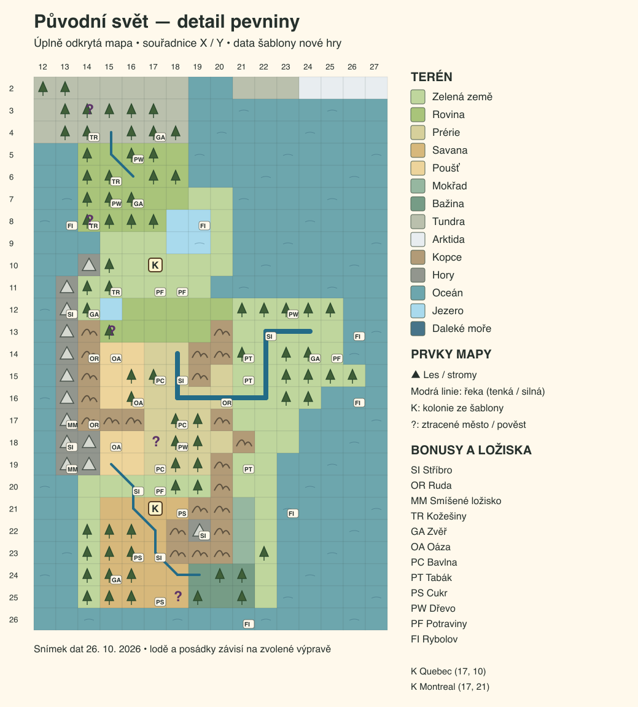
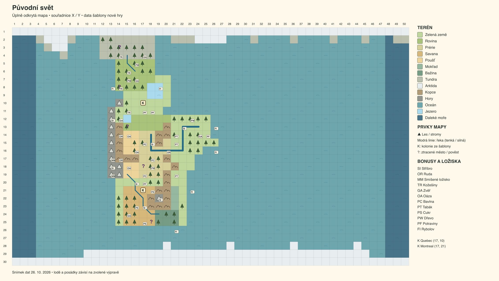
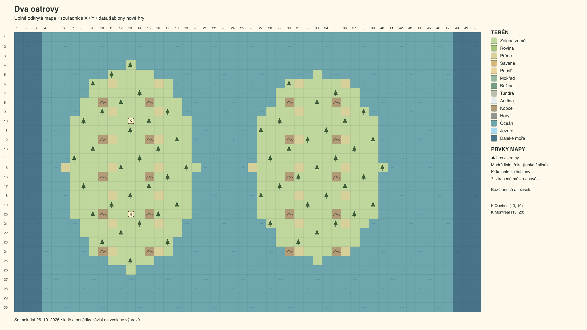
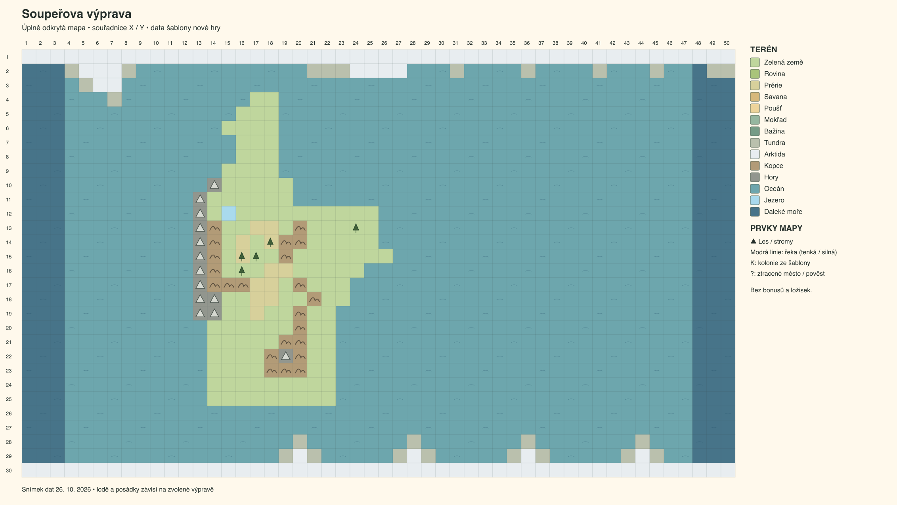
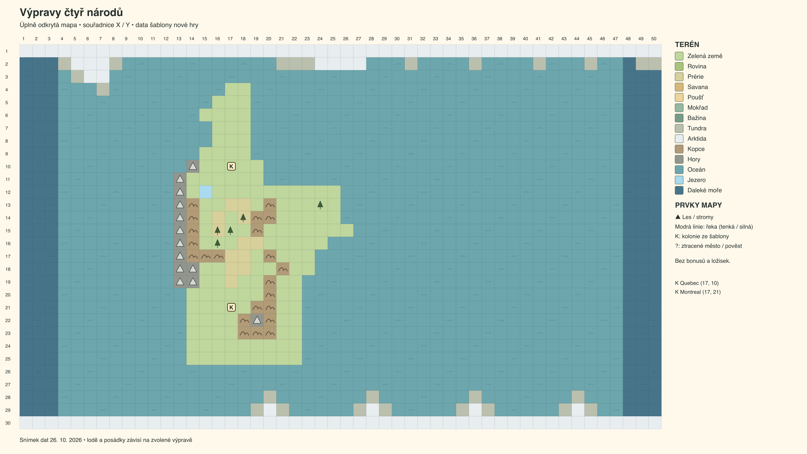

# Mapy volné hry

Nová výprava zná také svou příjezdovou námořní cestu z Evropy; vlastní loď proto může zadat návrat pomocí **G** i po vyčerpání pohybu. Jde o zapamatovaný terén, nikoli rozšířený dohled. Existující uložené hry se při načítání neupravují. Rozsah a stav přejímky vede [R-0424](requirements/done/R-0424.md).

Čtyři pevné mapy v nabídce **New free game / Nová volná hra**, v pořadí nabídky.
Náhledy z 26. října 2026 jsou vykreslené přímo z dat šablon: ukazují celý terén,
řeky, lesy, ložiska, bonusy, pověsti a kolonie. Lodě a posádky závisejí na zvolené
výpravě. Barvy a symboly jsou vysvětlené v legendě, souřadnice začínají v levém
horním rohu. Jde o datové diagramy, nikoli snímky herní grafiky.

[R-0302](requirements/done/R-0302.md) rozšiřuje pravidlo vnitrozemských řek i na pevné
mapy. Řeka nesmí vést přes kopce ani hory nebo sousedit s vodou, a to ani
rohem. Jezera jsou oddělená od oceánu souvislou pevninou. Oprava platí pro nově
zahájené hry; uložené rozehrané pozice se nepřepisují. Ověření je vedené v
[testové evidenci](functional-tests.md#r-0302-bundled-map-geography-2026-10-26).

Výjimka z 27. října 2026: [R-0313](requirements/done/R-0313.md) prodlužuje velkou
řeku Původního světa z (24, 13) na pobřežní (25, 13), aby bylo možné posuzovat
její vzhled. Výjimka platí jen pro toto pole; generované řeky se nemění.
Testy této změny nebyly na výslovné přání uživatele spuštěny.

## 1. Původní svět

Pět nových pobřežních polí uzavírá jezero na souřadnicích X=18–19, Y=8–9.
Samostatná vnitrozemská voda na (15, 12) je správně označená jako jezero.
Tři samostatné řeky mají 3, 13 a 7 polí. Ložiska a bonusy byly podle potřeby
přesunuty, jejich počet a konečné zásoby zůstaly zachované. Kolonie i běžné
vylodění u (25, 14) zůstávají na místě.

Následující diagramy zachycují stav z 26. října 2026, před přidáním pole (25, 13).

## 2. Dva ostrovy

Dva oddělené ostrovy, výchozí francouzské kolonie Quebec a Montreal.
Šablona nemá řeky, jezera ani zvláštní surovinové bonusy; vodní pravidla
nevyžadují změnu jejího terénu.

## 3. Soupeřova výprava

Pevný kontinent pro střet výprav, bez řek a zvláštních bonusů. Vnitrozemská
voda na (15, 12) je opravená z oceánu na jezero. Osádky se sestaví při založení partie.

## 4. Výpravy čtyř národů

Sdílí geografii předchozí varianty; nastavení výpravy a účastníků je samostatné.
Šablona rovněž nemá řeky ani zvláštní bonusy; voda na (15, 12) je opravená na jezero.
Značky K ukazují kolonie obsažené v základní šabloně.

## Vygenerované nové pobřeží

Pátá volba vytváří mapu podle semínka, klimatu a množství pevniny, takže nemá
jeden pevný obrázek. Její říční pravidlo popisuje
[R-0301](requirements/done/R-0301.md). Výše jsou všechny čtyři pevné šablony.

## Severní Amerika

Šestá volba **North America / Severní Amerika** ([R-0221](requirements/done/R-0221.md))
spouští autorský stylizovaný svět 100 × 80 polí podle
[pravidla geografické mapy](gap-analysis.md#north-america-reference-map). Jde o
původní herní mapu, ne o přesná zeměpisná data. Hráč volí národ i obtížnost.

1. Editovatelný zdroj je `akropia-game/src/main/resources/maps/north-america.txt`:
   řádky terénu zapsané jako úseky kódů uložení (velké písmeno znamená les),
   řeky jako lomené čáry a domorodé osady. `NorthAmericaWorld` z něj při každé
   nové hře skládá stejný svět; zdroje surovin, bravové a pověsti používají
   pevné semínko 1492.
2. Krajina: Aljaška, arktické ostrovy, Baffinův ostrov, Hudsonův a Jamesův záliv,
   Velké jezero Medvědí a Otročí, Winnipeg, pět Velkých jezer, ústí řeky
   sv. Vavřince, Newfoundland, Nové Skotsko, Chesapeake, Florida, Mexický záliv,
   Kalifornský poloostrov, Yucatán, Střední Amerika po Panamu a Velké i Malé
   Antily. Pohoří: Skalisté hory, Kaskády a Sierra Nevada, Sierra Madre a
   Apalačské vrchy. Řeky: Mississippi s Missouri a Ohiem, Mackenzie, Yukon,
   Saskatchewan, Columbia, Colorado, Rio Grande a sv. Vavřinec. Řeky drží
   vnitrozemské pravidlo R-0302.
3. Domorodé národy: Irokézové, Čerokíové, Siouxové, Apačové, Aztékové a Arawakové,
   každý s hlavním a jedním dalším sídlem a dvěma bravy u každého sídla.
4. Čtyři výpravy připlouvají z atlantického širého moře: Nizozemci (92, 30),
   Francouzi (91, 45), Angličané (98, 54) a Španělé (100, 64).

Datový náhled celé mapy vzniká v modelovém testu `NorthAmericaWorldTest` jako
`akropia-game/target/r0221/north-america-preview.svg`; snímek zatím není
převzat do dokumentace.
