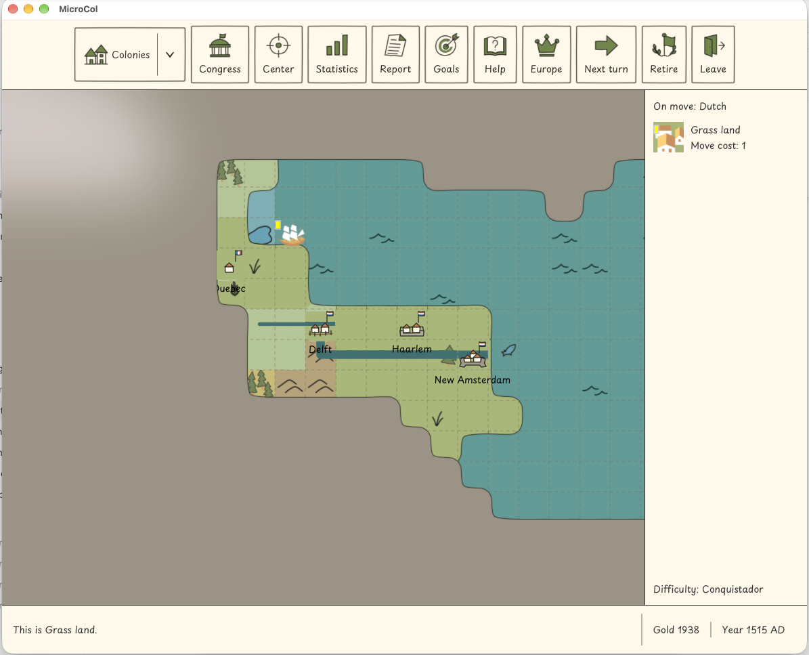
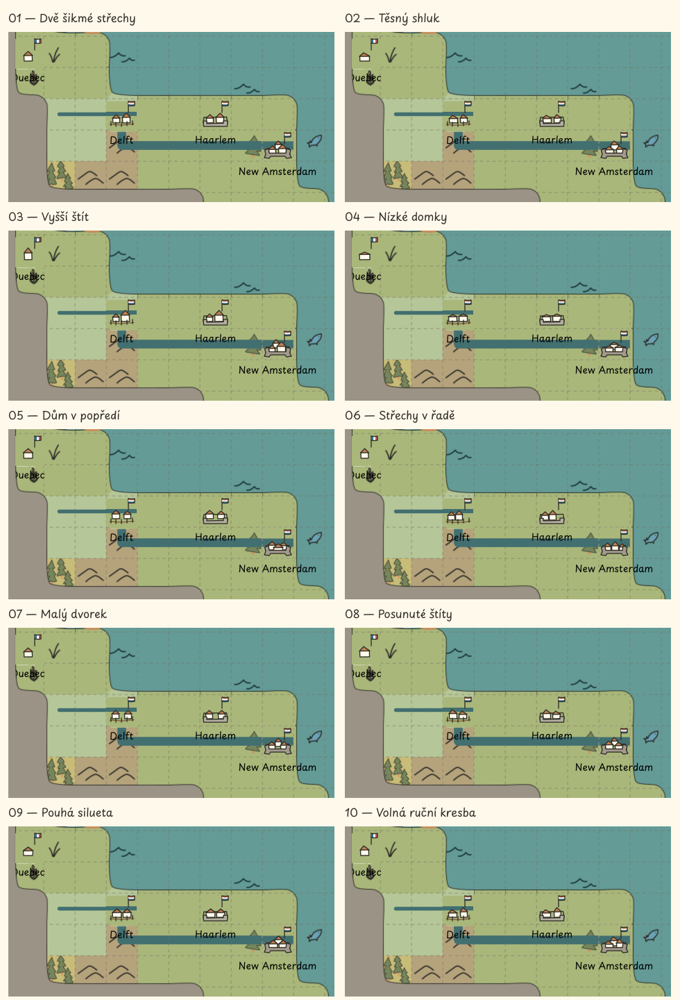

# Kolonie v měřítku herní mapy

**Výtvarné návrhy z 25. října 2026; [R-0280](requirements/R-0280.md).** Obrázky jsou kompozice nad uživatelovým screenshotem, nikoli snímky implementované změny. Žádná varianta zatím není vybraná.

## Rozměr a společná pravidla

1. [Herní políčko](../microcol-game/src/main/java/org/microcol/gui/Tile.java) má **45 × 45 logických px**. Na dodaném screenshotu má 90 × 90 obrazových px. Celé nové značky včetně vlajky a obrany jsou navrženy přímo v souřadnicích 45 × 45; náhled celé obrazovky je exportovaný v měřítku 1×.
2. Návrhy používají jednu, dvě nebo tři střechy a čtyři nezávislé stavy obrany. Populační hranice nejsou dohodnuté. Domky nemají okna, tašky, jednotlivé kameny ani dekorativní okolí. Základní tah všech deseti rodin má 1,35 px; jde o konkrétní návrh k posouzení, nikoli novou závaznou hodnotu grafického manuálu.
3. Jméno zůstává bez rámečku. Nizozemská vlajka slouží jako společný příklad; Quebec má francouzskou. Národní vlajky nejsou samostatné varianty velikosti či obrany. Při implementaci je nutné sladit konkrétní národní motivy se společným značením hráčů.
4. Všechny mapové ukázky používají původní screenshot jako nezměněný podklad. Překryté jsou původní značky a jejich výběrový obrys; místní podklad/řeka je pod novou značkou doplněn. **Haarlem je přidaný ukázkový bod**, aby bylo možné současně porovnat všechny obrany. Pravý informační panel zůstává původní.
5. První generované ilustrace byly po uživatelově připomínce vyřazeny: nabízely příliš mnoho detailů pro skutečné políčko. Následující podklady jsou jednoduché editovatelné SVG kresby. Nejde o zmenšení předchozích ilustračních listů.

## Jaká opevnění hra má

1. Model definuje řetězec **palisáda → fort → fortress**. Zvlášť existuje stav bez opevnění. Ceny a minimální počet vnitřních obyvatel pro stavbu vlastní [ConstructionType](../microcol-game/src/main/java/org/microcol/model/ConstructionType.java); obranné účinky vlastní [CombatStrengths](../microcol-game/src/main/java/org/microcol/model/CombatStrengths.java). Následující hodnoty byly přečteny ze zdrojů 25. října 2026; nejde o nový běh herních testů.

| Stav | Kladiva / nástroje / obyvatelé pro stavbu | Obranný bonus opevnění | Značka v návrhu |
| --- | --- | --- | --- |
| Bez opevnění | — | 0 % | Pouze domky |
| Palisáda (`STOCKADE`) | 64 / 0 / 3 | +100 % | Krátká hnědá hrana a pět kůlů |
| Fort (`FORT`) | 120 / 100 / 4 | +150 % | Nízká šedá zeď se dvěma rovnými konci |
| Fortress (`FORTRESS`) | 320 / 200 / 8 | +200 % | Kompaktní obranný obrys s vystupujícími rohy |

2. Bonusy jsou složkou bojového výpočtu, nikoli zárukou výsledku každého boje. Pobřežní fort a fortress mohou za příslušných podmínek střílet na nepřátelské lodě na sousedním moři; palisáda nikoli. Pravidla včetně vlivu dělostřelectva vlastní [pobřežní palba](requirements/done/R-0177.md).
3. Opevnění může zůstat i po nuceném úbytku obyvatel. Velikost obrázku proto není synonymem obrany; viz [pravidlo obyvatel opevněné kolonie](requirements/done/R-0082.md).

## Přímo v původním screenshotu

1. Quebec: malá kolonie bez opevnění. Delft: střední kolonie s palisádou. Haarlem: střední kolonie s fortem. New Amsterdam: velká kolonie s fortress. Toto rozdělení pouze ukazuje značky a nedokládá skutečnou populaci nebo stavby v uživatelově hře.

## Deset variant

1. Srovnání níže používá výřezy stejného screenshotu, ve stejném měřítku jako celá obrazovka výše. Zobrazení v úzkém prohlížeči může obrázek dále zmenšit; pro přesné 1× měřítko otevřít PNG v jeho přirozené velikosti.

| Varianta | Celá obrazovka | Editovatelných 12 značek |
| --- | --- | --- |
| 01 — Dvě šikmé střechy | [PNG](graphics-assets/colony-2026-10-25/01-map.png) | [SVG](graphics-assets/colony-2026-10-25/01-icons.svg) |
| 02 — Těsný shluk | [PNG](graphics-assets/colony-2026-10-25/02-map.png) | [SVG](graphics-assets/colony-2026-10-25/02-icons.svg) |
| 03 — Vyšší štít | [PNG](graphics-assets/colony-2026-10-25/03-map.png) | [SVG](graphics-assets/colony-2026-10-25/03-icons.svg) |
| 04 — Nízké domky | [PNG](graphics-assets/colony-2026-10-25/04-map.png) | [SVG](graphics-assets/colony-2026-10-25/04-icons.svg) |
| 05 — Dům v popředí | [PNG](graphics-assets/colony-2026-10-25/05-map.png) | [SVG](graphics-assets/colony-2026-10-25/05-icons.svg) |
| 06 — Střechy v řadě | [PNG](graphics-assets/colony-2026-10-25/06-map.png) | [SVG](graphics-assets/colony-2026-10-25/06-icons.svg) |
| 07 — Malý dvorek | [PNG](graphics-assets/colony-2026-10-25/07-map.png) | [SVG](graphics-assets/colony-2026-10-25/07-icons.svg) |
| 08 — Posunuté štíty | [PNG](graphics-assets/colony-2026-10-25/08-map.png) | [SVG](graphics-assets/colony-2026-10-25/08-icons.svg) |
| 09 — Pouhá silueta | [PNG](graphics-assets/colony-2026-10-25/09-map.png) | [SVG](graphics-assets/colony-2026-10-25/09-icons.svg) |
| 10 — Volná ruční kresba | [PNG](graphics-assets/colony-2026-10-25/10-map.png) | [SVG](graphics-assets/colony-2026-10-25/10-icons.svg) |

2. V každém listu značek mají sloupce pořadí bez opevnění / palisáda / fort / fortress; řádky malá / střední / velká. Rozměr listu je 180 × 135 px, tedy dvanáct buněk po 45 × 45 px. Názvy se při implementaci vykreslují zvlášť skutečným herním písmem, nejsou součástí atlasu.
3. Výtvarné doporučení k dalšímu posouzení: **01** pro přehlednost dvou oddělených střech, **04** pro nízkou siluetu nebo **06** pro čitelné rozšíření do řady. Varianty jsou záměrně drobné změny geometrie v omezeném prostoru, nikoli deset nových stylů mapy.

## Podklady a ověření

1. [Původní screenshot](graphics-assets/colony-2026-10-25/reference-game.png) je společný podklad; `NN-map.svg` a `comparison.svg` jej odkazují relativně. SVG kompozice jsou dokumentační podklady. Export lze zopakovat například `python3 scripts/graphics/with-fonts.py rsvg-convert -o docs/graphics-assets/colony-2026-10-25/01-map.png docs/graphics-assets/colony-2026-10-25/01-map.svg`.
2. Dokončená dokumentační kontrola se zaznamenává do [publikační evidence](publishing.md#colony-marker-proposals-2026-10-25). Tyto náhledy neověřují herní interakce ani publikaci nové distribuce. Implementace bude vyžadovat kontrolu skutečného vykreslení, vlajek, popisků, viditelnosti a hráčských scénářů.
