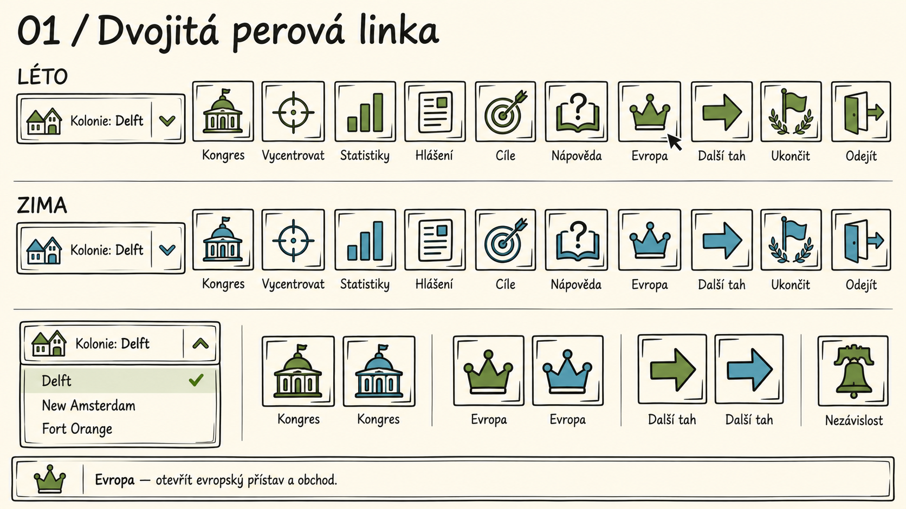
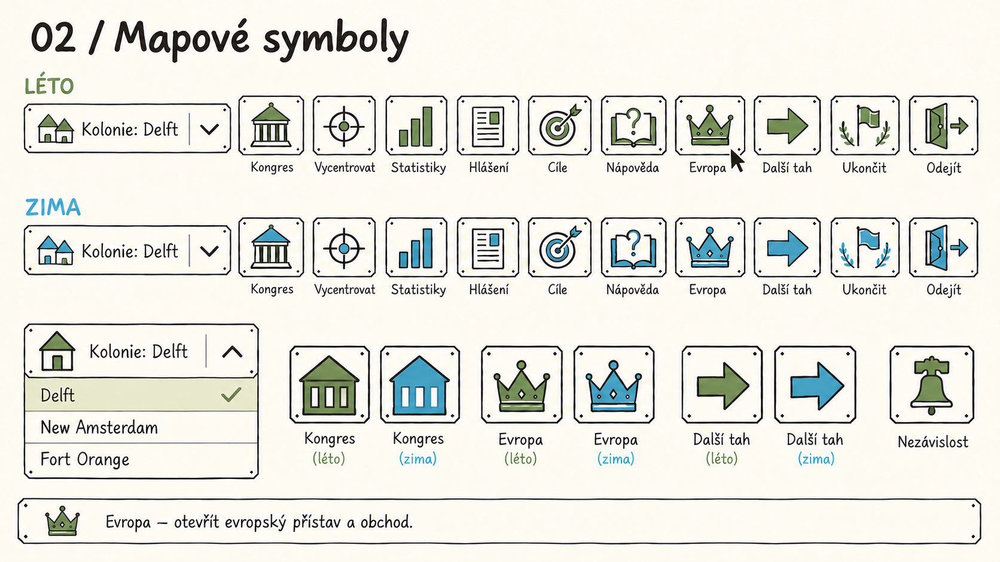
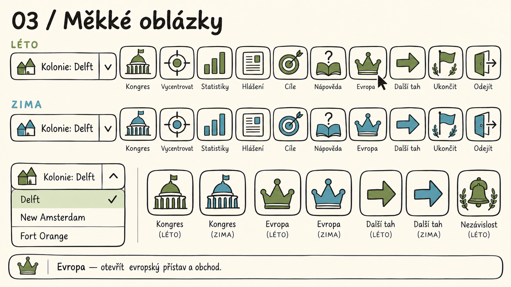
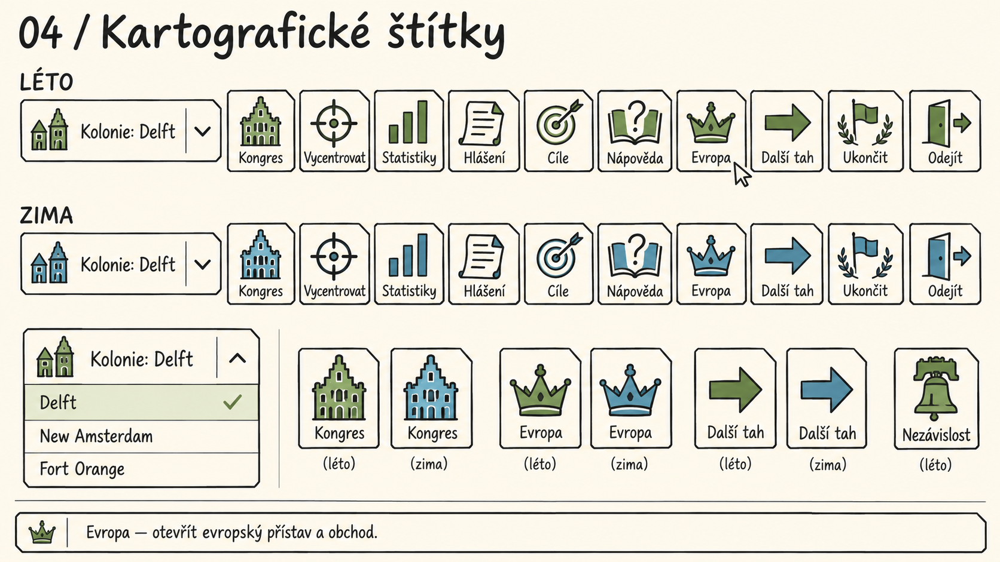
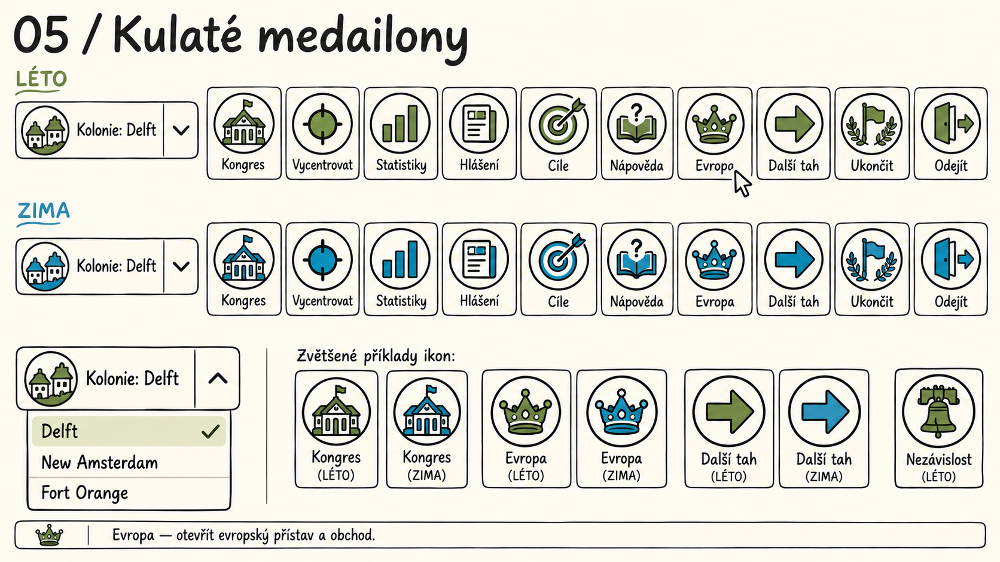
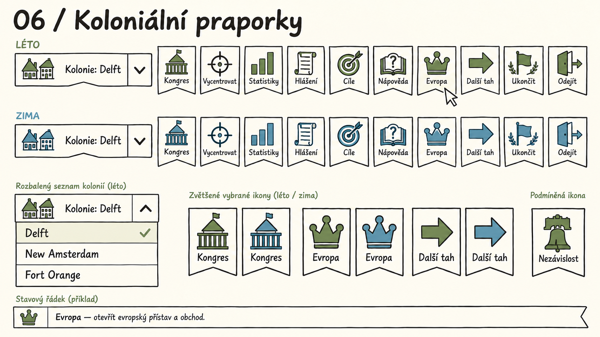
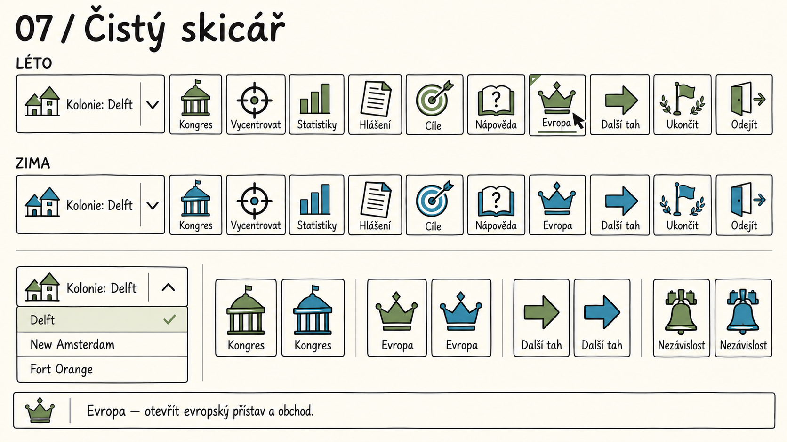
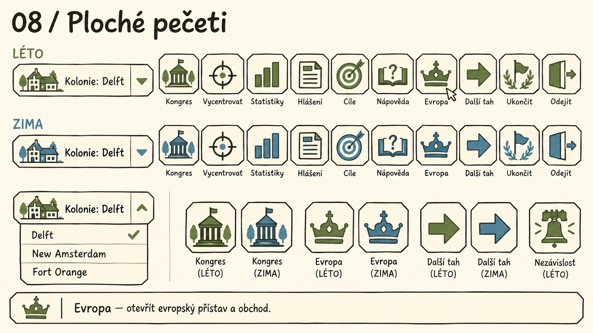
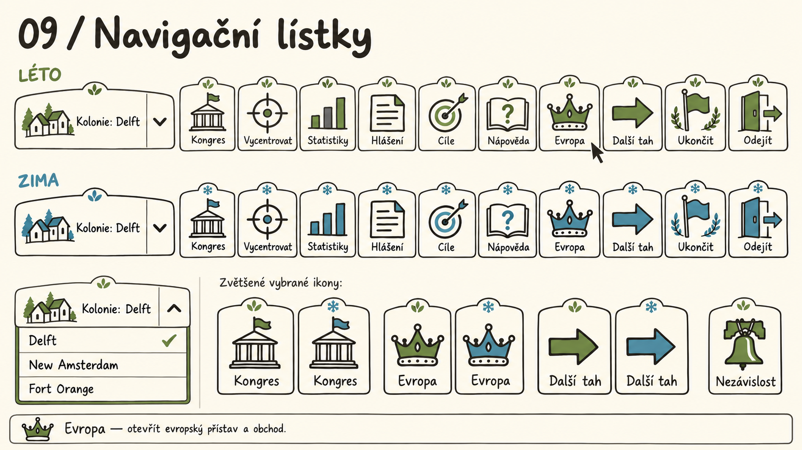
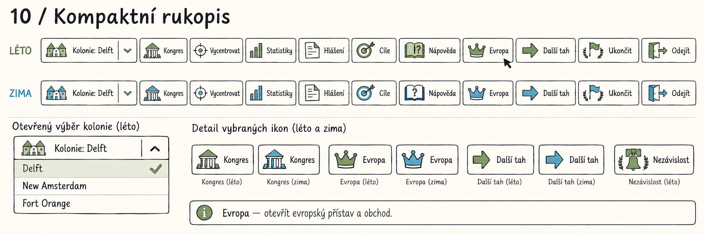

# Horní lišta — deset výtvarných návrhů

**Návrhy z 25. října 2026, zatím nevybrané a nezapojené do hry.** Požadavek a jeho další rozhodnutí vlastní [R-0273](requirements/R-0273.md). Společná pravidla vzhledu zůstávají v [grafickém manuálu](graphics.md#soucasne-zadani-vzhledu).

Každý list porovnává letní a zimní lištu, trvalé názvy akcí, otevřený výběr kolonie a příklad vysvětlení ve spodní stavové liště. Nezávislost je uvedena zvlášť jako podmíněně dostupná akce. Nejde o snímky běžící hry.

## Společný princip

1. Tmavý inkoust zůstává, druhá barva se mění podle režimu. Pracovní návrh palety: inkoust `#302D27`, léto `#71864B`, zima `#568B9B`; krémový podklad `#FFF9EC` je pozadí. Hodnoty jsou návrhem, ne ověřenou konfigurací hry.
2. Ikona a krátký název jsou stále vidět. Podrobnější význam patří při najetí myší i klávesnicovém zaměření do spodní stavové lišty.
3. Dropdown má rámeček kolem celého ovladače a oddělenou šipku. Seznam má jasný výběr se značkou, čitelné názvy a možnost zavření bez změny.
4. Generované PNG slouží k volbě směru. Při převodu vybrané sady do SVG je nutné sjednotit geometrii mezi sezonami, přesné dvě barevné role a typografii; drobné rastrové odchylky a zvětšené příklady nejsou výrobní specifikace.

## Porovnání

Nejblíže současnému vzhledu je **01**, nejstřídmější je **07**. Pro nízkou lištu stojí za porovnání **10**, která však potřebuje více šířky pro názvy. Toto doporučení je výtvarný úsudek, nikoli výsledek uživatelského testování.

| Varianta / samostatné PNG | Charakter |
| --- | --- |
| [01 / Dvojitá perová linka](graphics-assets/top-menu-2026-10-25/01-dvojita-perova-linka.png) | Nejbližší současné hře; lehce nepravidelný dvojitý rámeček. |
| [02 / Mapové symboly](graphics-assets/top-menu-2026-10-25/02-mapove-symboly.png) | Hranaté značky a seříznuté rohy ve stylu mapové legendy. |
| [03 / Měkké oblázky](graphics-assets/top-menu-2026-10-25/03-mekke-oblazky.png) | Oblé, měkčí tvary a výraznější barevné plochy. |
| [04 / Kartografické štítky](graphics-assets/top-menu-2026-10-25/04-kartograficke-stitky.png) | Štítky s ustřiženým rohem a koloniálními štíty budov. |
| [05 / Kulaté medailony](graphics-assets/top-menu-2026-10-25/05-kulate-medailony.png) | Kruhové medailony s jasnými siluetami. |
| [06 / Koloniální praporky](graphics-assets/top-menu-2026-10-25/06-kolonialni-praporky.png) | Papírové praporky s mělkým výřezem dole. |
| [07 / Čistý skicář](graphics-assets/top-menu-2026-10-25/07-cisty-skicar.png) | Nejúspornější kresba, jednoduchý rámeček a hodně volného místa. |
| [08 / Ploché pečeti](graphics-assets/top-menu-2026-10-25/08-ploche-peceti.png) | Výraznější vyplněné siluety v osmihranném rámečku. |
| [09 / Navigační lístky](graphics-assets/top-menu-2026-10-25/09-navigacni-listky.png) | Lístky se zaobleným horním výstupkem. |
| [10 / Kompaktní rukopis](graphics-assets/top-menu-2026-10-25/10-kompaktni-rukopis.png) | Nízká lišta: ikona vlevo, text vedle ní. |

Všechny listy vznikly vestavěným nástrojem **imagegen**. [Úplná zadání a následné úpravy](graphics-assets/top-menu-2026-10-25/prompts.txt) jsou uloženy spolu s podklady.

## Náhledy

### 01 / Dvojitá perová linka

Nejbližší současné hře; lehce nepravidelný dvojitý rámeček.

### 02 / Mapové symboly

Hranaté značky a seříznuté rohy ve stylu mapové legendy.

### 03 / Měkké oblázky

Oblé, měkčí tvary a výraznější barevné plochy.

### 04 / Kartografické štítky

Štítky s ustřiženým rohem a koloniálními štíty budov.

### 05 / Kulaté medailony

Kruhové medailony s jasnými siluetami.

### 06 / Koloniální praporky

Papírové praporky s mělkým výřezem dole.

### 07 / Čistý skicář

Nejúspornější kresba, jednoduchý rámeček a hodně volného místa.

### 08 / Ploché pečeti

Výraznější vyplněné siluety v osmihranném rámečku.

### 09 / Navigační lístky

Lístky se zaobleným horním výstupkem.

### 10 / Kompaktní rukopis

Nízká lišta: ikona vlevo, text vedle ní.

