# Jednotky — současný stav a deset návrhů pro mapu

**Návrhová studie z 25. října 2026.** [R-0285](requirements/done/R-0285.md) zachycuje výběr budoucí podoby. Uživatel následně vybral **09 — Lehký pohyb** pro implementaci se silnějším tahem; aktuální stav patří do [zadání jednotek](graphics.md#vybrane-jednotky-25-rijna-2026) a [funkční evidence](functional-tests.md#r-0285-walking-unit-artwork-2026-10-25). Níže zůstává původní porovnání. Všechny celé listy obsahují 35 současných typů a pět dalších podob výbavy či poškození.

## Vybraná varianta ve hře

Varianta **09 — Lehký pohyb** je zapojená se zesílenými tmavými obrysy. Snímek z Docker/Xvfb z 25. října 2026 ukazuje všech 35 typů a pět stavů v běžné velikosti 45 × 45 px. Domorodý bojovník stojí blíže další řadě, aby byl v aktuálním dohledu hráče. Test ověřil také pohyb a načtení uložené hry; podrobnosti a stav závěrečné přejímky jsou v [evidenci](functional-tests.md#r-0285-walking-unit-artwork-2026-10-25).

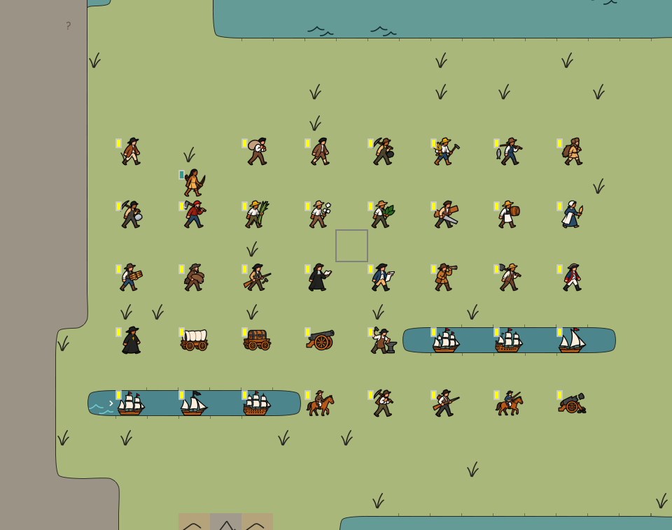

## Stav před úpravou (revize cbbe0abb)

Soupis vychází ze zdrojů revize `cbbe0abb`: [UnitType](../microcol-game/src/main/java/org/microcol/model/UnitType.java), [výběr obrázků](../microcol-game/src/main/java/org/microcol/gui/image/UnitImageProvider.java), [výřezy atlasu](../microcol-game/src/main/java/org/microcol/gui/image/ImageLoaderUnit.java) a [české názvy](../microcol-game/src/main/resources/org/microcol/gui/UnitTypes_cs_CZ.xml). Jde o přehled skutečně načítaných resources, nikoli o nové překreslení nebo snímek spuštěné hry.

1. Hra má **35 typů**, ale jen **pět základních ilustrací**: člověk, povoz, dělo a dvě lodě. Stejnou postavu používá 26 lidských typů včetně specialistů a domorodého bojovníka.
2. Karavela, obchodní loď a galeona sdílejí galeonu; frigata, korzárská a řadová loď sdílejí frigatu. Povoz a pokladní povoz mají společný obrázek.
3. Skutečná výbava evropské lidské jednotky přepíná čtyři další obrázky: kůň, nástroje, mušketa, kůň s mušketou. Dělostřelectvo má samostatný poškozený stav. ID E01–E05 proto nejsou další typy jednotek.
4. Galeonová skupina má také zrcadlený pohled pro západ. List nepočítá zrcadlení jako další typ. Národní značky, výběr a další herní překryvy jsou samostatná vrstva.

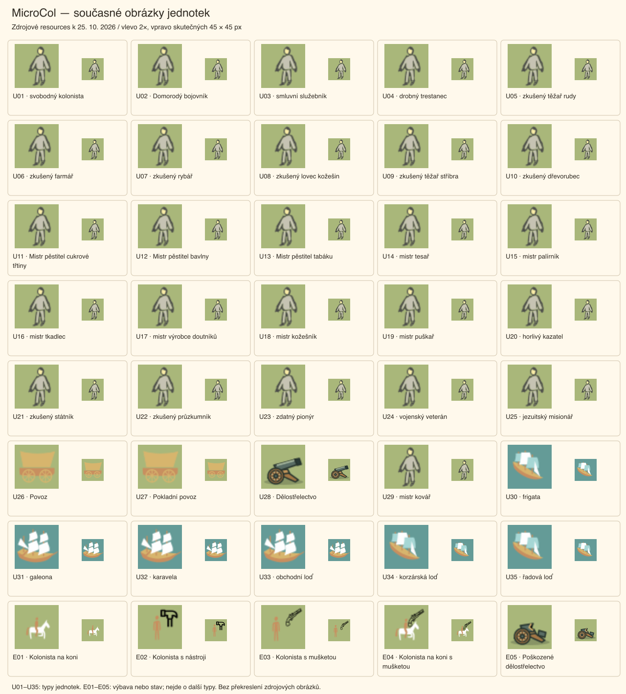

V každé kartě je současný obrázek vlevo zvětšený 2× a vpravo v prostoru 45 × 45 px. [Zdroj přehledu SVG](graphics-assets/units-2026-10-25/current.svg).

## Rychlé porovnání návrhů

V malých náhledech má každý výřez prostor **45 × 45 px**; vpravo je kolonista zvětšený 2×. Při zobrazení celé tabulky zmenšené prohlížečem je potřeba otevřít PNG na 100 %. Zachovává se poměr stran jednotlivých výřezů. Zelené a modré plochy slouží k porovnání na barvě terénu; nejsou návrhem neprůhledných čtverců pod jednotkami.

Jde o deset variant uvnitř dohodnutého směru [propiskové kresby](graphics.md#soucasne-zadani-vzhledu). Některé generované listy obsahují jemné stínování, texturu nebo příliš drobné detaily. Při převodu vybraného směru do herních SVG musí zmizet a tah se musí sjednotit podle grafického manuálu. Tyto listy jsou podklady k výběru siluet, nikoli hotové produkční atlasy.

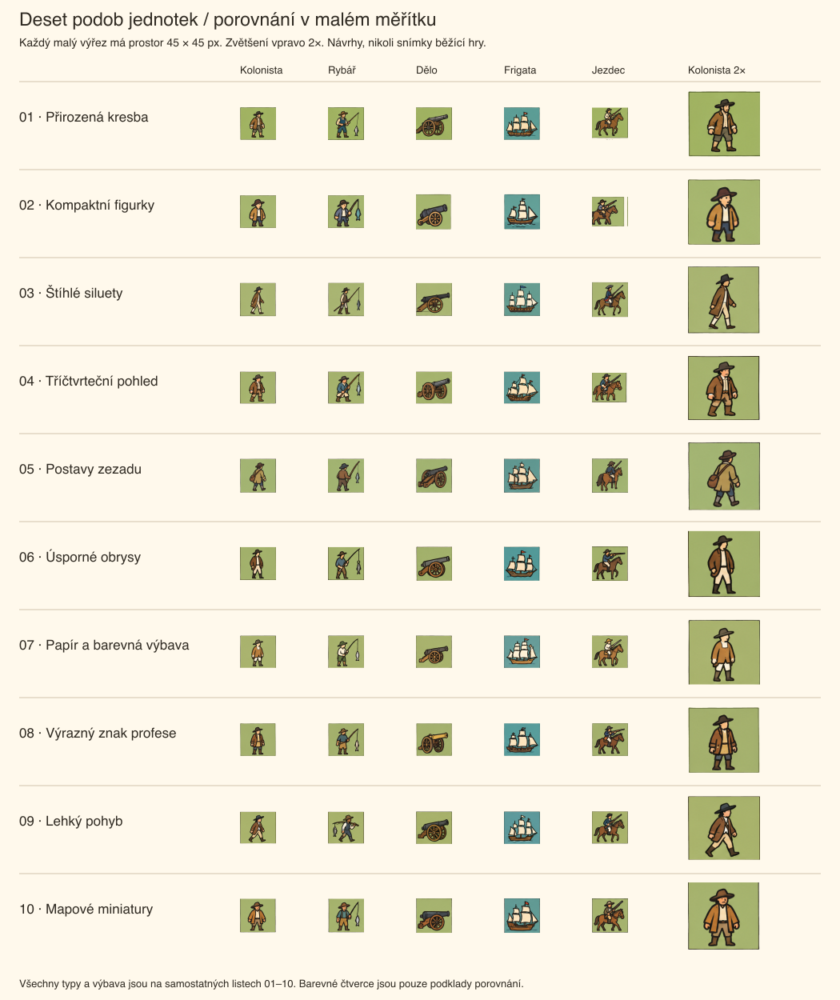

Za vhodné kandidáty pro další výběr považuji **02** pro výrazné malé figurky, **06** pro úspornější kresbu a **09** pro živější mapu. Jde o vizuální posouzení náhledů, nikoli výsledek hráčského testu.

| Sada | Směr | Celý list |
| --- | --- | --- |
| 01 — Přirozená kresba | Přirozené proporce a uvolněný postoj; nejbližší běžné figurální ilustraci. | [PNG](graphics-assets/units-2026-10-25/01.png) |
| 02 — Kompaktní figurky | Zkrácené proporce a větší hlavy. Výraznější silueta při malé velikosti. | [PNG](graphics-assets/units-2026-10-25/02.png) |
| 03 — Štíhlé siluety | Úzké postavy z profilu a dlouhé kabáty. Jemnější, vzdušnější dojem. | [PNG](graphics-assets/units-2026-10-25/03.png) |
| 04 — Tříčtvrteční pohled | Šikmý pohled a širší postoj; podobně natočené povozy a lodě. | [PNG](graphics-assets/units-2026-10-25/04.png) |
| 05 — Postavy zezadu | Pohled zezadu přes rameno. Batohy a nesené předměty vystupují do popředí. | [PNG](graphics-assets/units-2026-10-25/05.png) |
| 06 — Úsporné obrysy | Jednodušší tváře a obrysy. Méně drobných čar uvnitř postavy. | [PNG](graphics-assets/units-2026-10-25/06.png) |
| 07 — Papír a barevná výbava | Více nevybarvených ploch, světlejší oděvy a střídmé barevné akcenty. | [PNG](graphics-assets/units-2026-10-25/07.png) |
| 08 — Výrazný znak profese | Povolání zdůrazňuje nesený předmět a jeho silueta. | [PNG](graphics-assets/units-2026-10-25/08.png) |
| 09 — Lehký pohyb | Krok vpřed, nástroje přes rameno a nakloněné postoje. | [PNG](graphics-assets/units-2026-10-25/09.png) |
| 10 — Mapové miniatury | Čelnější, vyvážené postavy s pevnou siluetou; kompaktní mapové miniatury. | [PNG](graphics-assets/units-2026-10-25/10.png) |

Nástroje a výrobky v konceptech pomáhají poznat profesi; nepřidávají vybavení nebo schopnosti do modelu. Před implementací musí výsledné značky odlišit profesi od skutečné výbavy, zejména u puškaře, pionýra, průzkumníka a vojáka. Značky na plachtách jsou ilustrativní; vlastnictví musí dál určovat skutečný herní stav.

## Legenda všech jednotek

| ID | Současný název ve hře |
| --- | --- |
| U01 | svobodný kolonista |
| U02 | Domorodý bojovník |
| U03 | smluvní služebník |
| U04 | drobný trestanec |
| U05 | zkušený těžař rudy |
| U06 | zkušený farmář |
| U07 | zkušený rybář |
| U08 | zkušený lovec kožešin |
| U09 | zkušený těžař stříbra |
| U10 | zkušený dřevorubec |
| U11 | Mistr pěstitel cukrové třtiny |
| U12 | Mistr pěstitel bavlny |
| U13 | Mistr pěstitel tabáku |
| U14 | mistr tesař |
| U15 | mistr palírník |
| U16 | mistr tkadlec |
| U17 | mistr výrobce doutníků |
| U18 | mistr kožešník |
| U19 | mistr puškař |
| U20 | horlivý kazatel |
| U21 | zkušený státník |
| U22 | zkušený průzkumník |
| U23 | zdatný pionýr |
| U24 | vojenský veterán |
| U25 | jezuitský misionář |
| U26 | Povoz |
| U27 | Pokladní povoz |
| U28 | Dělostřelectvo |
| U29 | mistr kovář |
| U30 | frigata |
| U31 | galeona |
| U32 | karavela |
| U33 | obchodní loď |
| U34 | korzárská loď |
| U35 | řadová loď |
| E01 | Kolonista na koni |
| E02 | Kolonista s nástroji |
| E03 | Kolonista s mušketou |
| E04 | Kolonista na koni s mušketou |
| E05 | Poškozené dělostřelectvo |

## Celé návrhové listy

### 01 — Přirozená kresba

Přirozené proporce a uvolněný postoj; nejbližší běžné figurální ilustraci.

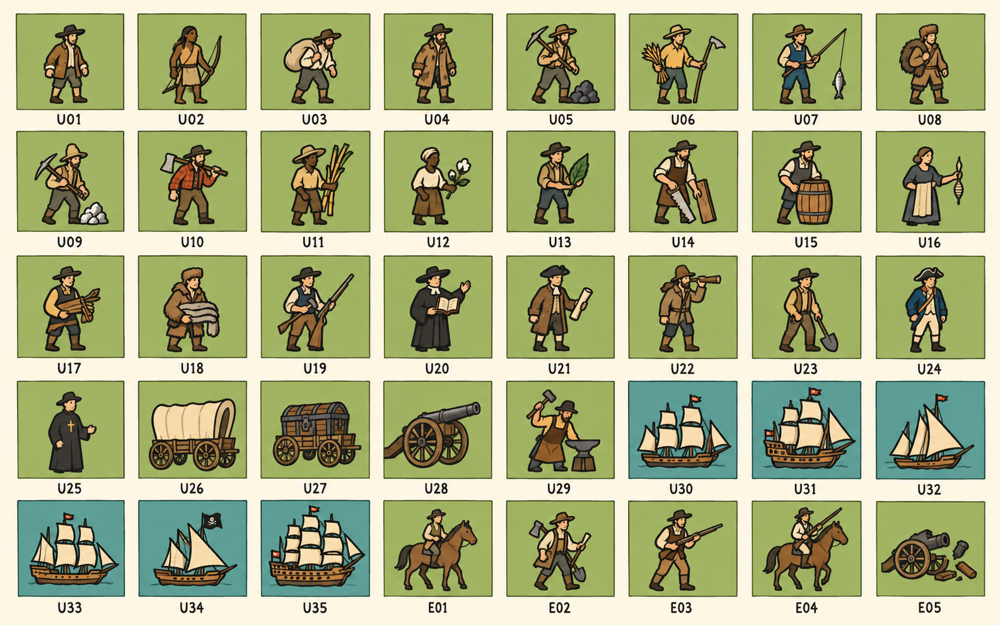

### 02 — Kompaktní figurky

Zkrácené proporce a větší hlavy. Výraznější silueta při malé velikosti.

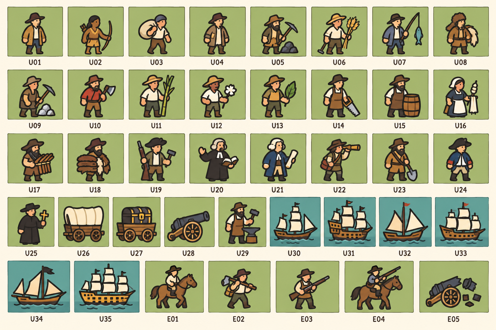

### 03 — Štíhlé siluety

Úzké postavy z profilu a dlouhé kabáty. Jemnější, vzdušnější dojem.

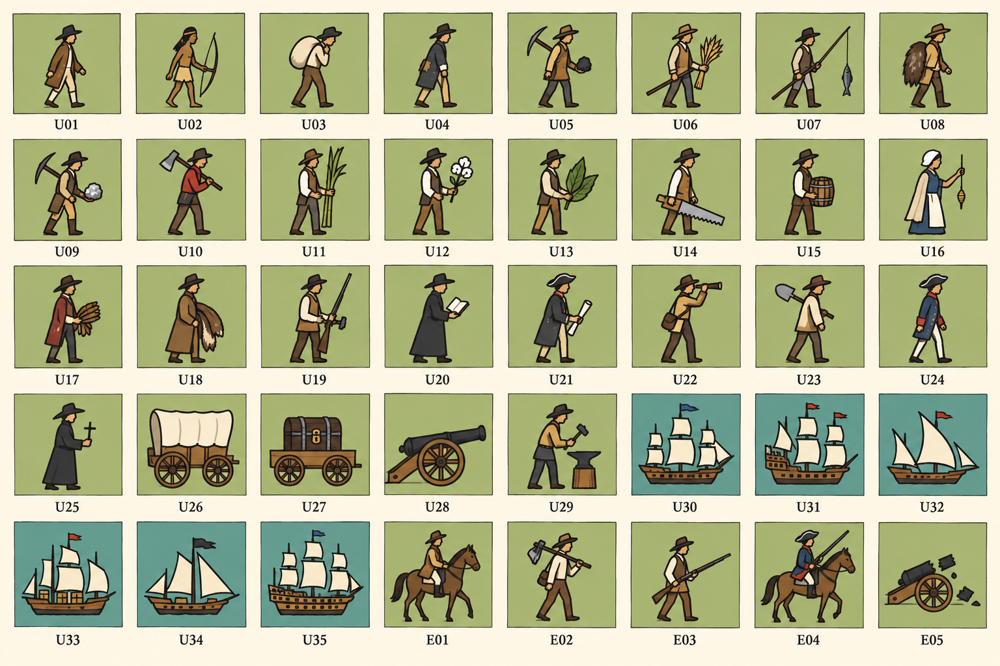

### 04 — Tříčtvrteční pohled

Šikmý pohled a širší postoj; podobně natočené povozy a lodě.

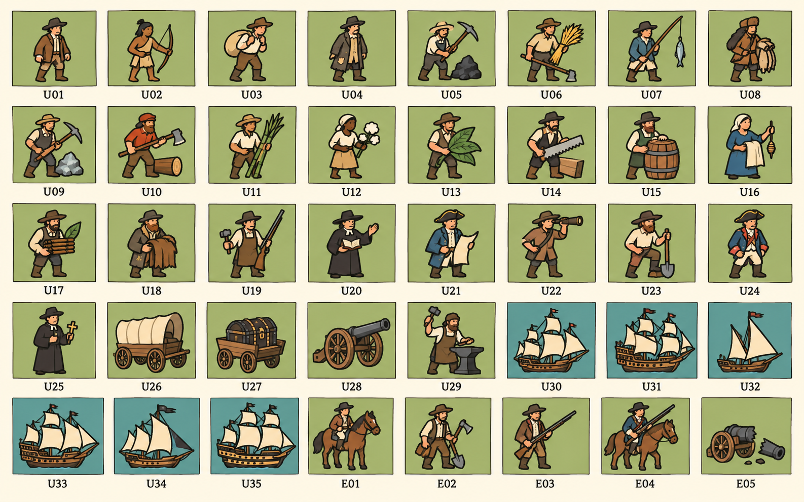

### 05 — Postavy zezadu

Pohled zezadu přes rameno. Batohy a nesené předměty vystupují do popředí.

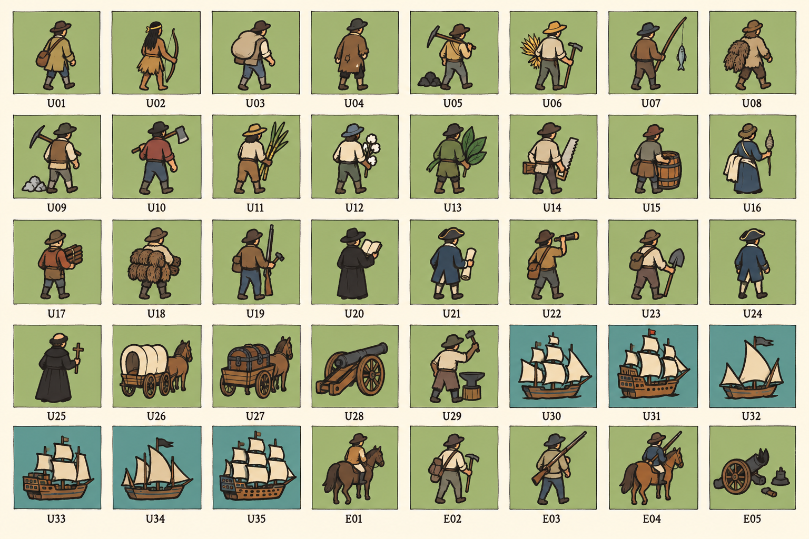

### 06 — Úsporné obrysy

Jednodušší tváře a obrysy. Méně drobných čar uvnitř postavy.

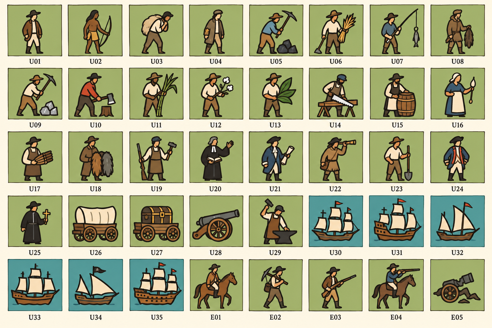

### 07 — Papír a barevná výbava

Více nevybarvených ploch, světlejší oděvy a střídmé barevné akcenty.

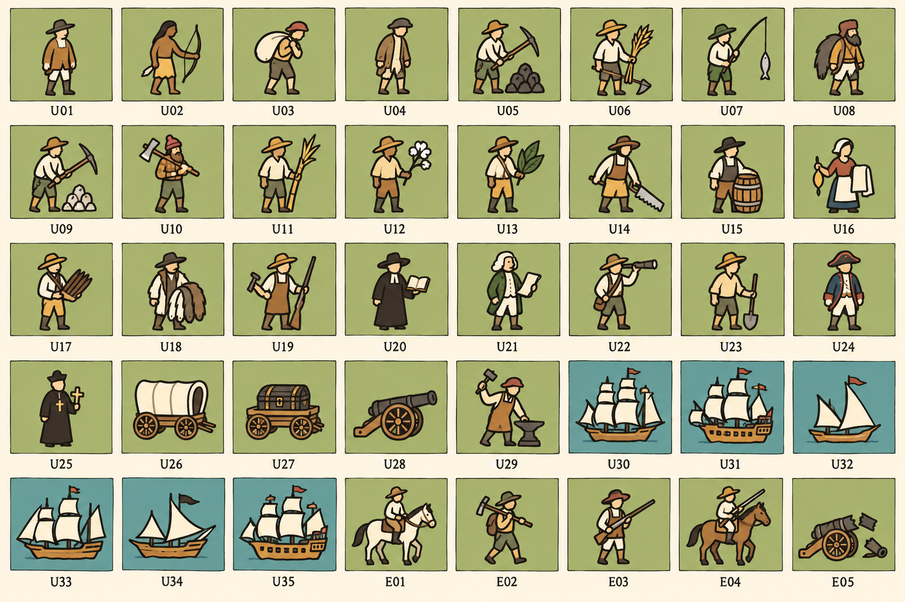

### 08 — Výrazný znak profese

Povolání zdůrazňuje nesený předmět a jeho silueta.

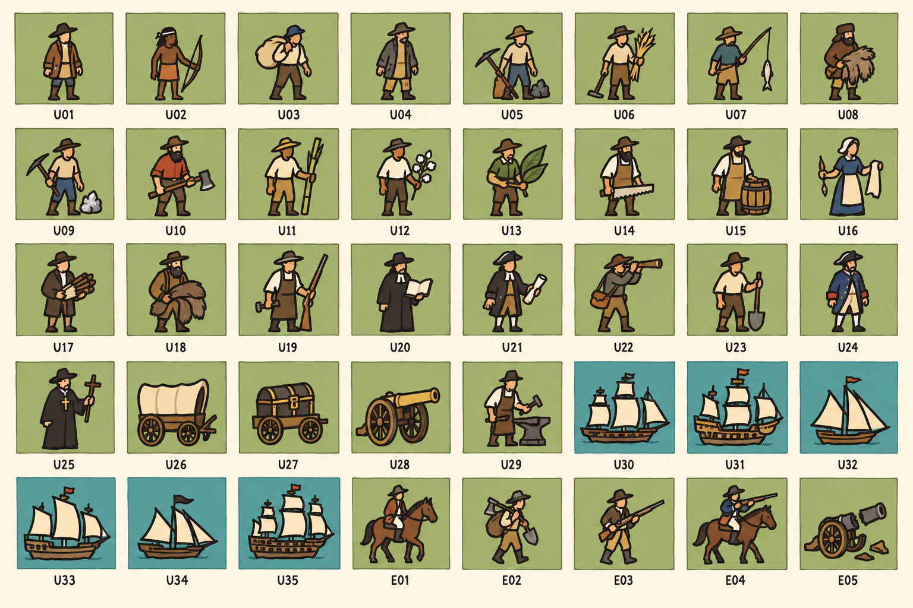

### 09 — Lehký pohyb

Krok vpřed, nástroje přes rameno a nakloněné postoje.

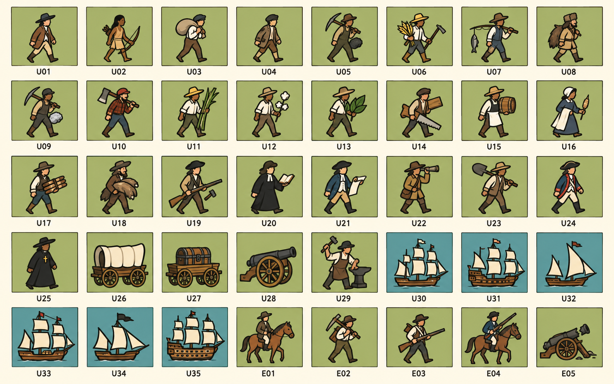

### 10 — Mapové miniatury

Čelnější, vyvážené postavy s pevnou siluetou; kompaktní mapové miniatury.

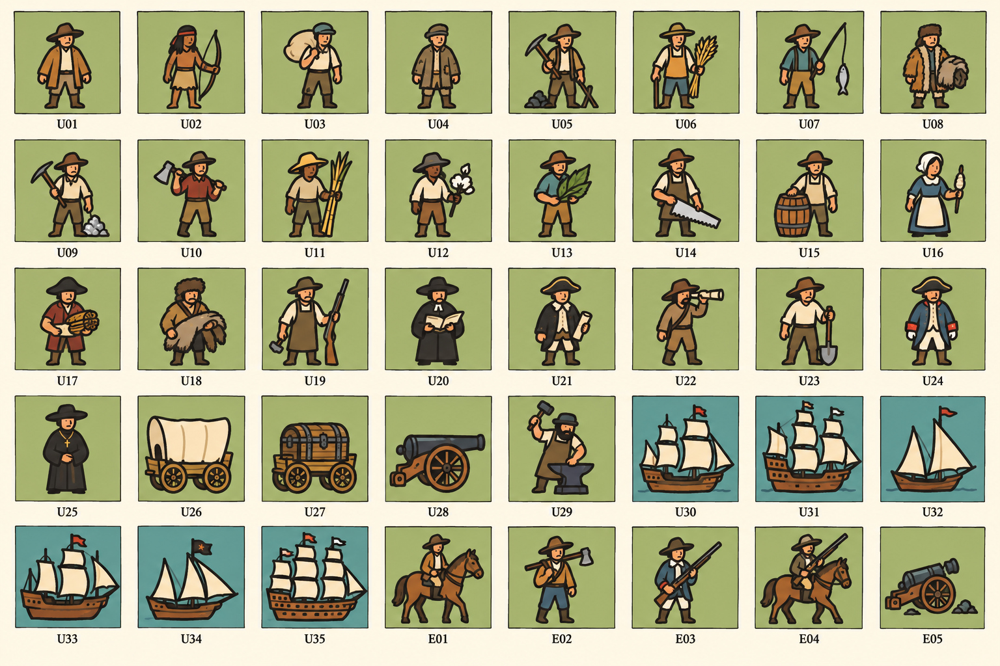

## Zdroje a kontrola

1. Deset finálních listů vytvořil vestavěný ImageGen, každý samostatným zadáním. Přesná znění jsou v [prompts.json](graphics-assets/units-2026-10-25/prompts.json). První detailnější pokus sady 01 byl nahrazen jednodušším; zveřejněné zadání patří finálnímu obrázku.
2. [Inventář](graphics-assets/units-2026-10-25/inventory.json) uchovává vazbu ID na typ, český název a zdrojový výřez. [Porovnání SVG](graphics-assets/units-2026-10-25/comparison.svg) pouze zobrazuje výřezy finálních listů v pevných rozměrech; nepřekresluje je.
3. Vizuální kontrola zahrnula současný přehled, všech deset celých listů a malé porovnání. Sada 02 má poslední dvě řady rozdělené na devět a sedm položek; obsahuje stejných 40 ID. Pořadí určují ID, nikoli automatický výřez mřížky.
4. [Evidence dokumentačních kontrol](publishing.md#unit-map-proposals-2026-10-25) odděluje tuto studii od přijetí změny hry. Případný export, integrace, rozlišení vlastníka, skutečná průhlednost, pohyb a UI scénáře budou součástí vybrané implementace.
