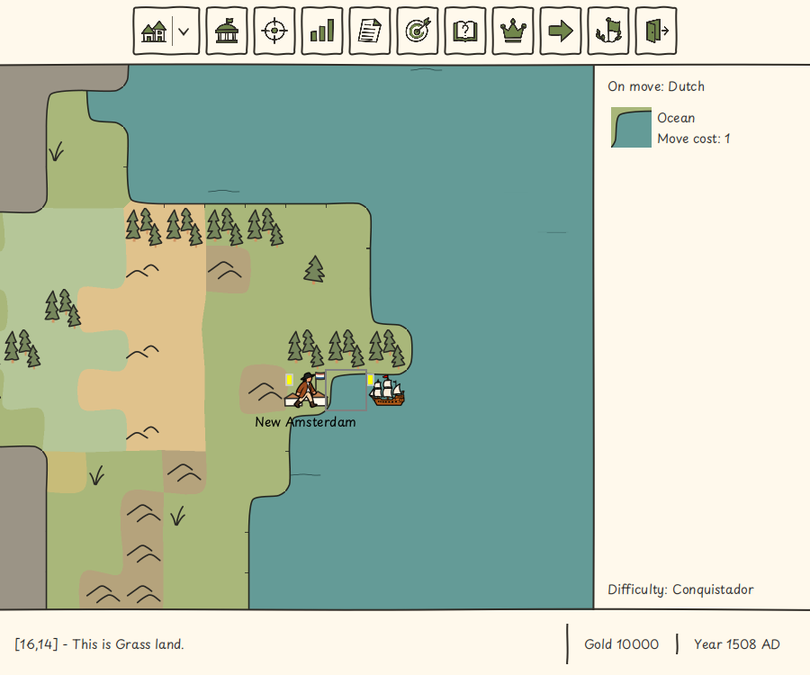
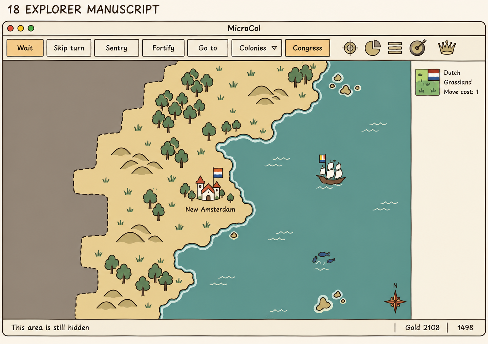
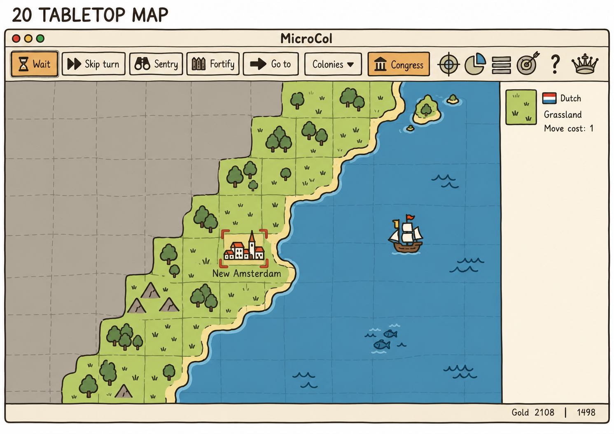
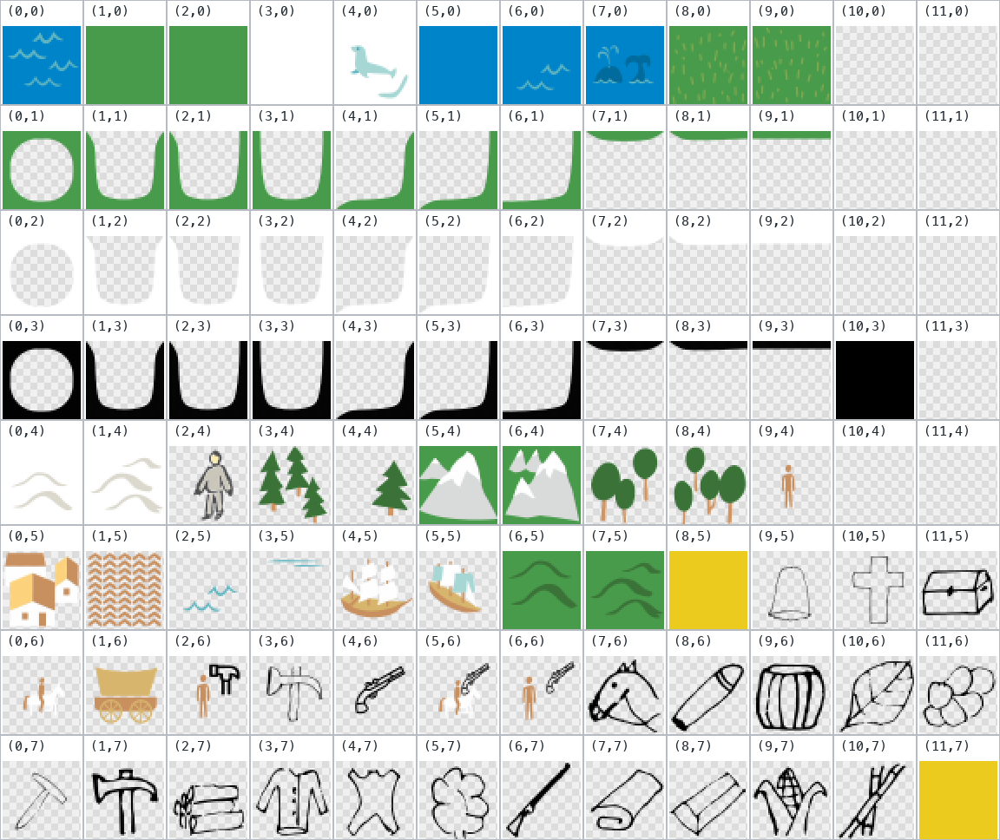
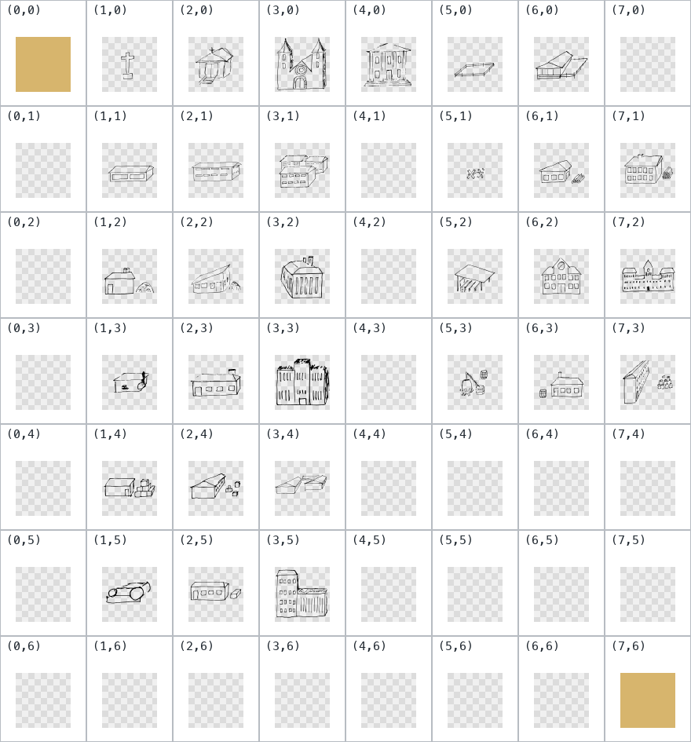
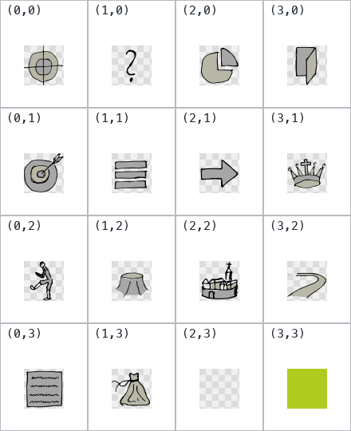
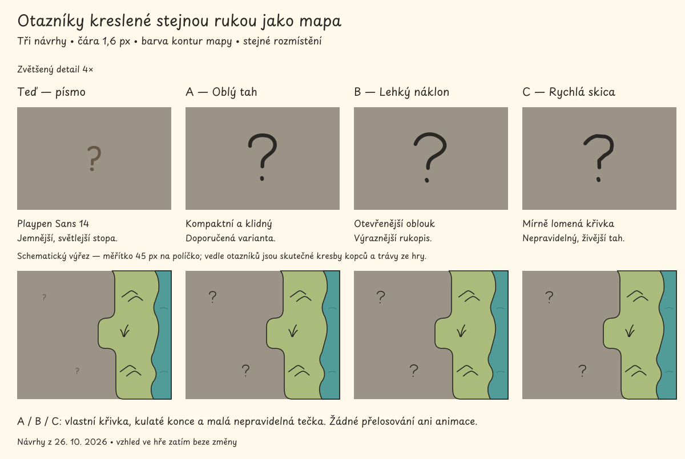

# Grafické podklady a jejich použití v MicroCol

## Ručně kreslené řeky — 26. října 2026

1. Uživatel vybral variantu 2, **Ručně kreslené koryto**, z pěti návrhů
   [R-0300](requirements/done/R-0300.md): plynulé zatáčky s jemně proměnlivou šířkou,
   současná jednolitá barva vody a bez přidané kontury či textury.
2. Ikony bonusů musí zůstat **nad řekou i mostem**; voda nesmí překreslit stříbro
   ani rudu. Zobrazení zachovává identitu a polohu bonusu, rozlišení velikosti
   řeky a pravidla viditelnosti. Malé a velké úseky navazují plynule.
3. Tvar se při posunu mapy, překreslení ani Continue nemění. Most se orientuje
   podle koryta. Přijatý vzhled nemění říční spojení, pohyb ani produkci.
4. [Skutečný snímek hry](graphics-assets/rivers-2026-10-26/hand-drawn-map.png)
   z cíleného Docker/Xvfb běhu ukazuje zakřivené koryto a rudu nad mostem.
   [Evidence](functional-tests.md#r-0300-hand-drawn-rivers-2026-10-26) rozlišuje
   cílené testy, povinnou lokální přejímku a historické neúspěšné pokusy.

## Nepravidelné hranice terénů — 26. října 2026

1. Uživatel schválil [R-0294](requirements/done/R-0294.md): jednolité plochy souše se oddělují sdílenými, jemně nepravidelnými křivkami bez nové obrysové čáry. Barvy a současné pobřežní siluety zůstávají zachované; ruční charakter vytváří geometrie, nikoli textura nebo gradient.
2. Nové vykreslení se automaticky vztahuje i na rozehrané hry. Středy políček, pravidla pohybu, výnosy a uložená mapa se nemění. Seed mapy a světové souřadnice určují stabilní tvary přes posun i Save/Continue; otevření uložený soubor nepřepisuje.
3. Společná hrana používá stejnou kubickou křivku z obou stran. Posun uzlu je nejvýše 8 % šířky políčka v každé ose a řídicí body zůstávají v pásu do 18 % kolem původní hrany; střední část políčka zůstává původnímu terénu. Stejné barvy splývají, také u úzkých pásů a vícečetných spojů. Čísla jsou počáteční výtvarné nastavení této implementace, nikoli nové herní pravidlo.
4. Okraj mapy, voda a neprozkoumané sousedství omezují deformaci. Barvy pobřeží vybírá stejná geometrie pouze ze známé souše; alfa a inkoust původní pobřežní masky zůstávají zachované. Geometrie nesmí prozradit skrytý typ terénu. Mřížka, dekorace, lesy, řeky, bonusy, kolonie a jednotky používají dosavadní pořadí a pravidla.
5. `TerrainBoundaryImages` v `gui.image` vlastní geometrii a obrázky, `MapManager` dodává aktuální prozkoumané okolí a `PaintService` kreslí podklad před dekoracemi. Pomocná geometrie se po vytvoření obrázku uvolní. Mezipaměť se obnoví při změně známého okolí; nevzniká nové schéma uložených her ani nová knihovna. [Evidence](functional-tests.md#r-0294-terrain-boundaries-2026-10-26) odděluje ověření od publikace.



## Široké rozlití vlny — 26. října 2026

1. Uživatel schválil [animovaný návrh 05](graphics-assets/wide-wash-2026-10-26/selected-05.png), „Široké rozlití“; [zdroj SVG](graphics-assets/wide-wash-2026-10-26/selected-05.svg). [R-0293](requirements/done/R-0293.md) nahrazuje pohyb starší varianty 04: malá vlna vytvoří krátký převis, špička padne dopředu, dopadne a rozlije se do postupně mizející stopy.
2. Smyčka trvá šest sekund a obsahuje 120 průhledných snímků 45 × 45 px. Používá stávající 30Hz hodiny a rozdílné fáze podle seedu a souřadnic. Časování odpovídá schválenému návrhu; pohyb se za běhu nepočítá ze SVG.
3. Vhodné daleké moře má 100% účast v animaci. Úplné rozplynutí vlny je záměrná fáze, nikoli náhodné vynechání políčka. Bílá směrová značka zůstává přítomná. Statické náhledy a nápověda zobrazují převis (snímek 53), takže se nezastaví na prázdné hladině.
4. Zachované jsou barvy terénů, tmavá kresba oceánu `#152f31`, světlá kresba dalekého moře `#6ec9cf`, 5% četnost oceánu, jezera, priorita atributů a skrytí neprozkoumaných políček. Tah hlavní vlny má podle schváleného náhledu 0,6 logického px, doznívající stopa přibližně 0,47 px; ostatní kontury se nemění. Výběr oceánských políček se mění pouze na hranici jejich šestisekundové smyčky, aby se nepřerušil dopad; jezera zachovávají čtyřsekundový interval.
5. [SVG atlas](../microcol-game/src/graphics/terrain-symbols.svg) má 14 sloupců a 21 řádků: první tři řádky zachovávají původní význam, následuje 120 oceánských a 120 dalekomořských snímků. Export: `rsvg-convert -o microcol-game/src/main/resources/images/terrain-symbols.png microcol-game/src/graphics/terrain-symbols.svg`. [Skutečný snímek hry v Dockeru](graphics-assets/wide-wash-2026-10-26/implemented-map.png); stav ověření vede [funkční evidence](functional-tests.md#r-0293-wide-wash-2026-10-26).


MicroCol používá SVG jako editovatelné výtvarné podklady. Za běhu načítá rastrové soubory z `microcol-game/src/main/resources/images`, z některých vyřezává malé obrázky a další skládá do pozadí obrazovek. Změna SVG se ve hře projeví až po exportu a zařazení odpovídajícího rastrového souboru mezi resources.

Stránka vlastní [minimalistický grafický manuál](#minimalisticky-graficky-manual)
z 18. října 2026 s upřesněním z 24. října 2026 a technické vazby obrázků. Historický inventář níže
zachycuje **24 SVG** v `microcol-game/src/graphics`, **47 rastrových souborů**
v `resources/images` a tehdejší spotřebitele; nejde o aktuální úplný počet.

Výchozí stav technického inventáře k **11. říjnu 2026**, větev `develop`, revize `1854fa5446f54cbf99d4f6892d7f32aa4e3e5a00`. Rozměry níže jsou skutečné rozměry uložených obrázků v pixelech, pokud není výslovně uvedena velikost UI komponenty nebo souřadnice SVG.

## Současné zadání vzhledu

Každá změna vzhledu musí zachovat herní výsledky podle
[pravidel funkčních testů](functional-tests.md). Kontrola obrázku nenahrazuje
provedení dotčených hráčských scénářů.

**Dohoda z 24. října 2026, [R-0260](requirements/done/R-0260.md),** stanoví
společný cíl pro všechny obrazovky: kresba kuličkovou propiskou na papíře,
Playpen Sans 14 bez úpravy tloušťky písma, opticky sjednocené čáry a jednolité
vybarvené plochy z [přiložené palety](#vychozi-paleta). Nahrazuje starší
výchozí velikosti a řezy písma, návrh různých tlouštěk čar a předběžnou paletu.
Odchylku od výchozí typografie je potřeba výslovně dohodnout; dosavadní
odlišný vzhled sám o sobě není výjimkou z nového cíle.

1. Zachovat vysoký kontrast a čitelnost i v malých výsledných rozměrech.
2. Ruční charakter vytváří tvar kresby a barevné plochy; konkrétní estetické
   volby v tomto rámci nevyžadují další schválení.
3. Tento zápis sjednocuje zadání. Neprokazuje, že současné obrazovky už byly
   převedeny nebo vizuálně ověřeny. Starší realizace a evidence níže zůstávají
   označené datem; implementaci převzít po vybraných změnách a jejich kontrolách.


## Sjednocená síla kontur mapy — 26. října 2026

1. Uživatel vybral [druhou variantu](graphics-assets/map-outline-2026-10-26/selected-02.png); realizaci vlastní [R-0291](requirements/done/R-0291.md). Obrázek je orientační návrh vytvořený ImageGenem, nikoli snímek implementované hry. Zadání sjednocuje sílu mapových kontur s horními ikonami při zachování původních tvarů a barev.
2. Referenční ikony mají tah 2,4 v buňce 48 a zobrazují se ve 32 logických px: výsledný tah je 1,6 px. Lesy a vnitřní pobřežní/průzkumné křivky v `background.svg` přecházejí na 0,47 SVG jednotky, tedy přibližně 1,6 px při stávajícím exportu. Domky a vlajky v `colonies.svg` používají 1,6; bonusy v `terrain-symbols.svg` 12 při měřítku 0,135, tedy 1,62 px.
3. Stávající terénní kresby mají přibližně 1,69 px a vybrané rastrové jednotky již výrazné tmavé kontury. Jejich kresba zůstává zachována. Mřížka a běžné otazníky zůstávají podružné; šířky řek si zachovávají význam. Samostatná volba tvaru a animace vln není touto úpravou nahrazena.
4. Exporty zachovávají rozměry a průhlednost atlasů. Pro `background.png` platí [stávající výřez](#paleta-a-kontury-hlavni-mapy-r-0265); ostatní atlasové SVG se exportují přímo pomocí `rsvg-convert -o <výstup.png> <zdroj.svg>`. Změna sdílených atlasů se projeví také v existujících náhledech a nápovědě. [Snímek implementace](graphics-assets/map-outline-2026-10-26/implemented-map.png) byl prohlédnut po úspěšných cílených testech; závěrečná smoke brána prošla. Podrobnosti vede [funkční evidence](functional-tests.md#r-0291-map-outline-weight-2026-10-26).

## Vybrané terény a bonusy — 25. října 2026

1. Uživatel vybral **T01–T14 ze sady 10**, **B01–B03 ze sady 09**
   a **B04–B12 ze sady 08**; implementaci vlastní [R-0274](requirements/done/R-0274.md).
   Zdrojové listy jsou zachované jako [sada 10](../microcol-game/src/graphics/terrain-selection-10.png),
   [sada 09](../microcol-game/src/graphics/terrain-selection-09.png)
   a [sada 08](../microcol-game/src/graphics/terrain-selection-08.png).
2. Editovatelný přepis vybraných siluet je [terrain-symbols.svg](../microcol-game/src/graphics/terrain-symbols.svg).
   Atlas po rozšíření R-0277 má 630 × 135 px: první řada obsahuje 14 náhledů terénů v pořadí
   `TerrainType.TERRAINS`, druhá 12 bonusů v pořadí neprázdných `ResourceOverlay`
   a dvě prázdné buňky. Třetí řada obsahuje průhledné kresby stejných 14 terénů. Každá buňka má 45 × 45 px bez mezery.
3. Původní integrace R-0274 zachovala barvy pobřežního atlasu; R-0277 je
   nahrazuje rozlišenými barvami a přebarvením pobřeží podle pravidel níže.
   Vybrané motivy zachovávají jednolité výplně. Tah terénu má 1,69 px,
   bonusu 1,49 px. Bonus je průhledná vrstva s přibližně 27px motivem vpravo nahoře,
   aby nechal místo ostatním prvkům. Výběrové rámečky ani označení T/B se neexportují.
4. `ImageLoaderTerrainSymbols`, `TerrainImageProvider` a `ImageProvider` vlastní
   společné obrázky pro mapu, náhledy a nápovědu. `PaintService` kreslí bonus
   stejnou cestou jako Colonizopedia. Náhodné staré terény a velryby již vybrané
   motivy nestřídají; existující variace lesa zůstává samostatnou vrstvou.
5. Reprodukce exportu: `rsvg-convert -o microcol-game/src/main/resources/images/terrain-symbols.png microcol-game/src/graphics/terrain-symbols.svg`.
   Zdroj neobsahuje text ani externí obrázky. Aktuální přejímku a vizuální kontrolu
   eviduje [funkční ověření](functional-tests.md#r-0274-selected-terrain-artwork-2026-10-25).


## Řidší značky terénu a živá voda — 25. října 2026

1. Dohoda [R-0277](requirements/done/R-0277.md) odděluje plnou podkladovou barvu
   od jedné průhledné doprovodné kresby každého terénu. Význam lesa, bonusů,
   sídel, pohybu a produkce zůstává v modelu. Barvy vycházejí ze společné
   [palety](#vychozi-paleta), bez textur, gradientů a náhodného odstínu políček.
2. Počáteční četnosti a barvy jsou následující. Četnost platí pro vhodná
   políčka; není to pravidelná mřížka ani záruka přesného počtu na malé mapě.

| Terén | Barva podkladu | Četnost kresby |
| --- | --- | --- |
| Zelená země | `#a9b77a` | 10 % |
| Prérie | `#c8bc79` | 10 % |
| Savana | `#c9a66c` | 20 % |
| Planiny | `#b5c698` | 10 % |
| Močál | `#8fae9a` | 25 % |
| Bažina | `#7c9580` | 25 % |
| Poušť | `#e0c28c` | 15 % |
| Tundra | `#b3afa0` | 20 % |
| Arktika | `#f0ede1` | 15 % |
| Kopce | `#b5a37c` | 100 % |
| Hory | `#a29a8d` | 100 % |
| Oceán | `#649b97` | 5 % |
| Jezero | `#80aeb5` | 5 % |
| Daleké moře | `#4c858b` | 100 % (upřesnění R-0289, 26. října 2026) |

3. Les, pole, cesta, řeka, kolonie, známé domorodé sídlo, právě viditelná
   pověst a bonus potlačí běžnou dekoraci. Kopce a hory si ponechají reliéf
   i s atributem. Samotné atributy se nadále kreslí, jednotky rozmístění
   nemění a neprozkoumané území zůstává skryté.
4. Pevnina používá uložený seed mapy a souřadnice; posun ani Save/Continue
   nepřehází kresby. Oceán a jezera přehodnocují výskyt jednou za čtyři sekundy
   na každém políčku, s rozdílnou fází podle souřadnic. Daleké moře si kresbu
   ponechává i ve statickém náhledu. Tvar vln oceánu a dalekého moře nově
   animuje [varianta 04](#nizka-prelevajici-se-vlna-26-rijna-2026).
5. Pobřeží používá dosavadní masky a jejich průhlednost. Pevninská část
   přebírá barvu nejbližšího sousedního terénu, včetně smíšených a arktických
   břehů; voda pod maskou má barvu vlastního terénu. Maska se připraví při
   otevření mapy, nikoli při každém snímku.
6. Nápověda a výběrové náhledy ukazují identifikační kresbu vždy. Dvojice
   bez lesa / s lesem nadále představuje dva herní stavy, ne náhodné varianty.
   Název terénu ve stavovém panelu zůstává dostupný i bez dekorace.
7. Jde o schválené výchozí nastavení; případné ladění četností patří sem.
   Aktuální stav ověření uvádí [funkční evidence](functional-tests.md#r-0277-sparse-terrain-2026-10-25),
   nikoli samotný zápis této dohody.

## Nízká přelévající se vlna — 26. října 2026

1. Uživatel vybral [návrh 04](graphics-assets/waves-2026-10-26/selected-04.png).
   [R-0289](requirements/done/R-0289.md) nahrazuje ostré dvojité oblouky oceánu
   a dalekého moře nízkou vlnou s drobným zaobleným přelivem a krátkým
   doprovodným tahem. Schválené ztenčení na 0,85 logického px platí pro tuto
   vodní kresbu; nemění výchozí tloušťku ostatních ilustrací.
2. Čtyři průhledné snímky mají stejné ukotvení a prostor 45 × 45 px. Každý
   trvá půl sekundy, celá smyčka dvě sekundy. Počátek fáze se liší podle
   uloženého seedu mapy a souřadnic. Četnost výskytu a fáze kresby jsou
   oddělené: vhodné daleké moře má vlnu vždy, včetně zastaveného vykreslování.
   Významové atributy nadále mají přednost. Jezera si ponechávají svoji kresbu.
3. Oceán zachovává tmavý tah `#152f31`, daleké moře světlý `#6ec9cf` a dosavadní
   bílou směrovou značku. Nápověda používá první snímek; mapové a statické
   výběrové náhledy používají stejnou sadu. Nevzniká nové nastavení animace.
4. Zdroj [terrain-symbols.svg](../microcol-game/src/graphics/terrain-symbols.svg)
   má nově čtvrtý řádek: čtyři fáze oceánu a čtyři fáze dalekého moře.
   Export: `rsvg-convert -o microcol-game/src/main/resources/images/terrain-symbols.png microcol-game/src/graphics/terrain-symbols.svg`.
   Dřívější řádky zůstávají na původních souřadnicích.
5. [Skutečný snímek hry z Dockeru](graphics-assets/waves-2026-10-26/implemented-map.png)
   ukazuje převod návrhu do mapy. Samotný obrázek nepotvrzuje celou přejímku; výsledky vede
   [funkční evidence](functional-tests.md#r-0289-rolling-waves-2026-10-26).

## Minimalistický grafický manuál

**Každá obrazovka MicroCol působí jako kresba stejnou kuličkovou propiskou
na papíře, vybarvená jednolitými barevnými plochami. Ovládání zůstává čitelné
a přesné.**

### Kresba a společné prvky

| Prvek | Dohodnuté pravidlo |
| --- | --- |
| Čáry | Přibližně jednotná optická tloušťka odvozená od výchozího písma, tmavý inkoust, mírně nepravidelná cesta a měkká zakončení. Ruční charakter nevzniká náhodnou změnou tloušťky mezi obrázky; viz [kalibrace tahu](#stejna-tloustka-car-na-obrazovce). |
| Výplně | Jednolité barevné plochy podle [reference palety](#vychozi-paleta); část kresby může zůstat nevybarvená. Bez přechodů, stínování, lesku, texturových efektů a simulované plastičnosti uvnitř ilustrací. |
| Tlačítka | Použít stávající ovládací prvky a [dřevěnou tabulku](#drevena-tlacitka-bez-bocnich-zarezu); při převodu musí jejich písmo, linka a barvy odpovídat společnému cíli. Vlastní skin není automatickou výjimkou ze stylu. |
| Stavy | Rozlišit běžný stav, najetí, stisk, klávesnicový fokus, výběr a nedostupnost. Fokus a výběr označit také tvarem či další linkou; nedostupnost má dohledatelný důvod. |
| Typografie | [Playpen Sans Regular 14](#typografie-playpen-sans) pro všechny texty, bez dodatečné změny tloušťky. Jiné velikosti či řezy jen jako výslovně dohodnutá výjimka. |
| Oddělení obsahu | Přednostně volným místem; kde nestačí, jemnou kreslenou linkou. Silný rám jen pro hlavní skupiny. |
| Ikony a ilustrace | Jednoduchá silueta, společný charakter obrysu, málo vnitřních detailů. Kontrolovat skutečnou zobrazovanou velikost. |
| Rozložení | Pravidelné mezery a zarovnání. Kreslený okraj nesmí zasahovat do textu ani zmenšovat klikací plochu. |

Texty a ovládání zůstávají skutečnými prvky UI kvůli překladům, zvětšení
a klávesnici. SVG slouží ilustracím, ikonám, obrysům a dekoracím.
Pravidla interakce vlastní [UX dokumentace](ux.md#spolecna-pravidla-pro-dalsi-zmeny).

### Typografie Playpen Sans

1. **Aktuální dohoda 24. října 2026:** výchozí písmo je **Playpen Sans Regular
   (400), velikost 14 logických px**. Platí pro názvy, nadpisy, popisky, dialogy,
   tabulky, vstupy, tooltipy i texty kreslené na mapě. Jiná velikost nebo řez
   vyžadují výslovnou dohodu; starší hodnoty nejsou automaticky převzaté výjimky.
2. Písmo dále neztučňovat ani neztenčovat: žádné obtahování znaků, překrývání
   barvou pozadí nebo syntetický tučný řez. CSS rodina `Playpen Sans` označuje
   přibalený Regular; `normal` pouze zachová jeho přirozenou tloušťku.
3. Text i kresba se mohou společně zvětšovat s měřítkem UI či dostupnosti.
   Základ 14 není požadavek na pevný počet fyzických pixelů na každém monitoru.

```css
-fx-font-family: "Playpen Sans";
-fx-font-size: 14;
-fx-font-weight: normal;
```

**Stav provedení:** tato dohoda sama nemění CSS, Canvas ani text v SVG.
Následující záznam popisuje dřívější realizaci Light 18 / nadpisy 36; nové
výchozí nastavení ještě neprokazuje. Rozsah a přejímka převodu patří do vybrané
implementace podle [funkčního kontraktu](functional-tests.md).

**Upřesnění 25. října 2026, [R-0268](requirements/done/R-0268.md):** herní obrazovka
s mapou je vzorem tloušťky písma. Společná dřevěná tlačítka v menu, Nastavení,
dialozích i ostatních obrazovkách používají Playpen Sans Regular 14 bez
zesilování; místní výjimka Medium se ruší. Tato oprava nemění rozvržení ani
velikost nadpisů. Dostupnost jiných přibalených řezů není souhlas s jejich
použitím v běžném UI.

#### Historie implementace 19.–20. října 2026


1. **Dohoda 19. října 2026, [R-0250](requirements/done/R-0250.md):** uživatel vybral
   `02-Playpen-Sans-tenci.png`. Všechny živé texty hry používají vzpřímený
   Playpen Sans Light: menu, dialogy, tabulky, vstupní pole, tlačítka, Nastavení,
   tooltipy, kontextová menu, názvy kolonií na mapě a produkční údaje na plátně.
2. Náhled používal Regular 400 opticky ztenčený tahem barvy pozadí. Pro JavaFX
   je připraven skutečný statický řez **300 (Light)** ze stejného variabilního
   zdroje. Nepoužívá překrývání barvou pozadí ani syntetickou kurzívu; přesná
   rasterizace prohlížeče a JavaFX se může lišit. Navazující [R-0251](requirements/done/R-0251.md) stanoví hlavní nadpisy 36 px a výchozí běžný text 18 px, včetně popisků Jazyk a Verze v Nastavení; místní drobné údaje kolonie a mapy zůstávají výjimkou.
3. Soubor, licence OFL a reprodukční údaje jsou v
   `microcol-game/src/main/resources/fonts/PlaypenSans`. Načtení nevyžaduje
   síť ani instalaci fontu do systému. Zdroj obsahuje ověřené základní abecedy
   češtiny, angličtiny, němčiny, francouzštiny a nizozemštiny, číslice a euro;
   nejde o tvrzení o všech evropských jazycích ani nové překlady hry.
   Symbol `→` obsažený v překladech není v rodině Playpen Sans; jeho kresbu
   doplní obvyklý systémový fallback JavaFX. Totéž může platit pro jiné
   symboly v hráčem zadaném textu.
4. `FontService` registruje Light, Regular, Medium a SemiBold pro CSS; Canvas nadále používá Light. Společné
   `Typography.css` platí pro hlavní scénu i dialogy; konkrétní ovládání
   dědí rodinu. Zachovat černé obrysy, paletu a individuální skiny tlačítek.
   Kontrolovat především kratší popisky bez ořezu, překlady a husté dialogy.
   Skutečné výsledky a omezení vede [funkční evidence](functional-tests.md#r-0250-playpen-sans-2026-10-19).

### Volba silnějšího řezu v CSS

Technický přehled dostupných řezů. Od dohody z 24. října 2026 je změna
výchozího Regular na jiný řez pouze výslovně dohodnutou výjimkou.


Od 20. října 2026 [R-0252](requirements/done/R-0252.md) přidává skutečné statické
řezy Regular 400, Medium 500 a SemiBold 600 ze stejného zdroje jako Light. Registrují se
při startu bez instalace do systému. Přidání samo nemění výchozí vzhled.
Dostupné rodiny pro CSS:

| Řez | Váha | `-fx-font-family` |
| --- | --- | --- |
| Light | 300 | `"Playpen Sans Light"` |
| Regular | 400 | `"Playpen Sans"` |
| Medium | 500 | `"Playpen Sans Medium"` |
| SemiBold | 600 | `"Playpen Sans SemiBold"` |

Regular je tenčí než Medium a silnější než Light. Použijte
`-fx-font-family: "Playpen Sans"; -fx-font-weight: normal;`.
Pro stupnici použijte `-fx-tick-label-font: 14px "Playpen Sans";`.
Zdroj nabízí také Thin 100, ExtraLight 200, Bold 700 a ExtraBold 800;
tyto řezy nejsou přibalené. Variabilní zdroj dovoluje i meziváhy, ale hra
načítá statické řezy, takže CSS nepřepočítává libovolnou tloušťku.

Pro běžné prvky vyberte rodinu (pro mírnější zesílení nahraďte `SemiBold` za `Medium`):

```css
.settings-controls .label,
.settings-controls .check-box,
.settings-controls .radio-button {
    -fx-font-family: "Playpen Sans SemiBold";
    -fx-font-weight: normal;
    -fx-text-fill: black;
}
```

Stupnice má vlastní vlastnost fontu:

```css
.settings-controls .slider .axis {
    -fx-tick-label-font: 14px "Playpen Sans SemiBold";
    -fx-tick-label-fill: black;
}
```

`normal` zde ponechá skutečný vybraný řez bez požadavku na další tučné písmo.
Pro společný výchozí font změňte rodinu v `Typography.css`; výslovné rodiny
ve stupnici nebo jiných pravidlech je nutné změnit také. Uvedených 14 px odpovídá
nově dohodnutému základu; jeho zavedení do hry tento dokument neprovádí. Canvas a vložené SVG
se změnou CSS nepřepnou. Dostupnost v JavaFX ověřuje TC85/02; výsledky vede
[funkční evidence](functional-tests.md#r-0252-additional-font-weights-2026-10-20).

### Přibalený font v SVG a exportu

1. Podle doplnění z 19. října 2026 obsahuje všech pět SVG s textem
   (`background.svg`, `logo.svg`, `icon.svg` a referenční `screen-flow.svg`,
   `units.svg` v ponechaném `microcol-site`) Playpen Sans Light 300.
   Každý soubor má vložený WOFF subset potřebných znaků v `@font-face`;
   prohlížeč nepotřebuje systémovou instalaci ani stahování fontu.
   Copyright a OFL zůstávají také uvnitř subsetu.
2. Autoritativní plný TTF a licence jsou ve
   [fonts/PlaypenSans](../microcol-game/src/main/resources/fonts/PlaypenSans/).
   Po změně SVG textu obnovit subsety pomocí
   [svg-font.py](../scripts/graphics/svg-font.py); `--check` zjistí zastaralý
   subset a chybějící znaky jsou chyba, nikoli tichý fallback. Skript používá
   fontTools 4.60.2 pouze při tvorbě podkladů. Hra ani otevření SVG ho nepotřebují.
3. Některé grafické editory nepodporují vložený webfont. Pro nástroje používající
   Fontconfig slouží [with-fonts.py](../scripts/graphics/with-fonts.py): dočasná
   konfigurace obsahuje pouze projektový TTF, ověří jeho výběr a po exportu se
   odstraní. Na macOS vynucuje `PANGOCAIRO_BACKEND=fc`, protože výchozí CoreText
   v librsvg izolovaný Fontconfig ignoruje. Neinstaluje nic do systému.
   Nativní Inkscape nebyl na tomto stroji ověřen; ověřen je librsvg 2.61.4.
4. `logo.svg` má výslovnou oblast a rozměr 200 × 200; nápis se vejde bez
   deformace znaků. Jeho nový export je skutečný `splash-screen.png` balený
   do hry. `icon.svg` používá standardní SVG text místo nepřenositelného
   `flowRoot`; není zdrojem distribuční ikony s kostelem. Skryté popisky atlasu
   nemění bitmapu atlasu. U historických diagramů zůstává původní rozsah stránky.

```sh
python3 -m venv target/graphics-venv
target/graphics-venv/bin/python -m pip install fonttools==4.60.2
target/graphics-venv/bin/python scripts/graphics/svg-font.py
target/graphics-venv/bin/python scripts/graphics/svg-font.py --check
target/graphics-venv/bin/python -m unittest discover -s scripts/graphics -p 'test_*.py'
python3 scripts/graphics/with-fonts.py rsvg-convert --width 200 --height 200 \
  -o microcol-game/src/main/resources/images/splash-screen.png \
  microcol-game/src/graphics/logo.svg
```

Poslední příkaz vyžaduje `fc-match` a `rsvg-convert`. Nový testovací/exportní
postup doplňuje starší `images.groovy`; nespouští jeho nesouvisející exporty.
Před publikací zkontrolovat obraz i [funkční přejímku](functional-tests.md#r-0250-playpen-sans-2026-10-19).

### Výchozí paleta

**Dohoda 24. října 2026:** barevnou referencí je uživatelem přiložený obrázek
`18-objevitelsky-rukopis-1 (dragged).tiff`, zde uložený jako věrný PNG převod
pro zobrazení v dokumentaci.



| Role | Barva podle reference |
| --- | --- |
| Papír a podklad textu | Světlá teplá krémová |
| Inkoust a obrysy | Velmi tmavá, téměř černá s teplým tónem |
| Zem a písek | Světlá písková až okrová |
| Voda | Tlumená tyrkysová se zeleným tónem |
| Vegetace | Tlumené zelené a olivové tóny |
| Drobné teplé akcenty | Cihlová červená, medová žlutá a okrová |
| Neutrální plochy | Tlumená šedohnědá |

1. Každá vybarvená oblast má jednu plnou barvu. Nepřebírat z reference její
   texturu, barevné přechody, stíny ani světelné efekty; uživatel je pro vlastní
   ilustrace výslovně vyloučil. Rozdílné části objektu mohou mít různé plné výplně.
2. Obrázek určuje paletu a barevné vztahy; neukládá převzít jeho rozložení
   obrazovky, texty ani velikosti ovládacích prvků. Typografii a tah určuje
   společný kontrakt výše.
3. Přesné hodnoty barev při převodu do konkrétního assetu zvolit z této reference
   a ověřit kontrast ve výsledné velikosti. Tabulka není nově změřený seznam HEX.
   Starší návrh vycházející z `colors.properties` už není cílovou paletou;
   dosavadní konfiguraci dokumentuje [technická paleta](#barvy-a-prebarvovani).
4. Význam ovládání nesmí záviset pouze na barvě. Jednolitá výplň je závazné
   výtvarné pravidlo; aktuální PNG a CSS tímto zápisem nebyly přebarveny.

### Mřížka a neprozkoumaná část mapy

**Upřesnění 25. října 2026, [R-0268](requirements/done/R-0268.md):** zákaz přesahů
mřížky platí i pro šedou část zaobleného okraje uvnitř již objeveného políčka.
Finální překrytí mapy používá stávající kresbu hranice až po mřížce a animacích;
nevytváří nový tvar hranice ani neodhaluje terén. Dva chybné svislé tahy na
spoji dílů hranice jsou odstraněné ze zdrojového `background.svg`; export
podle [stávajícího postupu](#paleta-a-kontury-hlavni-mapy-r-0265) mění pouze
příslušné díly mlhy a nevyužité mezery atlasu. Samostatné náhledy políček
zachovávají totéž překrytí. Výsledek se kontroluje v měřítku 1×/2× a po změně
velikosti okna; [evidence](functional-tests.md#r-0268-grid-frontier-and-button-font-2026-10-25)
rozlišuje reprodukci chyby a dokončené ověření.


**Dohoda 24. října 2026, [R-0261](requirements/done/R-0261.md):** hlavní herní
mapa má mít méně výraznou přerušovanou čtvercovou síť pouze na prozkoumaných
políčkách. Implementace používá tlumenou přerušovanou čáru a plnou šedou mlhu.
Cílené testy a kontrola snímků v Linux/Xvfb prošly 24. října 2026;
[průběh ověření](functional-tests.md#r-0261-explored-grid-2026-10-24) rozlišuje
renderování 2× od dosud neprovedené kontroly na fyzickém HiDPI displeji.



1. Uživatel dodal `20-rucne-kreslena-deskovka-1 (dragged).tiff`; PNG zde
   zachovává referenci pro podobu mřížky. Společnou barevnou paletou zůstává
   [Explorer Manuscript](#vychozi-paleta), nikoli nové barevné nastavení celého
   přiloženého návrhu.
2. Mřížka je tlumená, přerušovaná a lehce ručně kreslená. Sedí na skutečných
   hranicích políček na souši i na vodě. Méně výrazného vzhledu dosáhnout barvou
   a přerušováním při zachování [společného charakteru tahu](#stejna-tloustka-car-na-obrazovce).
3. Neprozkoumané území tvoří souvislá plná teplá šedá **`#9B9486`**, zvolená
   podle dohodnuté palety. **Uvnitř neprozkoumané oblasti se mřížka nekreslí**,
   ani při posunu mapy nebo u rozhraní s prozkoumaným územím. Síť, kterou
   reference zobrazuje přes šedou oblast, se výslovně nepřebírá. Bez přechodů,
   stínování a texturových efektů.
4. „Prozkoumané“ znamená dříve odkryté území, nikoli pouze současný dohled.
   Po odchodu jednotek zůstává jeho síť viditelná; pravidla skrytých cizích
   jednotek a zapamatovaných kolonií se nemění. Použít stávající
   [rozlišení průzkumu a dohledu](architecture.md#prozkoumany-teren-a-soucasny-dohled-r-0070).
5. Zachovat možnost vypnout mřížku v existujícím nastavení. Při odkrytí nového
   území, posunu, změně velikosti okna a načtení hry síť sedí na stejných
   políčkách, nezdvojuje společné hrany a nepřeblikává. Výběr, cesty a objekty
   zůstávají čitelné; změna vzhledu neodhaluje skryté informace.

### Hlavní herní obrazovka a spodní panel

**Upřesnění 25. října 2026, [R-0267](requirements/done/R-0267.md):** spodní panel
má stejný vzhled na mapě, v kolonii i v Evropě. Sdílený styl v `MicroCol.css`
určuje krémové pozadí, minimální výšku 72 px, odsazení 12/16 px a Playpen Sans
Regular 14. Rok nemá vlastní rámeček; od zlata jej odděluje jediná svislá
čára. Oddělovač popisu zůstává. Pravidlo Regular 14 platí také pro názvy
kolonií a značky činností vykreslované přímo do mapy. Sdílený výchozí font
pláten je Regular; velikost produkčních údajů v kolonii se touto změnou nemění.
Přechody mezi obrazovkami, jejich zavření a herní hodnoty zůstávají stejné.
Skutečné výsledky jsou vedené v [evidenci ověření](functional-tests.md#r-0267-shared-status-panel-2026-10-25).


**Dohoda 24. října 2026, [R-0262](requirements/done/R-0262.md):** hlavní obrazovka
s mapou má působit jako skutečně jednotná ručně kreslená a vybarvená obrazovka
podle obou dodaných návrhů. Implementace hlavní obrazovky nyní sjednocuje
papírové pozadí, oddělení panelů a Regular 14 na jejích tlačítkách; původní
mapové a příkazové ilustrace zůstávají. [Cílená kontrola](functional-tests.md#r-0262-main-screen-paper-layout-2026-10-24)
ověřila anglické 1280×850 a české 1000×700 okno; předcommitový gate i dokumentační kontroly prošly.

1. Horní ovládání, mapa, pravý informační panel a spodní stavový panel tvoří
   jeden celek. Použít Playpen Sans Regular 14, společný tah propisky a plné
   barvy z [dohodnuté palety](#vychozi-paleta). Samotný podklad s kresbou nestačí,
   pokud ovládání a panely působí jiným stylem.
2. Aktivní části jsou rozpoznatelné už v klidovém stavu: z rámu, tvaru, ikony
   nebo popisku je patrné, kde lze provést akci. Viditelný ovládací prvek
   odpovídá klikací ploše. Najetí, stisk, fokus, výběr a nedostupnost mají
   čitelné stavy; běžný informační text nemusí vypadat jako tlačítko.
3. **Spodní panel zvětšit na výšku** oproti dosavadní obrazovce při stejné
   velikosti okna. Získat prostor a svislé odsazení pro kontextový popis,
   zlato a datum s jasným členěním. Základní písmo zůstává 14 bez změny řezu.
   Delší české či anglické popisy se nesmějí překrývat s ostatními údaji.
4. Vyšší panel zapojit do rozložení; nesmí zakrývat mapu nebo její klikací
   oblasti. Ověřit menší podporované okno, změnu velikosti a měřítko UI.
   Použít minimálně 72 logických px, svislé odsazení 12 px a vodorovné
   16 px. Dlouhý popis může panel přirozeně zvýšit; zlato a datum mají
   vyhrazenou preferovanou šířku.
5. Zachovat existující herní akce, klávesnici, návraty a pravidla zobrazení
   informací. Podobu mřížky a šedého neprozkoumaného území vlastní
   [R-0261](#mrizka-a-neprozkoumana-cast-mapy). Obrázky jsou vzorem vzhledu;
   nezavádějí nové herní funkce jen tím, že mají v návrhu další ikonu.

### Rámečky a pravítko v Nastavení

Následuje záznam dosavadní implementace. Při převodu na dohodu z 24. října
2026 mají přednost aktuální [typografie](#typografie-playpen-sans),
[paleta](#vychozi-paleta) a [tloušťka tahu](#stejna-tloustka-car-na-obrazovce).


1. **Dohoda 19. října 2026, [R-0248](requirements/done/R-0248.md):** checkboxy,
   radio buttons a oba slidery v Nastavení používají vybraný třetí návrh.
   Čtvercový nebo kruhový dřevěný rámeček obklopuje světlý střed; výběr
   označuje černá fajfka nebo tečka. Pravítko má jemné rysky a jezdec
   se špičkou a černou středovou ryskou.
2. Platí paleta dřevěných tlačítek, černá linka 2 logické px, detaily 1 px
   a Playpen Sans Light 18 podle [aktuální typografie](#typografie-playpen-sans). Tloušťka se nemění s délkou posuvníku. Najetí a stisk mění
   výplň; přerušovaný černý obrys označuje fokus. Nedostupnost tlumí vzhled.
3. Implementace přidává kresbu k nativním skinům a jejich skutečným oblastem;
   původní vstup, rozsahy, ukládání hodnot a překlady zůstávají. CSS se
   vztahuje pouze na `.settings-controls`; jiné obrazovky nejsou převzaté
   touto dohodou. Výsledky ověření patří do [funkční evidence](functional-tests.md).

### Dřevěná tlačítka bez bočních zářezů

Následuje záznam dosavadní implementace. Při převodu na dohodu z 24. října
2026 mají přednost aktuální [typografie](#typografie-playpen-sans),
[paleta](#vychozi-paleta) a [tloušťka tahu](#stejna-tloustka-car-na-obrazovce).


**Dohoda 19. října 2026 — [R-0251](requirements/done/R-0251.md):** varianta „Mírné zvětšení“ používá text 18 px a odsazení nahoře 12, dole 14 a po stranách 24 logických px. Platí pro všechna standardní dřevěná tlačítka; dosavadní výjimky vlastních skinů zůstávají. Mezi tlačítky se rozestupy nemění. Implementaci a skutečné ověření rozlišuje [evidence](functional-tests.md#r-0251-button-spacing-2026-10-19).


1. **Dohoda 18. října 2026, [R-0246](requirements/done/R-0246.md):** vybrána
   varianta „Bez bočních zářezů“. Černý obrys `#000000`, hladké mírně
   nepravidelné boky a několik vnitřních tahů naznačují dřevo. Světlý okraj
   `#FFF9EC` zůstává částečně nevybarvený. Nejde o pozdější variantu bez
   vnitřních čárek.
2. Výplně běžná / pod myší / stisknutá jsou `#DFBD91` / `#EFC68F` /
   `#C69B6B`. Při stisku se kresba a text posunou o 2 logické px dolů
   a zmizí spodní hrana. Klávesnicový fokus má černý přerušovaný rámeček;
   vybraný přepínač také krátkou spodní linku. Nedostupné tlačítko má
   neutrální výplň `#DED5C7` a sníženou neprůhlednost.
3. Popisky zůstávají textem standardních JavaFX tlačítek. Původní Caveat
   z R-0246 nahrazuje pro celou hru [Playpen Sans Light](#typografie-playpen-sans),
   vybraný 19. října 2026. Šířka vychází z obsahu a dosavadních omezení
   rozložení, nikoli ze zvětšování hotového obrázku.
4. Implementace používá `WoodenButtonSkin`, `WoodenToggleButtonSkin`
   a společný `WoodenButtonDrawing` v `gui.util`. Křivky se kreslí přímo
   ve výsledných logických souřadnicích JavaFX Canvas: obrys 2 px,
   detail 1 px, spodní hrana 1,5 px. Jde o procedurální výjimku z cesty
   SVG → PNG; nevzniká raster, který by se roztahoval podle délky popisku.
5. `WoodenButtons.css` sdílí hlavní okno i modální dialogy. Výslovné výjimky:
   obrázkové `ButtonImage` (`image-button`), přepínače lodí `paneShip`,
   malé tlačítko stavební nabídky a statistické odkazy s vlastním stylem.
   Jejich dosavadní grafika zůstává zachována. Ostatní kontroly, systémový
   výběr souboru, obsah dialogů a herní pravidla nejsou předmětem změny.
6. Konkrétní přejímku a omezení uvádí
   [evidence R-0246](functional-tests.md#r-0246-drevena-tlacitka-2026-10-18).
   Dohoda ani přítomnost skinu samy neprokazují úspěšnou regresi či publikaci.

### Materiály a jejich význam

| Materiál | Použití a způsob kresby |
| --- | --- |
| Papír | Dialogy, seznamy, zprávy. Klidná světlá plocha pod textem, kreslený okraj. |
| Dřevo | Fyzické tabule, stavby a bedny. Několik tahů naznačí strukturu; bez husté textury pod popisky. |
| Látka | Vlajky a příslušnost. Jednoduchý obrys a naznačený záhyb. |
| Vosková pečeť | Potvrzení nebo splnění cíle. Rozpoznatelný symbol doprovázený textovým významem. |

Příklady charakteru kresby už poskytují moře a horizont hlavního menu,
bedny a pečeť v [katalogu podkladů](#katalog-vsech-svg-zdroju).
Dosavadní šedá plastická tlačítka nejsou cílovým vzorem této dohody.
Budoucí vizuální vzorník má ukázat paletu, písma, všechny stavy tlačítek,
jeden dialog, oddělovací čáry, ikony a materiály. Ověřit jej na hlavním menu
i informačně hustém dialogu; tento zápis samotný vzorník ani jeho přejímku nenahrazuje.

### Stejná tloušťka čar na obrazovce

1. **Dohoda 24. října 2026:** obrysy, rámečky, oddělovací čáry a ikony mají
   působit jako kresba stejnou propiskou, s přibližně jednotnou tloušťkou
   opticky odvozenou od Playpen Sans Regular 14. Tvar může být ruční, ale
   jiná obrazovka nebo velikost obrázku nemá sama měnit sílu linky.
2. Tah posuzovat v **logických pixelech výsledného UI** při stejném měřítku.
   HiDPI/Retina a uživatelské zvětšení škálují celé UI. Nejde o stejný počet
   fyzických pixelů ani milimetrů na všech monitorech.
3. Konkrétní běžný tah opticky kalibrovat vedle referenčního textu při prvním
   převodu a použít ho konzistentně. Starší pracovní stupnice detail 1,5 / obrys
   2 / zvýraznění 3 px už není výchozím zadáním. Malé ikoně raději ubrat detail
   než ji bezdůvodně kreslit jiným perem. Následující číselné příklady vysvětlují
   technické škálování; nepředepisují schválenou tloušťku nové kresby.
4. Běžný tah se škáluje spolu s obrázkem: zmenšení 100 → 50 při tahu 2
   vytvoří tah 1. Další zmenšení může čáru zesvětlit, rozmazat nebo potlačit;
   naopak ponechaný silný tah může ve velmi malé ikoně slít sousední detaily.
5. SVG nabízí `vector-effect="non-scaling-stroke"`, který u podporujícího
   rendereru zachová šířku tahu při transformacích uvnitř SVG v souřadnicích
   jeho viewportu. Atribut dát na jednotlivé kreslené prvky; nedědí se.
   Nechrání následné zvětšení hotového rastru ani obecně transformaci jeho
   vnějšího kontejneru. Viz [specifikace W3C](https://www.w3.org/TR/SVG2/coords.html#VectorEffects).

```xml
<svg xmlns="http://www.w3.org/2000/svg"
     width="48" height="48" viewBox="0 0 96 96">
  <path d="M12 48 Q36 45 48 48 T84 48"
        fill="none" stroke="#292824" stroke-width="2"
        stroke-linecap="round" stroke-linejoin="round"
        vector-effect="non-scaling-stroke"/>
</svg>
```

Při viewportu 48 × 48 má tento příklad nominálně tah 2 viewportové px;
bez `vector-effect` by měl 1 px. Jde o příklad standardu, ne o důkaz podpory
v aktuálním exportéru hry. Tah musí zůstat tahem (`stroke`): po převodu
na vyplněný obrys jde o geometrii, kterou `non-scaling-stroke` neochrání.

### Export a kontrola výsledné velikosti

1. MicroCol dnes používá cestu **SVG → PNG → UI**. Po exportu už PNG nezná
   tahy ani `vector-effect`; jeho zmenšení zeslabí i čáry. Samotný atribut
   v SVG proto stejnou tloušťku ve hře nezaručuje.
2. Pro každý dotčený asset zapsat zdroj, exportní velikost, cílovou logickou
   velikost v UI a roli tahu. Exportovat z SVG pro cílovou velikost; nevyrábět
   malé ikony opakovaným zmenšováním velkého PNG. Potřebuje-li drobná varianta
   méně detailů, upravit její kresbu.
3. U rastrového podkladu platí přibližně: **tloušťka v UI = tloušťka v PNG ×
   (zobrazená logická šířka / pixelová šířka PNG)** při rovnoměrném škálování.
   Například PNG široké 96 px s tahem 4 px, zobrazené na 48 logických px,
   dává tah 2 logické px. Export s `non-scaling-stroke` může ponechat pouze
   2 px i ve větším PNG; pouhé zdvojení rozlišení tak není zárukou správného
   HiDPI podkladu. Ověřit tah a nastavení konkrétního rendereru.
4. Přejímka musí porovnat SVG, exportovaný PNG a skutečné UI vedle referenční
   čáry stejné role. Zkontrolovat nejmenší používanou velikost, velkou variantu,
   základní i HiDPI měřítko, relevantní velikosti okna, světlé/tmavé pozadí,
   fokus a nedostupnost. Posoudit souvislost čáry, čitelnost a neslévání detailů;
   samotná kontrola atributu v XML nestačí.
5. Opakovatelnost exportu a evidence rozměrů patří do [R-0225](requirements/R-0225.md),
   kontrola viditelného výsledku do [R-0224](requirements/R-0224.md) a kontrola
   ovládání do [R-0222](requirements/R-0222.md). Tato dohoda je nezahajuje.
   V nynějším zápisu nebyly přegenerovány herní obrázky ani ověřen runtime.

## Jak obrázek projde od kresby do hry

### Dělostřelectvo R-0095 (2026-10-16)

Nové vektorové podklady [artillery.svg](../microcol-game/src/graphics/artillery.svg)
a [artillery-damaged.svg](../microcol-game/src/graphics/artillery-damaged.svg)
mají samostatné exporty 45 × 45 px v `resources/images`. `UnitImageProvider`
vybírá poškozené dělo podle modelového stavu; nabídka nákupu používá celé dělo.
Poškození znázorňuje zlomená hlaveň a zároveň je popsáno textem v náhledu boje
a výsledném hlášení. Export používá `rsvg-convert -o <výstup.png> <zdroj.svg>`.
Atlas se nemění. Hráčská přejímka patří do evidence R-0095.

**SVG → export v Inkscape nebo `images.groovy` → rastrový soubor v `resources/images` → načtení ve hře → zobrazení.**

Po načtení přes `ImageCache` a `ImageProvider` se použije buď celý obrázek, nebo výřez atlasu podle souřadnic. Výřez může dostat alias a projít otočením či složením; výsledný obrázek se vykreslí na canvas nebo vloží do `ImageView`. Některé rastry načítá přímo JavaFX CSS nebo spouštěcí obrazovka JVM.

`colors.properties` ovlivňuje jak přebarvení při exportu SVG, tak barevné výplně pozadí kreslené kódem za běhu.

**Atlas** je jeden větší obrázek obsahující více malých obrázků v pravidelné mřížce. Hra má tři: `background.png`, `buildings.png` a `buttons.png`. Kód nepoznává obsah kresby. Prostě vyřízne předem určený obdélník. Přesunout postavu do jiného políčka atlasu tedy znamená změnit i její mapování v kódu.

**Alias** je jméno obrázku v paměti. Například `good-corn.png` není samostatný soubor v repozitáři, ale pojmenovaný výřez z `background.png`. Ani přípona `.png` v názvu konstanty nezaručuje, že takový soubor existuje.

**Vrstva a ID v SVG** pomáhají při editaci a exportu. Hra z nich jednotlivé objekty nevybírá. Výjimkou v přípravě podkladů je přebarvování vybraných definic podle jejich ID; to probíhá v exportním skriptu, nikoli při vykreslování SVG ve hře.

### Načítání a paměťová cache

[ImageCache](../microcol-game/src/main/java/org/microcol/gui/image/ImageCache.java) při `getImage(name)` nejprve hledá již připravený obrázek v paměti. Pokud ho nemá, otevře resource `images/<name>` a vytvoří JavaFX `Image`. Opakované volání vrací stejnou instanci. Registrace aliasu také sdílí tutéž instanci; registrace stejného jména podruhé je chyba. Chybějící resource ohlásí [StreamReader](../microcol-game/src/main/java/org/microcol/gui/util/StreamReader.java).

[ImageLoaderImpl](../microcol-game/src/main/java/org/microcol/gui/image/ImageLoaderImpl.java) připravuje grafiku v tomto pořadí: hlavní atlas → zelené pobřeží → ledové pobřeží → okraje neodhalené mapy → zboží → budovy → tlačítka → několik samostatných pozadí → jednotky. Pořadí je významné: například jednotky a zboží přejmenovávají výřezy vytvořené prvním loaderem.

[ImageProvider](../microcol-game/src/main/java/org/microcol/gui/image/ImageProvider.java) nabízí `getImage(name)`, `getTerrainImage(terrain)`, `getUnitImage(unit/type)` a `getGoodsTypeImage(goods/type)`. `getConstructionImage(type)` vrací `Optional<Image>`, protože pro některé typy staveb obrázek registrovaný není. Statická metoda `getRawImage` načítá resource přímo, bez této instance cache.

Samostatné obrázky mohou být načteny až při prvním použití. To, že nejsou uvedeny ve startup loaderu, proto neznamená, že je hra nepoužívá. Další cestou je JavaFX CSS; ta nepotřebuje aliasy v `ImageCache`. Uživatelské rozhraní sestavují Java třídy, v prohlédnutém repozitáři nejsou FXML soubory.

Cache nemá automatické sledování změn souborů. Přepsání PNG na disku nezmění již načtenou instanci `Image`; pro běžné ověření nového exportu je potřeba aktualizovat resources používaného buildu a hru znovu spustit.

## Katalog všech SVG zdrojů

Odkazy v této části otevírají editovatelné zdroje. **Skriptovaná vazba** znamená, že převod výslovně obsahuje `images.groovy`. **Exportní metadata** jsou uložené atributy `inkscape:export-filename` na dokumentu nebo jeho objektech. Dokládají zamýšlený výstup, ale samy nezaručují, že aktuální PNG lze přesně znovu vyrobit jedním exportem současného stavu SVG.

### Atlasy

| SVG | Obsah a vrstvy | Výstup a způsob použití |
| --- | --- | --- |
| [background.svg](../microcol-game/src/graphics/background.svg) | Terén, pobřeží, stromy, pole, město, jednotky a zboží. Viditelná vrstva `main`, skrytá pomocná `description`. | Skriptovaná vazba na `background.png` **648 × 432**. Loader vytvoří 96 výřezů **45 × 45** a další odvozené varianty. Podrobná mapa je níže. Metadata obsahují i staré překlepy `backgroud.png` a `backgroud2.png`; aktuální runtime jméno je `background.png`. |
| [buildings.svg](../microcol-game/src/graphics/buildings.svg) | Kresby staveb v mřížce, jedna vrstva `Layer 1`. Barevné krajní čtverce jsou součástí podkladu, nikoli registrované typy staveb. | Metadata míří na `buildings.png` **560 × 490**. `images.groovy` pro něj nemá funkci. Runtime řeže 56 buněk **70 × 70**, z nichž 30 má alias podle typu stavby. DPI na kořeni SVG a na jednotlivých objektech se liší; rozhodující je cílový rozměr a mřížka PNG. |
| [buttons.svg](../microcol-game/src/graphics/buttons.svg) | Ikony ve vrstvách `background` a `main`. | Metadata míří na `buttons.png` **200 × 200**, skriptovaný export chybí. Runtime řeže 16 buněk **50 × 50**. Obrázky jsou symboly tlačítek; rozložení, události a okolní vzhled tlačítek řeší UI a CSS. |

### Velká pozadí

| SVG | Obsah a vrstvy | Výstup a způsob použití |
| --- | --- | --- |
| [sunset2.svg](../microcol-game/src/graphics/sunset2.svg) | Scéna moře, slunce a pobřeží; vrstvy `fill` a `contours`. | Zdroj funkce `sunset()`: `sunset.png` **781 × 651**, z něj `sunset-top-line.png` **65 × 90** a `sunset-bottom-line.png` **48 × 75**. Menu skládá středovou scénu a opakované kraje. |
| [sunset.svg](../microcol-game/src/graphics/sunset.svg) | Jednodušší varianta scény, jedna vrstva. Staré exportní metadata ukazují na Windows cestu k `sunset.png`. | Současná funkce `sunset()` tento soubor **nebere**; používá `sunset2.svg`. Jde o alternativní podklad bez aktuální skriptované vazby. Stejné jméno PNG v metadatech neznamená, že se používají obě SVG. |
| [europe1.svg](../microcol-game/src/graphics/europe1.svg) | Evropský přístav; `background`, skrytá `house1`, viditelná `house2`. | Zdroj funkce `europe()`: `europe.png` **780 × 624** a kraje `europe-left.png` **83 × 624**, `europe-right.png` **22 × 624**. Lodě, lidé a zboží jsou nad scénou samostatné prvky UI. |
| [europe.svg](../microcol-game/src/graphics/europe.svg) | Jiná kompozice přístavu; vrstvy `background` a `port`. | Také má metadata pro `europe.png`, ale současný skript vybírá `europe1.svg`. Tento zdroj proto nelze automaticky považovat za aktuální předlohu runtime pozadí. |
| [market.svg](../microcol-game/src/graphics/market.svg) | Tržištní tabule v krajině; vrstvy `background`, `ptak`, `lines`. | Funkce `market()` vytvoří `market.png` **700 × 598**, `market-top.png` **10 × 598** a `market-bottom.png` **65 × 598**. Poslední dva názvy jsou zavádějící: ve hře jde o levý a pravý kraj. |
| [colony-background.svg](../microcol-game/src/graphics/colony-background.svg) | Krajina s molem za obrazovkou kolonie, jedna vrstva. | Funkce `colony()` vytvoří `colony.png` **780 × 758** a tři kraje: `colony-top1.png` **65 × 203**, `colony-top2.png` **85 × 190**, `colony-bottom.png` **71 × 62**. Výrobní budovy, rámce, pracovníci a pole se doplňují zvlášť. Některá stará metadata na objektech zmiňují i `sunset.png`; zdrojovou vazbu zde určuje skript. |
| [wood.svg](../microcol-game/src/graphics/wood.svg) | Dřevěná textura; skryté pracovní vrstvy `work`, `parts`, viditelná `main`. | Metadata objektů míří na `background-wood2.png` **600 × 922**. Statistiky a přehled tahu jej opakují v obou osách. Kořenové metadata `/Users/jan/bitmap.png` jsou stará pracovní cesta, nikoli runtime resource. |

### Papír, rámečky a dialogy

| SVG | Obsah a vrstvy | Výstup a způsob použití |
| --- | --- | --- |
| [books.svg](../microcol-game/src/graphics/books.svg) | Otevřená kniha ve vrstvě `main`. | Metadata pro `book.png` **895 × 585**. Soubor je v resources, současný odkaz z Java/CSS/build kódu nebyl nalezen. Statistiky používají `book2.png`. |
| [books2.svg](../microcol-game/src/graphics/books2.svg) | Více samostatných návrhů: skryté `element`, `papers`, `wood`; viditelná `page`. | Metadata spojují `papers` s `book2.png` **900 × 888**, `page` s `page.png` **600 × 727** a `wood` s `background-wood.png` **200 × 506**. Exportuje se správná vrstva či výběr, nikoli všechny návrhy dohromady. Aktivní jsou kniha statistik a list přehledu tahu; pro tuto první dřevěnou variantu nebyl nalezen runtime odkaz. |
| [colony-frame.svg](../microcol-game/src/graphics/colony-frame.svg) | Více rámů. Skryté vrstvy `pok`, `colony-building-queue`, `colony-fields`, `colony-frame`, `colony-warehouse`; viditelná `colony-building-queue copy`. Název viditelné kopie sám neurčuje exportní soubor. | Metadata pro `colony-fields.png` **145 × 145**, `colony-building-queue.png` **264 × 135** a `colony-warehouse.png` **846 × 134**. DPI uložené v těchto PNG odpovídá po zaokrouhlení metadatům tohoto SVG. Pro `colony-frame.png` **100 × 134** obsahuje odpovídající rámovou vrstvu, ale výslovný exportní atribut pro tento název chybí. Rámy jsou CSS pozadí samostatných panelů. |
| [colony-frames.svg](../microcol-game/src/graphics/colony-frames.svg) | Další sada rámů; všechny tři vrstvy `structures`, `fields`, `building-queue` jsou v uloženém stavu skryté. | Metadata zmiňují stejné `colony-fields.png` a `colony-building-queue.png`, avšak při jiných DPI než současné PNG; dále `colony-structures.png` a na kořeni `colony-dock.png`, které v `resources/images` nejsou. Je to konkurenční/alternativní podklad; současné malé rámy nelze bez ověření regenerovat z tohoto souboru. |
| [dialog.svg](../microcol-game/src/graphics/dialog.svg) | Rámeček společně s postavou muže, jedna vrstva. | Metadata pro `dialog-petr.png` **501 × 378**. Hra používá celou kompozici jako CSS pozadí dialogu. Text, tlačítka a obsah dialogu nejsou součástí obrázku. |

### Drobné obrázky a pracovní předlohy

| SVG | Obsah a vrstvy | Výstup a způsob použití |
| --- | --- | --- |
| [crates.svg](../microcol-game/src/graphics/crates.svg) | Zavřená a otevřená bedna nad sebou, vrstva `main`. | Funkce `crates()` vytvoří `crates.png` **200 × 400** a dva řezy **200 × 200**: `crate-closed.png`, `crate-open.png`. Runtime načítá jednotlivé řezy a zmenšuje je do nákladového slotu **45 × 45**. |
| [cursors.svg](../microcol-game/src/graphics/cursors.svg) | Šipka, značka chůze a kotva nad sebou, vrstva `main`. | Funkce `cursors()` vytvoří `cursors.png` **30 × 90**, kurzor **30 × 30** a čtyři značky **25 × 25**. Bojové značky tímto skriptem nevznikají. |
| [bullet.svg](../microcol-game/src/graphics/bullet.svg) | Malý nepravidelný kroužek, vrstva `main`. | Funkce `bullet()` vytvoří `bullet.png` **15 × 15**. Slouží jako odrážka přehledu tahu, nikoli jako střela v bojové animaci. Je to jediná nyní aktivně zavolaná exportní funkce skriptu. |
| [clouds.svg](../microcol-game/src/graphics/clouds.svg) | Viditelné `example-background` a `cloud-1`, skrytá `cloud-2`. Ukázkové pozadí je vložený raster přímo uvnitř SVG. | Skupina `g929` má metadata pro `cloud-1.png` **799 × 479**, `g1215` pro `cloud-2.png` **1000 × 795**. Exportovat se má mrak bez referenčního pozadí. Mapa posouvá celý `cloud-1.png`; pro `cloud-2.png` nebyl nalezen runtime odkaz. |
| [kings-seal.svg](../microcol-game/src/graphics/kings-seal.svg) | Skrytá vrstva `main` a viditelná `shadow`. | Dva samostatné exporty `kings-seal.png` a `kings-seal-shadow.png`, oba **40 × 41**. V přehledu cílů se vybírá plná pečeť pro splněný cíl a světlá varianta pro nesplněný. Hra je nevrství přes sebe jako objekt a jeho stín. |
| [person.svg](../microcol-game/src/graphics/person.svg) | Tři kopie drobné postavy a větší otevřený rám, jedna vrstva s opacitou `0.94`. | Nemá skriptovaný výstup ani exportní metadata. Patnáct ze sedmnácti atributů cest `d` je doslova shodných s cestami v `background.svg`; dvě zbývající rámové cesty odpovídají `colony-frame.svg`. Dokládá sdílené kresby, ne automatické propojení. Herní kolonista se načítá z atlasu, nikoli z tohoto souboru. |
| [wagon.svg](../microcol-game/src/graphics/wagon.svg) | Viditelná vektorová vrstva `draw`, skrytá vrstva `image` s vloženou rastrovou předlohou. | Všech 12 cest `d` je doslova obsaženo také v `background.svg`. Samostatný export ve skriptu není. Loader registruje `wagon` z buňky `(1,6)` atlasu; R-0024 jej nyní používá v `UnitImageProvider` pro typ i instanci vozu. Změna zdejšího vozu sama atlas neaktualizuje. |
| [logo.svg](../microcol-game/src/graphics/logo.svg) | Kostel, pozadí a nápis MicroCol. Skrytá `background`, viditelné `background-2` a `logo`. | Metadata pro `splash-screen.png` **200 × 200**. Build jej vkládá do manifestu jako spouštěcí obrázek JVM a používá jej také argument `-splash`. Text zůstává editovatelný s vloženým fontem. Od R-0250 má zdroj stránku 200 × 200 a export používá přibalený TTF; viz [postup](#pribaleny-font-v-svg-a-exportu). |
| [icon.svg](../microcol-game/src/graphics/icon.svg) | Černý standardní SVG text MicroCol s vloženým Playpen Sans Light, nikoli ilustrace kostela. Rozměr dokumentu **1024 × 1024**. | Metadata ukazují na starou cestu `microcol-game/src/icon.png`, která v současném stromu není. Současná distribuční ikona s kostelem má odlišný obsah; tento SVG nelze označit za její doložený zdroj. R-0250 nahradil historický `flowRoot` přenositelným textem; obsah je viditelný i v běžném SVG rendereru. |

Pracovní SVG mají různě velké stránky, často A4, a kresby mohou sahat mimo stránku. Rozměr stránky není rozměr herního obrázku. Staré absolutní cesty, výběry objektů, skryté vrstvy a exportní DPI nejsou automatický exportní manifest. Zejména soubory s více návrhy vyžadují určení správné vrstvy a exportované oblasti.

U `colony-frame.svg` jsou výslovná metadata `colony-warehouse.png` právě ve viditelné vrstvě **`g1251`, nazvané `colony-building-queue copy`**, nikoli ve skryté vrstvě pojmenované `colony-warehouse`. Při obnově tohoto exportu je tedy potřeba řídit se konkrétními objekty a jejich obsahem, ne pouze názvem vrstvy.

## Export SVG do rastrových souborů

### Co dnes provádí exportní skript

[images.groovy](../microcol-game/src/main/groovy/images.groovy) je samostatný přípravný nástroj. Maven build `microcol-game` jej nespouští; balí již připravené soubory z `src/main/resources`. Samotná úprava SVG tedy při běžném buildu PNG nepřegeneruje.

Skript má natvrdo uložené cesty k Inkscape a ke starému checkoutu `/Users/jan/Documents/repo/github/microcol/`. SVG kopíruje do `microcol-game/target/`, v kopii případně zamění barvy, zavolá Inkscape a některé PNG následně rozřeže přes Java `ImageIO`. Originální SVG přebarvováním nepřepisuje.

V horní části jsou volání `sunset`, `colony`, `europe`, `market`, `background` a `cursors` zakomentovaná. **Spouští se pouze `bullet(conf, colors)`.** Funkce `crates()` existuje, ale v seznamu volání vůbec není. Spustit současný soubor proto neznamená vyexportovat veškerou grafiku.

| Funkce | Vstupní SVG | `exportArea` předané Inkscape | Výstupní PNG | Požadovaný rozměr |
| --- | --- | --- | --- | --- |
| `background` | `background.svg` | `0:0:720:480` | `background.png` | 648 × 432 |
| `sunset` | `sunset2.svg` | `-446:-113:1422:1450` | `sunset.png` | 781 × 651 |
| `colony` | `colony-background.svg` | `-635:-292:1327:1611` | `colony.png` | 780 × 758 |
| `europe` | `europe1.svg` | `-885:-879:1180:772` | `europe.png` | 780 × 624 |
| `market` | `market.svg` | `-257:-114:1674:1536` | `market.png` | 700 × 598 |
| `crates` | `crates.svg` | `0:0:125:250` | `crates.png` | 200 × 400 |
| `cursors` | `cursors.svg` | `0:0:100:300` | `cursors.png` | 30 × 90 |
| `bullet` | `bullet.svg` | `0:0:50:50` | `bullet.png` | 15 × 15 |

`exportArea` je čtveřice hran oblasti předávaná exportéru, nikoli `(x,y,šířka,výška)` runtime výřezu. Tabulka zachycuje přesné argumenty současného skriptu. Jejich interpretaci a kompatibilitu je při obnovení exportního nástroje nutné ověřit s konkrétní verzí Inkscape; nelze je mechanicky zaměnit za čísla z `viewBox`.

Příkaz používá směs přepínačů `--without-gui`, `--export-type=png`, `--export-file`, `--export-area`, `--export-width`, `--export-height`. Skript nekontroluje návratový kód exportéru a řetězec příkazu nemá robustní ošetření cest s mezerami. Tento popis proto není potvrzením, že původní skript lze na dnešním prostředí spustit beze změn. Během tohoto rozboru spuštěn nebyl a žádné herní obrázky nebyly regenerovány.

### Přesné následné výřezy PNG

Pomocná funkce má signaturu `cut(source, target, width, height, positionX, positionY)`. Následující tabulka používá pro snadnější čtení pořadí **x, y, šířka, výška**. Souřadnice jsou v pixelech zdrojového PNG, od levého horního rohu. Vytvoří se nový průhledný rastrový obrázek dané velikosti; nejde o výběr SVG elementu ani o škálování.

| Zdroj PNG | Výstup | x | y | Šířka | Výška |
| --- | --- | ---: | ---: | ---: | ---: |
| `sunset.png` | `sunset-top-line.png` | 0 | 65 | 65 | 90 |
| `sunset.png` | `sunset-bottom-line.png` | 0 | 555 | 48 | 75 |
| `colony.png` | `colony-top1.png` | 20 | 74 | 65 | 203 |
| `colony.png` | `colony-top2.png` | 685 | 82 | 85 | 190 |
| `colony.png` | `colony-bottom.png` | 2 | 645 | 71 | 62 |
| `europe.png` | `europe-left.png` | 1 | 0 | 83 | 624 |
| `europe.png` | `europe-right.png` | 757 | 0 | 22 | 624 |
| `market.png` | `market-top.png` | 1 | 0 | 10 | 598 |
| `market.png` | `market-bottom.png` | 634 | 0 | 65 | 598 |
| `crates.png` | `crate-closed.png` | 0 | 0 | 200 | 200 |
| `crates.png` | `crate-open.png` | 0 | 200 | 200 | 200 |
| `cursors.png` | `cursor-goto.png` | 0 | 0 | 30 | 30 |
| `cursors.png` | `icon-steps-25x25.png` | 2 | 32 | 25 | 25 |
| `cursors.png` | `icon-steps-turn-25x25.png` | 2 | 32 | 25 | 25 |
| `cursors.png` | `icon-steps-anchor-25x25.png` | 2 | 62 | 25 | 25 |
| `cursors.png` | `icon-steps-anchor-turn-25x25.png` | 2 | 62 | 25 | 25 |

Při porovnání dekódovaných RGBA pixelů uložených souborů odpovídá **13 ze 16** výřezů přesně této tabulce. `colony-top2.png` se liší ve **2 pixelech**, `europe-left.png` v **5** a `europe-right.png` v **1**; alfa se neliší. Jsou to drobné odchylky, nikoli rozdílné kompozice. Důvod z aktuálního kódu nelze určit. Tabulka popisuje recept skriptu, ne tvrzení o přesné totožnosti všech uložených výstupů.

Varianty chůze a kotvy s `-turn` jsou podle skriptu stejný výřez jako základní varianta; také uložené dvojice jsou pixelově shodné. Samotná přítomnost dvou jmen tedy dnes nezajišťuje vizuální rozlišení aktuálního a následujícího tahu.

## Barvy a přebarvování

[colors.properties](../microcol-game/src/main/resources/colors.properties) má dvojí účel: exportní skript podle něj přebarvuje část SVG a [ColorScheme](../microcol-game/src/main/java/org/microcol/gui/ColorScheme.java) jej čte za běhu pro barevné výplně okolo pozadí.

| ID | Aktuální hodnota | Význam v souboru |
| --- | --- | --- |
| `sun-1` | `#d0d627` | Slunce |
| `grass-1` | `#489b4b` | Tráva |
| `green-2` | `#3a7238` | Stromy, kopce a další zelené prvky |
| `sky-1` | `#f3f3f5` | Obloha |
| `sea-1` | `#0084c9` | Moře |
| `dirt-1` | `#ad7141` | Hlína |

`colorReplacer` prochází přímé potomky `<defs>`, hledá shodu jejich `id` s klíčem barvy a v jediném podřízeném `<stop>` nahrazuje položku `stop-color` uvnitř `style`. Ostatní položky stylu zachovává. Při jiném počtu stylů stop vypíše upozornění a danou definici nepřebarví. Nejde o obecnou náhradu všech podobných barev v dokumentu a ani o obecné zpracování vícebodových přechodů.

| SVG | Nalezené definice odpovídající současným klíčům |
| --- | --- |
| `background.svg` | `green-2`, `grass-1`, `sea-1` |
| `colony-background.svg` | `dirt-1`, `sky-1`, `sea-1`, `grass-1` |
| `europe.svg` | `grass-1`, `dirt-1`, `sea-1`, `sky-1` |
| `europe1.svg` | `sun-1`, `grass-1`, `dirt-1`, `sea-1`, `sky-1` |
| `market.svg` | `grass-1`, `sea-1`, `sky-1` |
| `sunset2.svg` | `sun-1`, `grass-1`, `sea-1`, `sky-1` |

Ostatních 18 SVG tyto konkrétní definice nemá. Proto mohou původní SVG v editoru vypadat barevně jinak než hotová PNG. Po načtení upraveného `colors.properties` použije hra nové barvy pro výplně kreslené kódem, ale **pixely existujících PNG se tím nepřebarví**. Pro shodu se scénou je nutný i nový export příslušných PNG a krajů. `ColorScheme` načítá soubor jednou při svém vytvoření; změny souboru za chodu automaticky nesleduje.

Soubor [colors-backup.properties](../microcol-game/src/main/resources/colors-backup.properties) uchovává starší čtyřbarevnou variantu. Současný skript a `ColorScheme` vybírají `colors.properties`. Další barvy jsou zároveň přímo v SVG, Java kódu a CSS, takže těchto šest hodnot ještě není úplná paleta celé hry.

## Jak se řežou tři atlasy

[AbstractTiledImageLoader](../microcol-game/src/main/java/org/microcol/gui/image/AbstractTiledImageLoader.java) nejprve zkontroluje přesný rozměr souboru a potom přes `PixelReader` a `WritableImage` vytvoří všechny čtvercové výřezy. Nesprávný celkový rozměr vyvolá chybu při načítání.

Souřadnice `(x,y)` v dalších tabulkách znamenají **sloupec a řádek od nuly**, nikoli pixel. Sloupec roste doprava a řádek dolů. To je jiný prostor souřadnic než herní `Location`, která mapové pozice čísluje od jedničky.

| Atlas | Sloupce × řádky | Jeden výřez | Krok počátků | Povinný rozměr PNG | Klíč výřezu |
| --- | --- | --- | --- | --- | --- |
| `background.png` | 12 × 8 | 45 × 45 | 54 px | 648 × 432 | `type_x_y` |
| `buildings.png` | 8 × 7 | 70 × 70 | 70 px | 560 × 490 | `building_x_y` |
| `buttons.png` | 4 × 4 | 50 × 50 | 50 px | 200 × 200 | `button_x_y` |

Obecný výřez je `(x × krok, y × krok, velikost, velikost)`. Například galeona v `type_4_5` vzniká z pixelů začínajících na **(216,270)**, v obdélníku **45 × 45**.

U hlavního atlasu po 45 pixelech obrázku následuje **9 pixelů mezery vpravo a dole**. Není to devítipixelový vnitřní okraj ze všech stran. Mezera se počítá i za posledním sloupcem a řádkem. Odděluje kresby při antialiasingu exportu. [TileImageParams](../microcol-game/src/main/java/org/microcol/gui/image/TileImageParams.java) z ní odvozuje krok a rozměry.

Všechny buňky dostanou souřadnicový klíč, i prázdné nebo pracovní. Dostupnost v cache sama nedokládá, že je hra někde zobrazuje.

## Hlavní atlas background

Náhled ukazuje **skutečné runtime výřezy**, nikoli celou SVG stránku. Každá buňka je pro čitelnost zvětšená 2×; šachovnice znázorňuje průhlednost a není součástí herního obrázku.



### Terén, les, pole a město

Mapování je v [ImageLoaderTerrain](../microcol-game/src/main/java/org/microcol/gui/image/ImageLoaderTerrain.java).

| Buňka | Alias v paměti | Obsah |
| --- | --- | --- |
| `(0,0)` | `tile-high-sea.png` | Vysoké moře |
| `(1,0)` | `tile-grassland.png` | Travnatá základní plocha |
| `(3,0)`, `(4,0)` | `tile-tundra-1.png`, `tile-tundra-2.png` | Dvě varianty tundry |
| `(5,0)` | `tile-ocean-1.png` | Běžný oceán |
| `(6,0)` | `tile-ocean-2.png` | Oceán s vlnkou |
| `(7,0)` | `tile-ocean-3.png` | Oceán s velrybou |
| `(8,0)`, `(9,0)` | `tile-prairie-1.png`, `tile-prairie-2.png` | Dvě varianty prérie |
| `(10,3)` | `tile-hidden.png` | Celé neodhalené políčko |
| `(0,4)`, `(1,4)` | `tile-arctic-1.png`, `tile-arctic-2.png` | Dvě varianty arktidy |
| `(3,4)`, `(4,4)` | `tree-1.png`, `tree-2.png` | Dva lesní překryvy |
| `(5,4)`, `(6,4)` | `tile-mountain-1.png`, `tile-mountain-2.png` | Dvě varianty hor |
| `(0,5)` | `tile-town.png` | Kolonie na světové mapě |
| `(1,5)` | `field` | Překryv obdělávaného pole |
| `(6,5)`, `(7,5)` | `tile-hill-1.png`, `tile-hill-2.png` | Dvě varianty kopců |

[TerrainImageProvider](../microcol-game/src/main/java/org/microcol/gui/image/TerrainImageProvider.java) vybírá jednu výchozí variantu podle `TerrainType`. Hlavní mapa navíc používá [ImageRandomProvider](../microcol-game/src/main/java/org/microcol/gui/image/ImageRandomProvider.java) a [WorldMapRandoms](../microcol-game/src/main/java/org/microcol/gui/image/WorldMapRandoms.java). Variace závislé na seedu mapy jsou pro dané políčko stabilní: hory, kopce, prérie a arktida mají dvě varianty podle parity náhodného čísla, druhá tundra se vybírá při dělitelnosti sedmi, druhý les při dělitelnosti třemi a velryba při dělitelnosti 63.

Vlnka je časované přepnutí na jiný statický výřez, nikoli animace několika snímků. Počáteční výběr má šanci 1/51 a trvání 0–6 sekund; pozdější výběr se zkouší po tickách a trvá 10–21 sekund. Používá jiný generátor náhodných čísel než stabilní vzhled terénu. [TileAnimation](../microcol-game/src/main/java/org/microcol/gui/image/TileAnimation.java) převádí sekundy na tick podle `AnimationScheduler.FPS`, nyní 30.

### Pobřeží a okraje neodhalené mapy

Řádky **y=1, y=2, y=3**, vždy sloupce **x=0 až 9**, jsou zdrojové díly přechodů. Zelené pobřeží má prefix `grass-`, ledové `ice-` a neodhalený okraj `hidden-`.

Pomocná vrstva `description` v `background.svg` obsahuje čísla sloupců 0–11, řádků 0–7 a popisky `Grassland` a `Iceland` pro pobřežní řádky 1 a 2. Popisek pobřežního řádku `Grassland` není označením základní travnaté dlaždice `(1,0)`. Při exportu musí pomocná vrstva zůstat skrytá.

| Sloupec x | Základní jméno bez prefixu | Úloha |
| ---: | --- | --- |
| 0 | `well` | Volné políčko obklopené okolní hmotou |
| 1 | `u-shapeNorth-03` | U přechod, první zakončení |
| 2 | `u-shapeNorth-02` | U přechod, druhé zakončení |
| 3 | `u-shapeNorth-12` | U přechod, třetí zakončení |
| 4 | `l-shapeSouthEast-39` | Rohový L přechod |
| 5 | `l-shapeSouthEast-29` | Další zakončení L |
| 6 | `l-shapeSouthEast-2a` | Další zakončení L |
| 7 | `i-shapeNorth-03` | Jednostranný I přechod |
| 8 | `i-shapeNorth-04` | Další zakončení I |
| 9 | `i-shapeNorth-b4` | Další zakončení I |

[AbstractCoastImageLoader](../microcol-game/src/main/java/org/microcol/gui/image/AbstractCoastImageLoader.java) z deseti zdrojů každé rodiny vytvoří **81 runtime obrázků**: 1 well, 16 U, 16 L, 16 I a 32 II. Další orientace vznikají otočením po 90°, zrcadlením a transpozicí. II je složení dvou protilehlých I přechodů. Celkem tak vznikají tři rodiny po 81 obrázcích bez dalších SVG souborů.

Koncovky jako `03` nebo `2a` označují body napojení hran, nikoli čísla animačních snímků. Dvanáct konektorů `0..9,a,b` a jejich uspořádání popisují [AbstractCoastMapGenerator](../microcol-game/src/main/java/org/microcol/gui/image/AbstractCoastMapGenerator.java) a [Connector](../microcol-game/src/main/java/org/microcol/gui/image/Connector.java).

Konkrétní tvar určí osm okolních políček: přímí sousedé hlavní tvar a diagonály zakončení. Zelené pobřeží odděluje moře od pevniny kromě tundry/arktidy; ledové od tundry/arktidy. Kreslí se jako průhledný překryv na mořském políčku. Neodhalený okraj obdobně odděluje viditelnou a neviditelnou oblast. [MapManager](../microcol-game/src/main/java/org/microcol/gui/screen/game/gamepanel/MapManager.java) dává při souběhu přednost zelenému pobřeží před ledovým; automaticky obě neskládá na jedno místo.

Technicky důležité je chování [ImageWrapper](../microcol-game/src/main/java/org/microcol/gui/image/ImageWrapper.java): při skládání vybírá v každém pixelu barvu s **větší neprůhledností**, při rovnosti první obrázek. Není to běžné prolnutí alfa kanálů. Operace jsou pevně velikosti 45 × 45. Průhlednost, napojení hran a otočitelnost kresby jsou tedy funkční vlastnosti. Spolu s pobřežím se otočí i případný nakreslený stín nebo směrová textura.

### Jednotky

Mapování je v [ImageLoaderUnit](../microcol-game/src/main/java/org/microcol/gui/image/ImageLoaderUnit.java), výběr varianty v [UnitImageProvider](../microcol-game/src/main/java/org/microcol/gui/image/UnitImageProvider.java).

| Buňka | Alias | Výběr |
| --- | --- | --- |
| `(4,5)` | `galeon_east` | Galeona směrem vpravo |
| Zrcadlo `(4,5)` | `galeon_west` | Galeona směrem vlevo |
| `(5,5)` | `tile-ship-frigate.png` | Fregata |
| Zrcadlo `(5,5)` | `frigate_left` | Vytvořená varianta, současný resolver ji nevybírá |
| `(2,4)` | `free-colonist` | Základní kolonista |
| `(0,6)` | `free-colonist-mounted` | Kolonista na koni |
| `(2,6)` | `free-colonist-tools` | Pěší kolonista s nástroji |
| `(6,6)` | `free-colonist-muskets` | Pěší kolonista se zbraněmi |
| `(5,6)` | `free-colonist-mounted-muskets` | Ozbrojený kolonista na koni |
| `(1,6)` | `wagon` | R-0024: obraz typu i instance vozu, stejný výřez pro oba směry |

U kolonisty má nejprve význam kůň, potom zbraně a u pěšího nástroje. Orientace nemění jeho sprite. Galeona, karavela a obchodní loď používají západní nebo výchozí východní podobu transportní lodi; fregata, korzárská a řadová loď používají základní bojovou variantu. R-0108 znovu používá tyto dvě rodiny obrázků, nikoli šest samostatných ilustrací; typy rozlišují přeložené názvy. Stav ověření vede [R-0108](requirements/done/R-0108.md). Jednotka mimo mapovou lokaci používá při běžném dotazu výchozí orientaci east.

Tytéž obrázky se používají na mapě, v přístavu, v docích, v nákladových slotech a seznamech. [PaintService](../microcol-game/src/main/java/org/microcol/gui/util/PaintService.java) kreslí jednotku i mapovou kolonii s posunem **(2,4)** od levého horního rohu mapového políčka, bez zmenšení. Obrázek proto může přesáhnout hranici svého políčka. Vlajku, jméno kolonie a znak akce jednotky kreslí kód zvlášť.

[AnimationWalk](../microcol-game/src/main/java/org/microcol/gui/screen/game/gamepanel/AnimationWalk.java) pohybuje stejným obrázkem po trase. V současném atlasu není sekvence fází chůze.

### Zboží a produkce

Všech 19 aliasů zavádí [ImageLoaderGoods](../microcol-game/src/main/java/org/microcol/gui/image/ImageLoaderGoods.java); [GoodsImageProvider](../microcol-game/src/main/java/org/microcol/gui/image/GoodsImageProvider.java) je přiřazuje k `GoodsType`.

| Buňka | Alias | Obsah |
| --- | --- | --- |
| `(9,5)` | `good-bell.png` | Zvony |
| `(10,5)` | `good-cross.png` | Kříže |
| `(11,5)` | `good-goods.png` | Obchodní zboží |
| `(7,6)` | `good-horse.png` | Koně |
| `(8,6)` | `good-cigars.png` | Doutníky |
| `(9,6)` | `good-rum.png` | Rum |
| `(10,6)` | `good-tobacco.png` | Tabák |
| `(11,6)` | `good-ore.png` | Ruda |
| `(0,7)` | `good-hammer.png` | Kladiva, stavební produkce |
| `(1,7)` | `good-tools.png` | Nástroje |
| `(2,7)` | `good-lumber.png` | Dřevo |
| `(3,7)` | `good-coat.png` | Kabáty |
| `(4,7)` | `good-fur.png` | Kožešiny |
| `(5,7)` | `good-cotton.png` | Bavlna |
| `(6,7)` | `good-musket.png` | Muškety |
| `(7,7)` | `good-silk.png` | Textil, v kódu pojmenovaný silk |
| `(8,7)` | `good-silver.png` | Stříbro |
| `(9,7)` | `good-corn.png` | Jídlo, ikona kukuřice |
| `(10,7)` | `good-sugar.png` | Cukr |

Množství zboží nemění obrázek; číslo a další informace doplňuje UI. Zdrojový výřez má 45 × 45, ale [PanelColonyFields](../microcol-game/src/main/java/org/microcol/gui/screen/colony/PanelColonyFields.java) produkci polí kreslí **25 × 25**, [AbstractPanelConstructionWithSlots](../microcol-game/src/main/java/org/microcol/gui/screen/colony/AbstractPanelConstructionWithSlots.java) produkci stavby **30 × 30** a [UnitPanel](../microcol-game/src/main/java/org/microcol/gui/UnitPanel.java) malý náklad **15 × 15**. Při úpravách je nutné posuzovat i tyto skutečné zobrazované velikosti.

### Zbývající buňky a skládání mapy

Pro následující buňky nebyl v loaderech nalezen pojmenovaný alias ani použití jako zdroj pobřeží: `(2,0)`, `(10,0)`, `(11,0)`, `(10,1)`, `(11,1)`, `(10,2)`, `(11,2)`, `(11,3)`, `(7,4)` až `(11,4)`, `(2,5)`, `(3,5)`, `(8,5)`, `(3,6)`, `(4,6)`, `(11,7)`. Nadále existují jako `type_x_y`; některé obsahují kresbu či barevnou značku. Nejsou tím automaticky označeny za volné místo pro nové assety.

Pořadí uvnitř viditelného mapového políčka je: **základní terén → pobřeží → les → pole → barevné zvýraznění → okraj neodhalené oblasti**. Neviditelné políčko dostává celé `tile-hidden.png`. Nad mapou se dále vykreslují mřížka/výběr, kolonie, jednotky, plán cesty a animace; mrak je až nad nimi. Konkrétní pořadí určují [PaintService](../microcol-game/src/main/java/org/microcol/gui/util/PaintService.java), [GamePaintService](../microcol-game/src/main/java/org/microcol/gui/screen/game/gamepanel/GamePaintService.java) a [GamePanelPainter](../microcol-game/src/main/java/org/microcol/gui/screen/game/gamepanel/GamePanelPainter.java).

Les a pole tedy mají být samostatné překryvy. Pokud by nový les obsahoval neprůhlednou celou plochu podkladového terénu, zakryl by předchozí vrstvy. To je současný technický požadavek, nikoli rozhodnutí o budoucím stylu.

[EditorPaintingService](../microcol-game/src/main/java/org/microcol/gui/screen/editor/EditorPaintingService.java) používá jednodušší náhled: pevnou výchozí variantu terénu, vždy `tree-1.png` a překryv pole. Nevybírá náhodné varianty hlavní mapy ani generované pobřeží. Mapovou kolonii kreslí přímo do levého horního rohu políčka, bez herního posunu `(2,4)`. Náhled v editoru proto není úplnou kontrolou výsledného vzhledu ve hře.

## Atlas budov



[ImageLoaderBuilding](../microcol-game/src/main/java/org/microcol/gui/image/ImageLoaderBuilding.java) převádí následující buňky na aliasy `building_<ConstructionType>`. Všechny výřezy mají 70 × 70.

| Řádek y | Sloupec x a typ stavby |
| ---: | --- |
| 0 | 1 `CHAPEL`; 2 `CHURCH`; 3 `CATHEDRAL`; 4 `TOWN_HALL`; 5 `STABLES`; 6 `LARGE_STABLES` |
| 1 | 1 `TOBACCONISTS_HOUSE`; 2 `TOBACCONISTS_SHOP`; 3 `CIGAR_FACTORY`; 5 `CARPENTERS_STAND`; 6 dříve `CARPENTERS_SHOP`, od R-0025 bez registrace; 7 `LUMBER_MILL` |
| 2 | 1 `FUR_TRADING_POST`; 2 `FUR_TRADERS_HOUSE`; 3 `FUR_FACTORY`; 5 `SCHOOLHOUSE`; 6 `COLLEGE`; 7 `UNIVERSITY` |
| 3 | 1 `BLACKSMITHS_HOUSE`; 2 `BLACKSMITHS_SHOP`; 3 `IRON_WORKS`; 5 `RUM_DISTILLERS_HOUSE`; 6 `RUM_DISTILLERY`; 7 `RUM_FACTORY` |
| 4 | 1 `WAREHOUSE_BASIC`; 2 `WAREHOUSE`; 3 `WAREHOUSE_EXPANSION` |
| 5 | 1 `WEAVERS_HOUSE`; 2 `WEAVERS_SHOP`; 3 `TEXTILE_MILL` |
| 6 | Bez pojmenovaných aliasů |

Ostatní buňky zůstávají přístupné pouze svým souřadnicovým klíčem. Z 42 konstant [ConstructionType](../microcol-game/src/main/java/org/microcol/model/ConstructionType.java) má zde přiřazení 30. Chybí `FORTRESS`, `FORT`, `STOCKADE`, `ARSENAL`, `MAGAZINE`, `ARMORY`, `SHIPYARD`, `DRYDOCK`, `DOCK`, `NEWSPAPER`, `PRINTING_PRESS`, `CUSTOM_HOUSE`. Neznamená to samo o sobě 12 chyb na aktuálních obrazovkách; znamená to, že tento loader pro tyto typy obrázek neposkytuje.

[AbstractPanelConstruction](../microcol-game/src/main/java/org/microcol/gui/screen/colony/AbstractPanelConstruction.java) dostane typ stavby, požádá o obrázek a vykreslí jej v původní velikosti. Tento konkrétní spotřebitel při chybějícím obrázku vyvolá chybu. [PanelConstructionBasic](../microcol-game/src/main/java/org/microcol/gui/screen/colony/PanelConstructionBasic.java) umisťuje stavbu na `(15,0)` do samostatného rámu, [PanelConstructionSimple](../microcol-game/src/main/java/org/microcol/gui/screen/colony/PanelConstructionSimple.java) na `(0,0)` bez něj.

Karta stavby není jediná bitmapa: rám přidává CSS, samotnou stavbu canvas, pracovníky a produkci další kreslení/UI. Aktualizace R-0025 z 14. října 2026: [QueueDialog](../microcol-game/src/main/java/org/microcol/gui/screen/colony/buildingqueue/QueueDialog.java) používá textové seznamy s cenami a důvody nedostupnosti; původní přetahovací panely s obrázkem kolonisty byly odstraněny. Viditelná karta tesaře zachovává atlas i pracovní místa a přidává tlačítko stavění a stav projektu. Existující rastry se nemění. [Cílené ověření](functional-tests.md#construction-ui-implementation-2026-10-14) zahrnuje anglický/český dialog i skutečný stav čekání na nástroje.

## Atlas tlačítek



Následuje skutečné přiřazení z [ImageLoaderButtons](../microcol-game/src/main/java/org/microcol/gui/image/ImageLoaderButtons.java), včetně existujícího nesouladu u kácení.

| Buňka | Alias | Význam |
| --- | --- | --- |
| `(0,0)` | `button_center` | Vycentrovat mapu |
| `(1,0)` | `button_help` | Nápověda |
| `(2,0)` | `button_statistics` | Statistiky |
| `(3,0)` | `button_exit` | Odchod, zpět či zavření podle obrazovky |
| `(0,1)` | `button_goals` | Cíle |
| `(1,1)` | `button_turn_report` | Přehled tahu |
| `(2,1)` | `button_next_turn` | Další tah |
| `(3,1)` | `button_europe` | Evropa |
| `(0,2)` | `button_move` | Pohyb |
| `(1,2)` | Bez pojmenovaného aliasu | V atlasu je kresba pařezu |
| `(2,2)` | `button_build_colony` | Založení kolonie |
| `(3,2)` | `button_cut_tree` a `button_build_road` | **Oba aliasy míří na stejnou buňku s cestou** |
| `(0,3)` | `button_plow_field` | Orba; současné UI stejnou ikonu používá také pro nezávislost |
| `(1,3)` | `button_buy` | Nákup |
| `(2,3)`, `(3,3)` | Bez pojmenovaných aliasů | Prázdná/pracovní buňka |

[ButtonImage](../microcol-game/src/main/java/org/microcol/gui/buttonpanel/ButtonImage.java) použije obrázek jako vycentrované neopakované pozadí tlačítka. [ButtonsPanel.css](../microcol-game/src/main/resources/gui/ButtonsPanel.css) stanovuje minimální velikost tlačítka 50 × 50. Samostatné výřezy pro hover a stisk se v této třídě nevybírají; chování a případné další zvýraznění řeší UI/CSS.

[ButtonsGamePanel](../microcol-game/src/main/java/org/microcol/gui/screen/game/components/ButtonsGamePanel.java) tlačítko nápovědy vytvoří, ale jeho přidání do panelu je zakomentované. Pro `BUTTON_CUT_TREE` a `BUTTON_BUILD_ROAD` nebyl nalezen spotřebitel mimo jejich definici a registraci. Sdílený chybný výřez proto dokumentujeme jako stav mapování, nikoli jako ověřenou viditelnou chybu na obrazovce. Tlačítka v ostatních screenech často sdílejí `button_exit`; nákup v Evropě používá `button_buy`.

## Jak se sestavují samostatné obrázky na obrazovkách

### Velké scény a opakované kraje

Pozadí menu, Evropy, tržiště a kolonie mají společný princip: barevné plochy přes celý canvas, opakované krajové obrázky a nakonec centrální PNG v původní velikosti. Kód jej umístí na `(velikost canvasu − velikost obrázku) / 2`. Změna velikosti okna tedy obrázek automaticky nenatahuje ani nezmenšuje; menší okno může kresbu oříznout.

[ImageStripePainter](../microcol-game/src/main/java/org/microcol/gui/background/ImageStripePainter.java) opakuje celé krajové PNG vodorovně. Volné místo uprostřed má šířku centrálního obrázku minus 10 px, takže střed překryje kraje přibližně o 5 px na každé straně. Následující posuny Y jsou měřené **od svislého středu canvasu**, nikoli od horního okraje hlavního PNG.

| Obrazovka a kód | Střed | Opakované kraje a posun Y | Barevné výplně |
| --- | --- | --- | --- |
| [GameMenuBackground](../microcol-game/src/main/java/org/microcol/gui/screen/menu/GameMenuBackground.java) | `sunset.png` | `sunset-top-line.png` obě strany, −260; `sunset-bottom-line.png` obě strany, +230 | Obloha, moře, tráva |
| [EuropeBackground](../microcol-game/src/main/java/org/microcol/gui/screen/europe/EuropeBackground.java) | `europe.png` | `europe-left.png` vlevo a `europe-right.png` vpravo, obě −312 | Obloha, moře, hlína |
| [MarketBackground](../microcol-game/src/main/java/org/microcol/gui/screen/market/MarketBackground.java) | `market.png` | `market-top.png` vlevo, `market-bottom.png` vpravo, obě −299 | Obloha, moře, tráva |
| [ColonyBackground](../microcol-game/src/main/java/org/microcol/gui/screen/colony/ColonyBackground.java) | `colony.png` | `colony-top1.png` vlevo −305; `colony-top2.png` vpravo −298; `colony-bottom.png` obě strany +265 | Obloha, tráva, tráva |

Návaznost horizontu, mola, země a krajových pásů závisí současně na ilustraci, výřezech i těchto číslech. Evropské lodě a postavy umisťuje zvlášť [Europe.css](../microcol-game/src/main/resources/gui/Europe.css). Posun mola v obrázku bez úpravy odpovídajícího UI proto může způsobit, že lodě nebo lidé budou stát mimo zamýšlené místo.

### Papír, dřevo a skutečné grafy

[StatisticsBackground](../microcol-game/src/main/java/org/microcol/gui/screen/statistics/StatisticsBackground.java) opakuje `background-wood2.png` a doprostřed položí `book2.png`. [TurnReportBackground](../microcol-game/src/main/java/org/microcol/gui/screen/turnreport/TurnReportBackground.java) postupuje stejně s `page.png`. Oba prostřední obrázky zachovávají původní rozměr. [RepeatingBackgroundPainter](../microcol-game/src/main/java/org/microcol/gui/background/RepeatingBackgroundPainter.java) začíná dláždění dřeva od středu canvasu směrem ven.

Čáry grafů nejsou nakreslené v SVG knihy. [StatisticsPanel](../microcol-game/src/main/java/org/microcol/gui/screen/statistics/StatisticsPanel.java) vytváří JavaFX `NumberAxis` a `LineChart<Number,Number>` nad skutečnými herními daty. Budoucí změna vzhledu grafů proto patří také do tohoto kódu a [Statistics.css](../microcol-game/src/main/resources/gui/Statistics.css), nejen do ilustrace pozadí.

### Rámy a dialogy přes CSS

Šest obrázků se načítá přímo z CSS: `dialog-petr.png`, `bullet.png`, `colony-fields.png`, `colony-frame.png`, `colony-building-queue.png` a `colony-warehouse.png`. Jejich použití je bez opakování. Rozměr obrázku není vždy totožný s rozměrem panelu:

| Obrázek | Rozměr souboru | Současná komponenta a obsah |
| --- | --- | --- |
| `dialog-petr.png` | 501 × 378 | [dialogs.css](../microcol-game/src/main/resources/gui/dialogs.css): panel 505 × 380, pravý textový padding 200 kvůli postavě; [DialogWithMan](../microcol-game/src/main/java/org/microcol/gui/dialog/DialogWithMan.java) připojuje styl. |
| `bullet.png` | 15 × 15 | [TurnReport.css](../microcol-game/src/main/resources/gui/TurnReport.css): prvek min. 20 × 20, posun Y 5. |
| `colony-fields.png` | 145 × 145 | [Colony.css](../microcol-game/src/main/resources/gui/Colony.css): panel max. 150 × 150 s paddingem 4 vlevo/nahoře. Vnitřní canvas kreslí 3 × 3 políčka, tedy 135 × 135. |
| `colony-frame.png` | 100 × 134 | Panel běžné stavby má preferované i maximální rozměry 100 × 135; uvnitř stavba, pracovníci a produkce. |
| `colony-building-queue.png` | 264 × 135 | Panel tesaře má preferované i maximální rozměry 264 × 137; canvas má posun X −82, popis X +37; kliknutí otevírá stavební frontu. |
| `colony-warehouse.png` | 846 × 134 | Panel skladu má minimální a preferovanou šířku 847, pevnou výšku 137 a posun X 220 a Y 293; vnitřní canvas posun `(10,−20)`. |

Pro `Colony.css` existuje také [Colony.scss](../microcol-game/src/main/sass/Colony.scss). Maven profil `sass` definuje generování CSS; běžný build tento profil automaticky nepoužívá. Při budoucích změnách rámů je nutné držet zdroj SCSS a používané CSS ve shodě.

### Náklad, kurzory, značky trasy a animace

[PanelCrateView](../microcol-game/src/main/java/org/microcol/gui/dock/PanelCrateView.java) zobrazuje `crate-open.png` nebo `crate-closed.png` přes `ImageView` s `fitWidth=45`, `fitHeight=45` a zachováním poměru stran. Na otevřenou bednu se přidává obrázek jednotky či zboží. Vlastní PNG bedny má 200 × 200.

[CursorServiceImpl](../microcol-game/src/main/java/org/microcol/gui/screen/game/gamepanel/CursorServiceImpl.java) z `cursor-goto.png` vytváří JavaFX `ImageCursor` s aktivním bodem **(1,1)**. [MoveModeSupport](../microcol-game/src/main/java/org/microcol/gui/screen/game/gamepanel/MoveModeSupport.java) vybírá běžnou, kotevní nebo bojovou značku plánované trasy. [GamePaintService](../microcol-game/src/main/java/org/microcol/gui/screen/game/gamepanel/GamePaintService.java) pro značky 25 × 25 používá posun **(10,10)** uvnitř políčka 45 × 45 a podle dostupných kroků vybírá i variantu pro další tah.

[AnimationClouds](../microcol-game/src/main/java/org/microcol/gui/screen/game/gamepanel/AnimationClouds.java) posouvá celý `cloud-1.png`, nezmenšuje jej a po průchodu opakuje cyklus. [AnimationFight](../microcol-game/src/main/java/org/microcol/gui/screen/game/gamepanel/AnimationFight.java) při boji kreslí statický `crossed-swords.png`; tentýž soubor používá [DialogFight](../microcol-game/src/main/java/org/microcol/gui/dialog/DialogFight.java). Jednotlivé fáze mraku a mečů se z atlasu nečtou.

Odlišný případ je `bird.png` v menu: přes svou příponu jde o **animovaný GIF89a, 480 × 270, 80 snímků**. Java načte celý resource jako `Image`; kód jej kreslí do **80 × 45** a zároveň posouvá horizontálně. `bird-1.png` je také 80snímkový GIF, ale současný odkaz na něj nebyl nalezen. Při budoucím zpracování těchto souborů se nelze řídit pouze příponou.

## Úplný inventář rastrových souborů

Všechny položky jsou v [resources/images](../microcol-game/src/main/resources/images). Zkratka „odkaz nenalezen“ znamená výsledek hledání v aktuálním Java/CSS/build kódu, nikoli doporučení soubor odstranit. Podrobnosti spotřebitelů jsou uvedeny výše. „Původ nedoložen“ znamená, že mezi 24 posuzovanými SVG ani ve skriptu není potvrzený export tohoto obrázku.

| Soubor | Rozměr | Zdroj nebo role |
| --- | --- | --- |
| `background-wood.png` | 200 × 506 | `books2.svg`, odkaz nenalezen |
| `background-wood2.png` | 600 × 922 | `wood.svg`, statistiky a přehled tahu |
| `background.png` | 648 × 432 | `background.svg`, hlavní atlas |
| `bird-1.png` | 480 × 270 | GIF, původ nedoložen, odkaz nenalezen |
| `bird.png` | 480 × 270 | GIF, původ nedoložen, animovaný pták menu |
| `book.png` | 895 × 585 | `books.svg`, odkaz nenalezen |
| `book2.png` | 900 × 888 | `books2.svg`, pozadí statistik |
| `buildings.png` | 560 × 490 | `buildings.svg`, atlas staveb |
| `bullet.png` | 15 × 15 | `bullet.svg`, CSS odrážka |
| `buttons.png` | 200 × 200 | `buttons.svg`, atlas tlačítek |
| `cloud-1.png` | 799 × 479 | `clouds.svg`, překryv mapy |
| `cloud-2.png` | 1000 × 795 | `clouds.svg`, odkaz nenalezen |
| `colony-bottom.png` | 71 × 62 | Výřez `colony.png`, spodní kraj |
| `colony-building-queue.png` | 264 × 135 | Metadata `colony-frame.svg` i `colony-frames.svg`; DPI podporuje první, CSS panel |
| `colony-fields.png` | 145 × 145 | Stejná dvojice zdrojů; DPI podporuje `colony-frame.svg`, CSS rám polí |
| `colony-frame.png` | 100 × 134 | Odpovídající vrstva `colony-frame.svg`, přesný exportní recept nedoložen |
| `colony-top1.png` | 65 × 203 | Výřez `colony.png`, levý kraj |
| `colony-top2.png` | 85 × 190 | Výřez `colony.png`, pravý kraj, drobná pixelová odchylka |
| `colony-warehouse.png` | 846 × 134 | `colony-frame.svg`, CSS sklad |
| `colony.png` | 780 × 758 | `colony-background.svg`, centrální krajina |
| `crate-closed.png` | 200 × 200 | Výřez `crates.png`, zavřený slot |
| `crate-open.png` | 200 × 200 | Výřez `crates.png`, otevřený slot |
| `crates.png` | 200 × 400 | `crates.svg`, exportní mezisoubor, runtime odkaz nenalezen |
| `crossed-swords.png` | 70 × 70 | Původ nedoložen, boj na mapě a dialog |
| `cursor-goto.png` | 30 × 30 | Výřez `cursors.png`, kurzor |
| `cursors.png` | 30 × 90 | `cursors.svg`, exportní mezisoubor, runtime odkaz nenalezen |
| `dialog-petr.png` | 501 × 378 | `dialog.svg`, CSS dialog |
| `europe-left.png` | 83 × 624 | Výřez `europe.png`, levý kraj, drobná pixelová odchylka |
| `europe-right.png` | 22 × 624 | Výřez `europe.png`, pravý kraj, drobná pixelová odchylka |
| `europe.png` | 780 × 624 | Skript vybírá `europe1.svg`, centrální přístav |
| `icon-steps-25x25.png` | 25 × 25 | Výřez `cursors.png`, chůze |
| `icon-steps-anchor-25x25.png` | 25 × 25 | Výřez `cursors.png`, kotva |
| `icon-steps-anchor-turn-25x25.png` | 25 × 25 | Stejný výřez kotvy, další tah |
| `icon-steps-fight-25x25.png` | 25 × 25 | Původ nedoložen, bojová značka trasy |
| `icon-steps-fight-turn-25x25.png` | 25 × 25 | Původ nedoložen, bojová značka dalšího tahu |
| `icon-steps-turn-25x25.png` | 25 × 25 | Stejný výřez chůze, další tah |
| `icon-steps.png` | 551 × 551 | Původ nedoložen, odkaz nenalezen |
| `kings-seal-shadow.png` | 40 × 41 | `kings-seal.svg`, nesplněný cíl |
| `kings-seal.png` | 40 × 41 | `kings-seal.svg`, splněný cíl |
| `market-bottom.png` | 65 × 598 | Výřez `market.png`, pravý kraj |
| `market-top.png` | 10 × 598 | Výřez `market.png`, levý kraj |
| `market.png` | 700 × 598 | `market.svg`, centrální tržiště |
| `page.png` | 600 × 727 | `books2.svg`, přehled tahu |
| `splash-screen.png` | 200 × 200 | Metadata `logo.svg`, spouštěcí obrázek JVM |
| `sunset-bottom-line.png` | 48 × 75 | Výřez `sunset.png`, spodní kraj menu |
| `sunset-top-line.png` | 65 × 90 | Výřez `sunset.png`, horní kraj menu |
| `sunset.png` | 781 × 651 | Skript vybírá `sunset2.svg`, centrální menu |

[Obrazový přehled všech 47 souborů](graphics-assets/raster-overview.jpg) ukazuje zmenšené náhledy. U GIFů zachycuje pouze první snímek. Pro přesné výřezy atlasů slouží samostatné mřížky výše; pro posouzení detailů původní soubory.

Distribuční ikony mimo tento adresář nejsou součástí uvedených 47 položek. `microcol-dist/src/icon.png` obsahuje kostel a odpovídá 1024px obrazu v tamním `icon.icns`, zatímco `microcol-module` uchovává i staré textové ikony. Současný [MainStageBuilder](../microcol-game/src/main/java/org/microcol/gui/MainStageBuilder.java) vlastní ikonu okna nenastavuje a konfigurace `src/icon.icns` v [microcol-dist/pom.xml](../microcol-dist/pom.xml) je v zakomentovaném appbundle pluginu. Vazbu současných distribučních výstupů na konkrétní SVG bude potřeba sjednotit zvlášť.

## Co zachovat při budoucích grafických úpravách

Technická kompatibilita současné hry vyžaduje zachovat souřadnice, rozměry a význam výstupů, nebo zároveň upravit příslušný kód. Praktický postup pro jednu změnu je:

1. Najít zdroj SVG, skutečný výstupní soubor a všechny jeho spotřebitele. U nejasných ručních exportů nejprve potvrdit vrstvu a oblast na porovnání se současným PNG.
2. U atlasu určit buňku a její runtime alias. Zachovat počátek, velikost, průhlednost a případnou mezeru; pomocné vrstvy nevkládat do exportu.
3. U přebarvovaných SVG zachovat ID příslušných definic a ověřit přebarvený výstup, nejen náhled originálního SVG.
4. Exportovat do dočasného místa v přesných cílových rozměrech. U velkých scén připravit zároveň i jejich krajové výřezy; u beden a kurzorů jejich samostatné soubory.
5. Porovnat výstup s mřížkou a prověřit všechny používané varianty. Pobřeží posoudit také otočené a složené, zboží i při 15/25/30 px, bedny při 45 px.
6. Prohlédnout skutečné obrazovky v různých velikostech okna: návaznost krajů, umístění živých prvků, čitelnost, alfa překryvy a rámy kolem dynamického obsahu.
7. Zařadit společně upravené SVG, výsledná PNG a případné změny mapování/CSS. Aktualizovat tento katalog, pokud se změnil technický význam, rozměr nebo použití.

Výtvarné volby se řídí [minimalistickým manuálem](#minimalisticky-graficky-manual); případné další upřesnění historického období či proporcí na něj naváže. Technická omezení jako otáčení pobřeží, průhledné lesy nebo zmenšování produkčních ikon platí při každé úpravě.

## Nejasnosti a nesoulady k dalšímu řešení

| Zjištěný stav | Význam pro další práci |
| --- | --- |
| Export není součást buildu a skript nyní volá jen `bullet()` | Hromadná reprodukovatelná regenerace zatím není doložená. |
| Ruční exporty nemají jednotný manifest výběrů/vrstev | Metadata jsou vodítko; u některých zdrojů je nutné potvrdit přesný recept. |
| `sunset`/`sunset2`, `europe`/`europe1`, dvě sady rámů | Je potřeba zachovat rozlišení aktuálně doloženého zdroje a alternativní kresby. |
| `button_cut_tree` a `button_build_road` sdílejí `(3,2)` | Mapování se liší od očekávání podle kresby pařezu v `(1,2)`; v tomto rozboru nebylo opraveno. |
| `frigate_left` je registrovaná bez odpovídajícího současného použití | Vůz má od R-0024 aktivní resolver; zrcadlo fregaty zůstává samostatnou odchylkou. |
| Pro 12 typů staveb nejsou aliasy | Při rozšíření použití těchto typů je potřeba doplnit grafické pokrytí nebo ošetřit chybějící obrázek. |
| Značky chůze/kotvy pro různé tahy jsou totožné | Rozdílné názvy dnes nenesou rozdílný vzhled. |
| Dvě `.png` jsou ve skutečnosti GIFy | Automatické nástroje musí ověřovat obsah formátu; převod jediného snímku by zahodil animaci. |
| Některé soubory nemají nalezený runtime odkaz či doložené SVG | Je nutné dohledat záměr/původ před úklidem; tento popis je neoznačuje k odstranění. |
| Barvy existují v properties, SVG, CSS i Java | Jednotná budoucí paleta bude vyžadovat sladění všech těchto míst. |

Starší [vývojová dokumentace](../microcol-site/src/site/apt/development.apt) popisuje ruční export `background.svg` a skrývání vrstvy `description`. Obsahuje ale překlep `scr/graphics` a odkaz na již nepřítomnou třídu `BackgroundImageLoader`. Aktuálním zdrojem rozměrů jsou výše uvedené loadery a `TileImageParams`.

## Rozsah ověření

Katalog vznikl z XML struktury všech 24 SVG, exportních metadat, exportního skriptu, skutečných rozměrů a formátů všech 47 rastrů a trasování jejich použití v Java, CSS a Maven konfiguraci. Výřezy atlasů byly zkontrolovány proti rozměrům loaderů a vizuálně prohlédnuty. Všech 16 následných PNG řezů ze skriptu bylo porovnáno s uloženými soubory po dekódování do RGBA; odchylky jsou uvedené výše. U SVG proběhla i pomocná vizuální kontrola, která nenahrazuje export v původním Inkscape ani jeho podporu písem a `flowRoot`.

Hra nebyla během tohoto rozboru spuštěna a Maven testy nebyly opakovány; popis zobrazování vychází z kódu a uložených obrázků. Produkční kód ani herní grafika nebyly změněny. Statické kontroly nedokládají pixelově totožnou regeneraci všech PNG ze současných SVG ani správný vzhled všech živých obrazovek.

Existující [ImageCacheTest](../microcol-game/src/test/java/org/microcol/gui/ImageCacheTest.java) ověřuje načtení, opakované použití a chybějící resource. Startup loadery kontrolují rozměry atlasů. [ImageProviderTestUtil](../microcol-game/src/test/java/org/microcol/integration/ImageProviderTestUtil.java) je ruční `main` utilita pro export obrázků z cache do `target/img`; není automatický vizuální test a exportuje jen tehdy načtené položky. Ke klíčům připojuje `.png`, takže některé výstupy mají `.png.png`.


### Zapojení vozu — 13. října 2026

1. R-0024 používá původní `ImageLoaderUnit.IMG_UNIT_WAGON`; nový obrázek,
   export ani rozměry atlasu nevznikají. Stejný výřez se používá na mapě
   a v seznamu dopravců pro oba směry. Český stavový text používá „povoz“.
2. Cílené TC22/TC_04 ověřilo obrázek typu i obou směrů instance; osm TC31
   ověřilo skutečné ovládání vozu a zásoby. Snímek `wagon-colony.png`
   potvrzuje rozpoznatelný vůz vedle lodi. Úplnou regresi a publikaci vede
   [testová evidence](functional-tests.md#wagon-unloading-implementation-2026-10-13).

### Zobrazení zbrojního řetězce (R-0079)

Od 16. 10. 2026 používají Armory, Magazine a Arsenal existující obrázky
kovozpracujících staveb `(1,3)`, `(2,3)` a `(3,3)`. Doplněné aliasy opravují
pád při otevření kolonie s těmito budovami. Vlastní vojenská kresba zůstává
výtvarným omezením; název a ikona produkovaných mušket rozlišují funkci.
Rastrové podklady se nemění; hráčské ověření vede
[evidence R-0079](functional-tests.md#r-0079-industrial-production-2026-10-16).

### Zobrazení opevnění — R-0082, 2026-10-16

Při skutečném otevření kolonie s palisádou chybějící registrace způsobila
pád obrazovky. `STOCKADE`, `FORT` a `FORTRESS` nyní používají existující
výřez `building_3_3`; jde o dočasně sdílenou kresbu zděné budovy.
Název stavby rozlišuje typ, samostatná kresba jednotlivých stupňů není
součástí této funkční opravy. Zdrojový atlas se nemění.

Vizuální kontrola zachytila chybějící pozici `id_fort`, která panel
překrývala s tabákovou dílnou. CSS i zdroj SCSS nyní umísťují opevnění
do volného místa vedle prostřední řady; TC53 kontroluje nepřekrytí sousedů.


### Paleta a kontury hlavní mapy — R-0265

Dne 24. října 2026 byla pro [R-0265](requirements/done/R-0265.md) použita paleta
referenčního Explorer Manuscript: voda `#649B97`, otevřená země `#C5C18A`,
vegetace `#76865C`, sníh/papír `#FFF9EC`, neprozkoumané území `#9B9486`
a obrysový inkoust `#292824`. Řeky používají tmavší tyrkysovou `#426F70`;
jejich dvě šířky zůstávají významově beze změny.

Zdroj `microcol-game/src/graphics/background.svg` zachovává rozložení atlasu.
Původní přijetí R-0265 používalo u pobřežních a průzkumných kontur tah 0,28 SVG jednotky
(přibližně 0,95 pixelu v exportu), u stromů 0,22 jednotky. Aktuální sílu sjednocuje
[R-0291](#sjednocena-sila-kontur-mapy-26-rijna-2026). Obrys se kreslí jen
na vnitřní křivce pobřežního dílu, nikoli po vnějším obvodu políčka. Kopce
jsou otevřené inkoustové křivky. Šedá výplň nahrazuje staré široké černé pásy.
Sdílený atlas používají také náhledy terénu; jejich barvy se proto mění shodně.

Reprodukce exportu: zkopírovat SVG do dočasného souboru, nastavit kořenový
`viewBox="0 0 190.5 127"`, `width="648"` a `height="432"` (stávající výřez
720 × 480 zdrojových pixelů), potom použít
`python3 scripts/graphics/with-fonts.py rsvg-convert -o microcol-game/src/main/resources/images/background.png <dočasné.svg>`.
Nespouštět celý historický `images.groovy` kvůli jedinému atlasu. Stav ověření
patří do [funkční evidence](functional-tests.md), nikoli do tohoto popisu barev.

### Úvodní menu — sjednocení palety R-0266

[R-0266](requirements/done/R-0266.md) sjednocuje `sunset2.svg`, jeho středový export
`sunset.png` a výřezy `sunset-top-line.png`/`sunset-bottom-line.png` se sdílenými
barvami `colors.properties`: obloha `#FFF9EC`, moře `#649B97`, země `#C5C18A`,
slunce `#D5BA76` a inkoust `#292824`. Rozměry, rozložení a animace zůstávají.
Pouhá změna barev kreslených kódem nestačí: všechny tři PNG musí být exportovány
společně, jinak při roztažení okna vznikají obdélníkové barevné bloky.

Export z 25. října 2026 používá librsvg přes `scripts/graphics/with-fonts.py`.
Historická oblast `-446:-113:1422:1450` je v souřadnicích SVG násobena `25.4/96`;
kořen dočasné kopie má tento `viewBox`, `preserveAspectRatio="none"` a rozměry
781 × 651. Kraje se exportují ze stejného zdroje s posunem a rozsahem viewBoxu
odpovídajícím výřezům `(0,65,65,90)` a `(0,555,48,75)` v těchto výsledných
pixelech. U zdrojů se nemění souřadnice kresby. TC_83 TC_01 kontroluje shodu
barev uvnitř i vně ilustrace při dvou velikostech skutečného okna a zachovává
ověření tlačítek a návratu z nastavení. Výsledky patří do funkční evidence.

## Obrazová nápověda terénů a bonusů

[R-0269](requirements/done/R-0269.md) přidává do Colonizopedie tabulky terénů a zvláštních zdrojů. Používají existující herní dlaždice, les a stejné barevné značky jako mapa; názvy rozlišují terény se sdílenou grafikou. Text zachovává Playpen Sans Regular, zalamuje se v tabulce a obsah lze rolovat. Číselné vlastnosti a přípustné terény čte nápověda přímo z modelu. Výsledky ověření vede [funkční evidence](functional-tests.md#r-0269-illustrated-terrain-help-2026-10-25).


## Kontextové nabídky — R-0271

1. Společný vzhled v [ContextMenus.css](../microcol-game/src/main/resources/gui/ContextMenus.css)
   používá papírovou plochu a Playpen Sans Regular 14. Uživatelem vybraná varianta 1
   z 25. října 2026 v [R-0276](requirements/done/R-0276.md) požaduje viditelně ruční
   jediný tah pera: nepravidelný obrys, mírně prohnuté hrany a měkké spoje.
   Zaměřený řádek má teplou plochou výplň a vlastní uzavřený ručně kreslený
   rámeček. Stejný obrys používá příkaz Jettison goods i položka výběru kolonie;
   systémový rovný či přerušovaný rámeček uvnitř této volby se nezobrazuje.
   Styl načítá hlavní scéna i dialogy.
2. Název akce je vlevo, skutečný JavaFX akcelerátor v samostatném sloupci vpravo
   s ručně kresleným rámečkem klávesy. Také vlastní příkazy jednotky oddělují
   existující lokalizovanou zkratku od viditelného názvu; klávesa zůstává vpravo.
   Zvýraznění nezvyšuje tloušťku písma. Položka bez zkratky nemá zástupnou
   klávesu; tato změna nezavádí nové zkratky ani jejich obsluhu.
3. JavaFX nadále vlastní rozvržení, polohu u okraje obrazovky, klávesovou navigaci,
   potvrzení a zavření. Původní rozsah vlastní [R-0271](requirements/done/R-0271.md),
   vybraný kreslený obrys [R-0276](requirements/done/R-0276.md). Skutečné výsledky
   patří do [funkční evidence](functional-tests.md#r-0276-single-stroke-menu-selection-2026-10-25).

4. [R-0279](requirements/done/R-0279.md) zpřesňuje nabídku jednotky podle
   [vybraného kompaktního náhledu](graphics-assets/context-menus-2026-10-25/compact-menu-proposal.png):
   název jednotky je prostý nevybíratelný text bez zvýraznění, jediná dělicí
   čára je hned pod ním. Akce mají menší svislé mezery; původní písmo,
   vysvětlení nedostupnosti, rámečky kláves a kreslený fokus zůstávají.
   Podnabídka výběru jednotky patří pod dělicí čáru mezi ovladatelné položky.
   Náhled je návrhová předloha; ověřené snímky patří do
   [funkční evidence](functional-tests.md#r-0279-compact-unit-menu-2026-10-25).

## Návrhy horní lišty — R-0273

Dne 25. října 2026 vzniklo [deset výtvarných variant ikon, popisků a výběru kolonie](graphics-top-menu-proposals.md). Listy zachycují výtvarný průzkum; nejde o snímky běžící hry. Rozsah implementace vlastní [R-0273](requirements/done/R-0273.md).

Uživatel následně vybral **07 — Čistý skicář** pro další rozpracování a požádal o dvě až tři podvarianty s drobnou nepravidelností samotných ikon. [Tři podvarianty 07A–07C](graphics-top-menu-proposals.md) zachovávají čisté ovládací prvky, pevnou tloušťku linky, plné výplně a domluvené **Playpen Sans 14 Regular**. Ruční charakter má vznikat lehce asymetrickými obrysy a jednotlivě kreslenými detaily. Následně téhož dne výslovně vybral **07B — Přirozený rukopis** k implementaci.


1. Produkční [atlas SVG](../microcol-game/src/graphics/game-toolbar.svg) a [rámeček SVG](../microcol-game/src/graphics/game-toolbar-frame.svg) obsahují ručně navržené lehce asymetrické křivky, jednolité plochy a žádný text. Atlas má 12 sloupců po 48 px a dvě řady; oba odstíny používají totožné sdílené tvary. Ikona se zobrazuje ve 40 × 40 logických px, tah 1,5 px v SVG tedy odpovídá 1,25 px v UI. Rámeček má tah 1,2 px a čtyřpixelové rohy při devítidílném roztažení.
2. Pevný inkoust je `#302D27`, roční tahy a jaro/léto/podzim mají `#71864B`, zima `#568B9B`. Pozadí zůstává `#FFF9EC`. Motivy jsou kolonie, Kongres, vystředění, statistiky, hlášení, cíle, kniha nápovědy, koruna Evropy, šipka dalšího tahu, vlajka s vavřínem pro ukončení, dveře pro odchod a zvon nezávislosti. Dostupnost akcí určuje dosavadní model.
3. `ImageLoaderGameToolbar` načítá [atlas PNG](../microcol-game/src/main/resources/images/game-toolbar.png); předchozí `buttons.png` zůstává pro ostatní obrazovky. `GamePanel.css` používá [rámeček PNG](../microcol-game/src/main/resources/images/game-toolbar-frame.png). Názvy a spodní vysvětlení jsou lokalizované UI texty, nikoli kresba z návrhového listu. Užší okno zalomí lištu. Menu kolonií je navigace, proto zobrazuje „Kolonie“ a nevymýšlí trvale vybranou kolonii.
4. Regenerace nevyžaduje fonty, protože SVG neobsahuje text:

```sh
rsvg-convert -o microcol-game/src/main/resources/images/game-toolbar.png microcol-game/src/graphics/game-toolbar.svg
rsvg-convert -o microcol-game/src/main/resources/images/game-toolbar-frame.png microcol-game/src/graphics/game-toolbar-frame.svg
```

5. Přejímka 07B a snímky skutečného UI patří do [funkční evidence](functional-tests.md#r-0273-toolbar-07b-2026-10-25); samotný export není důkazem přijetí ani publikace.

## Vodorovná horní lišta — R-0278

1. Dne 25. října 2026 uživatel vybral [první zobrazený návrh](graphics-assets/top-menu-2026-10-25/toolbar-horizontal-proposal.png): ikona vlevo a název vedle ní. Jde o výtvarný návrh, nikoli snímek běžící hry. [R-0278](requirements/done/R-0278.md) navazuje na 07B z R-0273; motivy ikon, jejich pořadí, sezónní barvy a Playpen Sans 14 Regular zůstávají.
2. Podle uživatelova porovnání skutečné hry s návrhem z 25. října 2026 jsou linky zesílené a rozestupy menší. Ikony mají 32 × 32 logických px, zdrojový tah 2,4 jednotky (1,6 logického px). Názvy zůstávají vedle ikon; mezera mezi ikonou a textem i mezi tlačítky je 3 px. Užší okno zalamuje celá tlačítka. Výběr kolonií zachovává oddělenou šipku s menším odsazením.
3. [Rámeček SVG](../microcol-game/src/graphics/game-toolbar-frame.svg) má souřadnice 96 × 48, tah 2 px, nestejné rohy a lehce zvlněné hrany. Oba rastry se exportují ve dvojnásobném rozlišení: atlas 1152 × 192 px s buňkami 96 px a rámeček 192 × 96 px. Dvanáctipixelový řez rámečku se zobrazuje v šířce šesti logických px. Zaměření klávesnicí zachovává kreslený rámeček a označuje název podtržením i výplní.
4. Ověření EN/CZ rozložení, klávesnice, nabídky kolonií a skutečné snímky vede [funkční evidence](functional-tests.md#r-0278-horizontal-toolbar-2026-10-25). Úprava provedení sama není důkazem přijetí ani publikace.

Aktuální export (nahrazuje jednonásobný export R-0273):

```sh
rsvg-convert --zoom 2 -o microcol-game/src/main/resources/images/game-toolbar.png microcol-game/src/graphics/game-toolbar.svg
rsvg-convert --zoom 2 -o microcol-game/src/main/resources/images/game-toolbar-frame.png microcol-game/src/graphics/game-toolbar-frame.svg
```

## Titulkový pruh macOS — 2026-10-25

[R-0281](requirements/R-0281.md) připravuje sjednocení systémového titulku hlavního okna s papírovou barvou `#FFF9EC`. Zachovává systémový název, ovládací tlačítka a změnu velikosti okna. Jde o titulek okna, nikoli horní lištu nabídek celého macOS. Skutečný vzhled na Macu zatím není ověřen; stav kontrol vede [funkční evidence](functional-tests.md#r-0281-macos-title-bar-2026-10-25).

## Kompaktní kolonie a počet domků — R-0280

1. Dne 25. října 2026 uživatel schválil kompaktní výtvarný směr kolonií a požádal o další srovnání jednoho, dvou a tří domků. Výslovně dovolil mírný přesah přes 45px políčko; původní požadavek úplného vměstnání tedy již není závazný. Zůstává jméno bez rámečku, národní vlajka, čitelná perová linka a nezávislé rozlišení palisády, fortu a fortress.
2. [Sestavy A–C v původní mapě](graphics-colony-proposals.md#dalsi-zkouska-jeden-dva-a-tri-domky) zkoušejí o něco větší domky a přesah až 4 px do stran při zachování tahu 1,35 px. Z porovnání byla následně vybrána sestava B; dohodnuté hranice a chování pro hru uvádí [aktuální zadání](#vybrana-podoba-kolonie-2026-10-25). Původní návrhy zůstávají historickým podkladem [R-0280](requirements/done/R-0280.md).

## Otazníky na neobjevené mapě — R-0282

1. Podle zadání a reference z 25. října 2026 má přibližně **4 % neobjevených políček** jeden otazník. Původní R-0282 používala hnědý znak Playpen Sans 14; aktuálně vybraný kreslený tvar A stanoví [R-0296](requirements/done/R-0296.md). Rozmístění určuje uložený seed mapy a souřadnice, nezávisle na skrytém obsahu.
2. Otazníky se nehýbou ani nepřelosují při posunu, změně velikosti okna nebo Save/Continue. S objevením políčka zmizí a po opuštění dohledu se nevracejí. Mřížka zůstává pod neprůhlednou mlhou; jde pouze o dekoraci.
3. Implementaci a přejímku sleduje [R-0282](requirements/done/R-0282.md); tato změna nepřidává uložená data ani nové herní pravidlo.
## Jednořádkové horní menu — 2026-10-25

[R-0283](requirements/done/R-0283.md) mění dohodu o zalamování herního menu: při nedostatku místa se všechny názvy současně skryjí a po rozšíření zase zobrazí. Ikony, rámečky, mezery i šipka kolonií zůstávají. Rozhoduje skutečná šířka přeložených názvů a dostupných akcí. Nejmenší šířka okna pojme celý řádek ikon. Implementace je místně ověřená; výsledky a snímky vede [funkční evidence](functional-tests.md#r-0283-one-row-toolbar-2026-10-25).

## Vybraná podoba kolonie — 2026-10-25

Uživatel vybral **B — Do hloubky** z [porovnání](graphics-colony-proposals.md). Počet domků se řídí obyvateli pracujícími uvnitř kolonie: **1–3 → jeden, 4–7 → dva, 8 a více → tři**. Jednotky na mapě se nezapočítávají. Palisáda, fort a fortress se kreslí podle nejvyšší skutečně dokončené obranné stavby i po nuceném úbytku obyvatel. Bez stavby se hradba nekreslí. Zůstává malá národní vlajka, název bez rámečku a podle [R-0291](#sjednocena-sila-kontur-mapy-26-rijna-2026) tah 1,6 logického pixelu; drobný přesah patří ke schválenému motivu. Kolonie mimo dohled používá poslední pozorovaný počet obyvatel, opevnění, jméno a vlastníka. Implementaci a ověření sleduje [R-0280](requirements/done/R-0280.md).

Zdroj runtime atlasu je [`colonies.svg`](../microcol-game/src/graphics/colonies.svg), exportovaný příkazem `rsvg-convert -o microcol-game/src/main/resources/images/colonies.png microcol-game/src/graphics/colonies.svg`. PNG má 512 × 512 px; každý výřez 128 × 128 px se kreslí jako 64 × 64 logických px s počátkem políčka posunutým o 10 px. První tři řádky nesou jeden/dva/tři domky, sloupce žádné opevnění/palisádu/fort/fortress. Poslední řádek obsahuje samostatné nizozemské, francouzské, anglické a španělské vlajky. Korunní kolonie používá národ příslušné Koruny. Boční náhled má šířku 53 px, aby drobný přesah zůstal viditelný.


## Vybrané jednotky — 25. října 2026

1. Uživatel vybral **09 — Lehký pohyb** z [deseti návrhů](graphics-unit-proposals.md) a požádal o implementaci se zřetelnou, nepříliš tenkou linkou; [R-0285](requirements/done/R-0285.md). Implementace prošla lokální přejímkou; [výsledky a snímek ze hry](functional-tests.md#r-0285-walking-unit-artwork-2026-10-25) rozlišují přijatou změnu od samostatně ověřovaného vydání.
2. Sada rozlišuje 35 typů, čtyři stavy výbavy kolonisty a poškozené dělo. Výbava podle modelu přebíjí profesní obrázek; po odebrání výbavy se vrací profese. Rekvizita profese nedává jednotce výbavu ani novou schopnost. Národní/action značka se kreslí samostatně a výběr ani pravidla se nemění.
3. Zdroj [units-walking-source.png](../microcol-game/src/graphics/units-walking-source.png) je průhledný rastr odvozený ImageGenem z vybraného listu; [zadání úprav](../microcol-game/src/graphics/units-walking-prompts.json) je zachované. [units.svg](../microcol-game/src/graphics/units.svg) skládá jeho výřezy do atlasu 360 × 225 px, osm sloupců a pět řad v pořadí U01–U35, E01–E05. Jde o rastrové podklady a editovatelnou kompozici, nikoli o vektorové kontury.
4. Každá 45px buňka má průhledný okraj a obrázek se vejde do 41px prostoru. Výraznější tmavý tah se posuzuje v konečné mapové velikosti, s cílem přibližně 2 px. Obrázek už nepotřebuje starý posun o 2/4 px; mapa jej kotví přímo na začátek políčka. Sdílený poskytovatel vybírá obrázky také pro Evropu, kolonii, boj a nápovědu.
5. Export: `rsvg-convert -o microcol-game/src/main/resources/images/units.png microcol-game/src/graphics/units.svg`. Staré výřezy jednotek v background atlasu a staré soubory děl zůstávají historickými podklady; aktuální společný poskytovatel je nepoužívá.


## Oddělovací linky hlavní obrazovky — 2026-10-25

1. Uživatel schválil druhý návrh: tenké, mírně nepravidelné linky se stejným optickým tahem a barvou jako obrysy tlačítek. Silnější první návrh se nepoužije. Oddělují horní menu, pravý panel a spodní stavový řádek včetně jeho tří polí.
2. [R-0286](requirements/done/R-0286.md) používá existující `game-toolbar-frame.png`: stejný výřez 12 px a cílovou šířku okraje 6 logických px jako tlačítka. Tento pás obsahuje přibližně 2px inkoustovou linku; šířka pásu není tloušťka tahu. Zobrazuje se pouze potřebná hrana, původní rovná čára je průhledná. Obrázek ani tlačítka se nemění.
3. Styl je omezen na hlavní obrazovku. Skutečné snímky, vybrané scénáře a stav přejímky vede [funkční evidence](functional-tests.md#r-0286-main-screen-separators-2026-10-25).


## Mapa bez mezery u linek — 2026-10-25

1. [R-0288](requirements/done/R-0288.md) navazuje na schválené linky R-0286: mapa má dosahovat přímo k jejich inkoustu, bez světlého pásku pod menu, vedle pravého panelu a nad stavovým řádkem. Zachovává se stejný obrázek, měřítko, barva i ruční tvar.
2. Pouze tyto tři hrany překrývají průhledný vnější okraj rámečku pomocí záporného odsazení obrázku. Vnitřní oddělovače stavových údajů ani tlačítka se nemění. Skutečné výsledky a snímky vede [funkční evidence](functional-tests.md#r-0288-map-separator-seams-2026-10-25).

## Říční koridory — 2026-10-26

1. [R-0290](requirements/done/R-0290.md) používá stávající šířky a barvu řek.
   [Pravidla koridoru](gap-analysis.md#river-corridors) odstraňují souběh s
   lesem, orbou a sídlem; běžný rybolov nepotřebuje další značku ryby.
2. Cesta na řece se vykresluje jako krátký mostek v dosavadních barvách cesty,
   s tenkým okrajem a příčkami, natočený napříč viditelným ramenem toku. Stříbro a ruda používají dosavadní drobnou
   značku v horní pravé části políčka. Žádný nový atlas ani asset nevzniká.
   Vykreslení zachovává mlhu, jednotky, výběr a napojení známých úseků toku.
3. Pixelové a hráčské ověření mostku, toku a pokračování hry patří do TC-90;
   [skutečný snímek z Dockeru](graphics-assets/rivers-2026-10-26/implemented-map.png)
   ukazuje příčný mostek a oddělenou značku stříbra. Výsledky eviduje
   [funkční přejímka](functional-tests.md#r-0290-river-corridors-2026-10-26).

## Ručně kreslené otazníky — návrhy 26. října 2026

1. Podnět: na uživatelském screenshotu má současný textový otazník slabší a světlejší stopu než kresby mapy. [R-0296](requirements/done/R-0296.md) zachycuje návrhy a následně vybranou implementaci A; [R-0282](requirements/done/R-0282.md) nadále určuje rozmístění a mizení.
2. Návrhy používají vlastní křivku, kulaté konce, krátkou nepravidelnou tečku a barvu terénních kontur `#292824`. Čára **1,6 px** odpovídá [sjednocené síle kontur](#sjednocena-sila-kontur-mapy-26-rijna-2026). Výška kresby kolem **20–22 px** nahrazuje přibližně 11 px inkoustové výšky původního textového znaku; nejde o změnu typografického pravidla Playpen Sans 14.
3. **Vybráno A — Oblý tah:** uživatel 26. října 2026 zvolil kompaktní oblouk a zadal jeho implementaci. **B — Lehký náklon** a **C — Rychlá skica** zůstávají nevybranými alternativami. A nahrazuje textový otazník původní R-0282; stav skutečné přejímky vede [funkční evidence](functional-tests.md#r-0296-hand-drawn-question-marks-2026-10-26).



4. Horní řada porovnává kresbu při 4× zvětšení. Spodní řada používá 45 px na políčko a stejné pozice otazníků; skutečné kresby kopců a trávy jsou převzaté z herního atlasu. Jde o schéma pro porovnání, nikoli screenshot implementace. Při zmenšení celé stránky se zmenší i náhled; nativní měřítko je v otevřeném PNG při 100 %.
5. Editovatelné zdroje: [porovnání SVG](graphics-assets/question-marks-2026-10-26/comparison.svg), [A](graphics-assets/question-marks-2026-10-26/variant-a.svg), [B](graphics-assets/question-marks-2026-10-26/variant-b.svg), [C](graphics-assets/question-marks-2026-10-26/variant-c.svg). PNG vzniklo pomocí `rsvg-convert`. Implementace zachovává četnost přibližně 4 %, stálou polohu i vybraný tvar a trvalé zmizení otazníku po objevení políčka.

6. [Skutečný snímek ze hry](graphics-assets/question-marks-2026-10-26/implemented-map.png) zachycuje variantu A po zapojení do vykreslování. Varianta A prošla cílenými testy i povinnou lokální přejímkou; přesné výsledky a její rozsah vede [funkční evidence](functional-tests.md#r-0296-hand-drawn-question-marks-2026-10-26).

## Opening menu R-0297

1. **Dohoda 26. října 2026:** uživatel vybral [návrh s jedním sloupcem vlevo](graphics-assets/opening-menu-2026-10-26/approved-proposal.png), nikoli dřívější dva sloupce. Pod názvem MicroCol jsou dvě krátké ručně kreslené vlnky. Obrázek je výtvarný návrh, nikoli snímek běžící hry; spodní vzorník ikon není další herní lišta.
2. [R-0297](requirements/done/R-0297.md) přebírá přímo `game-toolbar-frame.png` a společný `ToolbarControls.css`. Menu a herní lišta mají stejné odsazení, ikony 32 × 32 a Playpen Sans Regular 14; tlačítka menu nejsou vyšší. Sloupec má výchozí šířku 300 px, mezery 8 px a levý okraj 80 px i v širším okně. Pozadí, animace a dostupnost původních akcí zůstávají.
3. Nové ikony vlastní [menu-icons.svg](../microcol-game/src/graphics/menu-icons.svg), osm buněk 48 × 48, tah 2,4 jednotky a stejný inkoust/olivový akcent jako herní lišta. Export `rsvg-convert -w 768 -h 96 -o microcol-game/src/main/resources/images/menu-icons.png microcol-game/src/graphics/menu-icons.svg` se přes existující obrazovou cache řeže po 96 px a zobrazuje po 32 px. [menu-title-waves.svg](../microcol-game/src/graphics/menu-title-waves.svg) se exportuje přímo na 120 × 18 příkazem `rsvg-convert -o microcol-game/src/main/resources/images/menu-title-waves.png microcol-game/src/graphics/menu-title-waves.svg`.
4. Text tlačítka se zobrazí jen při dostatku místa vedle ikony. Jinak se skryje celý; nezalamuje se ani nezkracuje výpustkou. Přístupný název a tooltip zůstávají. Skutečné testy a snímky vlastní [funkční evidence](functional-tests.md#r-0297-opening-menu-2026-10-26).
