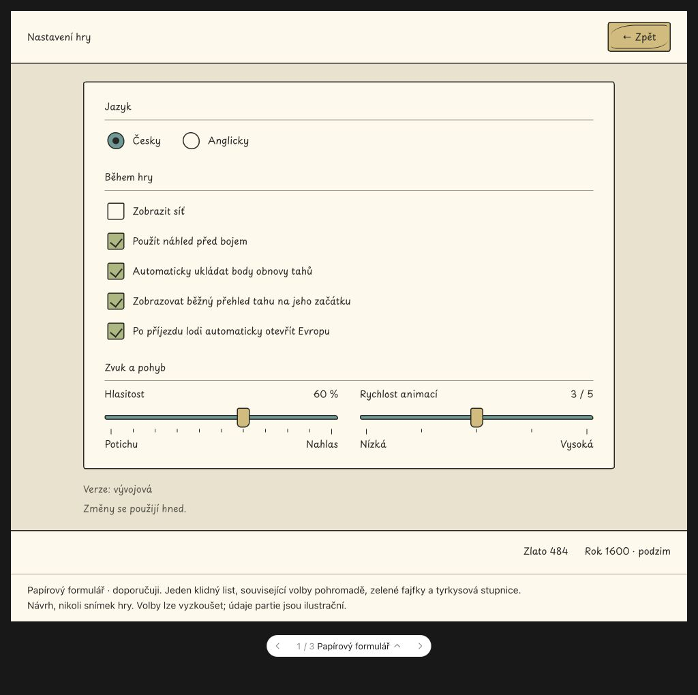
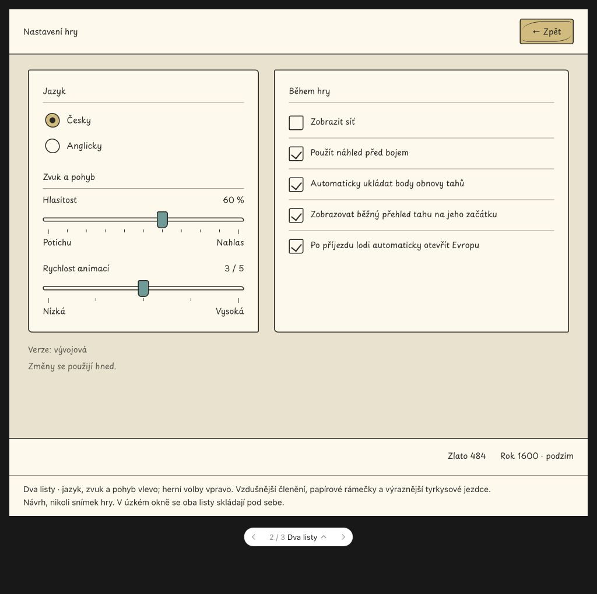
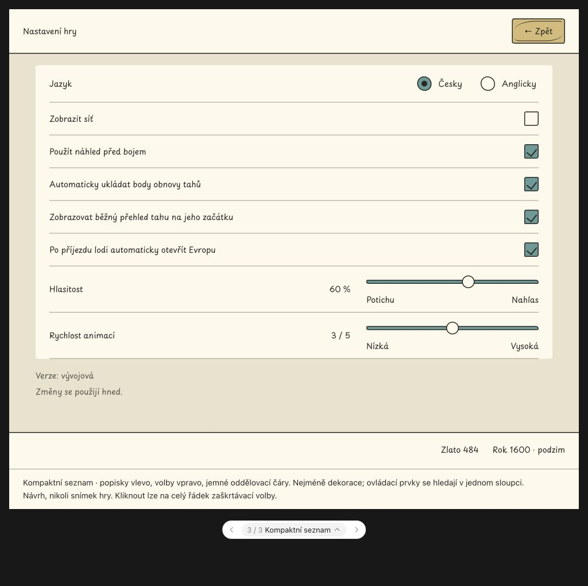

# R-0309 — Settings controls follow the shared visual style

1. Status: new
2. Updated: 2026-10-27
3. Related: UC-119 (Regrese), [UC catalogue](../use-cases.md), [shared visual rules](../graphics.md#minimalisticky-graficky-manual).
4. Dependencies: existing Settings behavior and [R-0248 controls](done/R-0248.md); the in-game frame is owned by the separate R-0307 work, outside this proposal commit.
5. Primary area: [A03](areas.md#a03), screens and shared UI language.
6. Related areas: A01 owns Settings entry and return navigation; A04 owns the existing turn-recovery preference. Neither behavior changes here.
7. Origin: on 2026-10-27 the user requested alternative designs for every Settings element before choosing an implementation.

## 1. Summary

1. Players should see one consistent visual language in Settings: the agreed paper, muted palette, pen contours and Playpen Sans Regular 14.
2. Source inspection on 2026-10-27, based on `ad8ab420` plus the existing R-0307 work in progress, found the older wooden frames and ruler drawing in the shared Settings skins. The existing visual manual explicitly gives the newer palette and typography priority over the historical R-0248 appearance.
3. Scope includes the background, heading, section labels, language choices, five checkboxes, both sliders and their scales, version text, Back button, and connection to the in-game header/status frame. This is a design proposal; implementation has not been selected.

## 2. Behavior

1. Open Settings from the startup menu or during play. Preserve the Czech/English language choice, grid, combat preview, automatic turn-recovery points, regular turn report, automatic Europe opening on arrival, music volume and animation speed. Keep the existing immediate application and return destination.
2. All three proposed designs use the same flat palette: paper `#FFF9EC`, background `#EAE2CC`, ink `#292824`, muted green `#A9B77A`, sea `#649B97`, sand `#D5BA76`, and secondary lines `#A49B86`. These are proposed role assignments from the existing game palette, not a newly approved global palette. Keep every text at Regular 14; distinguish groups with spacing and rules. Use no gradients, shading or texture.
3. Proposal A, **Papírový formulář**, puts language, play preferences and sound/motion in one centered sheet. Green checked boxes and a turquoise slider track make state visible; the checkmark or radio dot also communicates selection. This is the recommended starting point for long Czech labels.

   

4. Proposal B, **Dva listy**, separates language/sound/motion on the left from the five play preferences on the right. Paper checkboxes and turquoise slider handles reduce the amount of filled color. Narrow windows stack both sheets.

   

5. Proposal C, **Kompaktní seznam**, aligns labels left and controls right in a ruled list. The whole checkbox row remains clickable. Simple round slider handles reduce ornament; narrow windows move slider controls below their labels.

   

6. Hover, pressed, focused, selected and unavailable states must remain distinct. Keyboard focus must be visible independently of color; unavailable controls keep readable labels. Long Czech/English labels wrap without covering controls. The shared in-game frame retains its current gold/date information; startup Settings has no fictitious party status.
7. Numeric slider feedback (volume percentage and animation level 1–5), grouping and the immediate-application note are proposed presentation improvements. They do not change the existing ranges or add a Save/Cancel transaction. The browser preview uses sample values and cannot change game preferences.

## 3. Implementation steps

1. After the user chooses a design, refine the selected layout and state drawings with the existing `gui.screen.setting` views, `gui.util` Settings skins and scoped CSS. Reuse current preference presenters and navigation. The model and AI acquire no new responsibilities.
2. Review all Settings callers before edits, including both startup and in-game hosts, `SettingPage`, `FramedSettingsPage` and the existing shared-control tests. Preserve stable control IDs and existing fixture behavior. Update shared graphics/UX guidance with the selected decision; do not overwrite R-0307 frame work.
3. Planned game acceptance after implementation: all model/JUnit tests, targeted `TC_84_F75_framed_settings_test`, `TC_85_F75_playpen_typography_test`, `TC_83_F74_wooden_buttons_test` and the affected in-game frame scenario, then the fixed smoke/support selection. Confirm the final selection during refinement. Apply the shared Java formatter and documentation checks.
4. Current result: three interactive design proposals and their illustrative screenshots, with no runtime source, configuration, test or asset changes. Browser preview checks cover variant navigation, Czech/English labels, checkboxes and slider updates. These checks do not establish JavaFX rendering or gameplay acceptance. Documentation-only acceptance follows the [publishing workflow](../publishing.md#local-acceptance-policy).

## 4. Open questions

1. Which design, or combination of the three designs, should be selected? Blocking: yes, for final layout refinement and implementation. The user explicitly requested a choice before implementation; the existing typography, palette and preference behavior do not need renewed approval.
