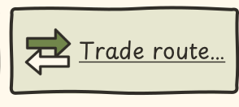

# R-0395 — Základy mapového plánování obchodních tras

1. Status: new
2. Updated: 2026-11-01
3. Related: P16; ROUTE-001–004 v [pravidlech tras](../gap-analysis.md#automated-trade-routes); UC-029/116 (Hra) v [katalogu use cases](../use-cases.md); [UX pravidla](../ux.md#planovani-obchodnich-tras).
4. Dependencies: struktura tras [R-0139](done/R-0139.md), náklad zastávek [R-0140](done/R-0140.md), přiřazení a opakování [R-0141](done/R-0141.md), úpravy a rušení [R-0142](done/R-0142.md), společná pohybová cena [R-0125](done/R-0125.md).
5. Primary area: [A06](areas.md#a06), plánování dopravy a obchodních tras.
6. Related areas: A03 mapový režim, pravý panel a ovládání; A01 vstup z hlavní herní lišty; A05 výpočet cesty podle pohybu dopravce; A04 zachování uložených tras; A06 stávající odjezd do Evropy a návrat podle [R-0021](done/R-0021.md) a délka plavby podle [R-0071](done/R-0071.md).
7. Origin: diskuse s uživatelem 2026-10-31 a zadání 2026-11-01; zachytit nový požadavek, nikoli implementovat.

## 1. Shrnutí

1. Hráč potřebuje na mapě přehledně vidět obchodní síť, založit trasu a upravit její zastávky a vlastnosti bez ztráty prostorové orientace.
2. Existující dokumentované schopnosti tras vlastní R-0139–R-0142. Tento požadavek přidává společné mapové plánovací rozhraní; současná implementace a její UI nebyly při zachycení znovu ověřeny.
3. Základem je přepnutí mapy do režimu obchodních tras, barevné trasy na tmavém podkladu a detail konkrétní trasy v místě běžného pravého panelu. Hra volí cestu mezi městy automaticky podle rychlosti průchodu, nikoli počtu dlaždic.

## 2. Chování

1. Hráč v rozehrané partii přepne v levém horním rohu mapové rozhraní na obchodní trasy. Uvidí všechny vlastní trasy barevně na ztmavené mapě s rozpoznatelnými městy. Všechny vypočtené cesty, nejen vybraná trasa, se vykreslí zhruba středy příslušných dlaždic jako měkké, ladně zahýbající křivky s viditelnými nepravidelnostmi připomínajícími ruční kresbu. Grafické vyhlazení a nepravidelnosti nemění skutečnou cestu ani její pohybovou cenu. Návrat obnoví běžný mapový režim a jeho pravý panel; prohlížení nemění herní stav.
2. Najetí myší na trasu zobrazí její jméno a základní vlastnosti. Výběr trasy otevře její trvalý detail v prostoru, který na normální mapě zabírá pravý panel. Panel popisuje zvolenou trasu a umožní upravovat její zastávky, přepravované zboží a přiřazení dopravy v mezích existujících pravidel. Zpřístupnění detailu nesmí být závislé pouze na hoveru.
3. Po přepnutí do zobrazení obchodních tras bude nahoře v hlavní herní liště tlačítko pro založení nové trasy („New trade route“). Použije podobu existujícího tlačítka „Trade route…“ z detailu kolonie podle přiložené reference; nejde o položku úvodního menu ani menu pozastavené hry. V plánovači hráč zvolí města a jejich pořadí a nastaví vlastnosti trasy; konkrétní cestu po mapě nekreslí ručně. Před potvrzením vidí plánované zastávky a nastavení. Zrušení rozpracovaného založení nebo úpravy ponechá původní trasy, příkazy a náklad beze změny.
4. Mezi každými dvěma navazujícími městy hra automaticky zvolí nejrychlejší legální cestu pro příslušný dopravní prostředek podle skutečných pravidel a nákladů pohybu. Má-li cesta přes více dlaždic nižší pohybovou cenu než kratší varianta, vybere delší, ale rychlejší cestu. Náhled i skutečný pohyb musí vycházet ze stejného pravidla. Je-li přiřazen pozemní vůz, hra hledá a zobrazuje cestu po pevnině; jsou-li přiřazené lodě, hledá a zobrazuje cestu po moři. Nedosažitelnost nevede k přepnutí na jiný druh dopravy. Existující rozlišení pozemních a námořních tras a validace kompatibility dopravce zůstávají zachovány.
5. Při nedosažitelném cíli nebo změně stavu hra vysvětlí důvod a nepřijme neplatnou změnu. Existující pravidla přerušení trasy, obchodování, kapacity, vlastnictví a utajené mapy zůstávají závazná. Pouhé otevření detailu nepohne dopravcem ani neprovede obchod; transakční report vlastní [R-0392](R-0392.md).
6. Potvrzená trasa a její změny přežijí uložení a Continue podle stávajícího kontraktu. Načtení ani přepnutí zobrazení nespustí další návštěvu zastávky. Překrývající se trasy musí být jednotlivě volitelné; konkrétní řešení výběru se dopracuje při refinementu.
7. Přiložený obrázek identifikuje uživatelem požadované existující tlačítko z detailu kolonie: dvě protisměrné šipky a text „Trade route…“. Při implementaci znovu použít jeho existující vzhled a zdroj; přiložený screenshot sám není produkční asset. Případná produkční ilustrace dodrží [vektorový kontrakt](../graphics.md#zdrojovy-format-herni-grafiky).

8. Trasa bez přiřazeného dopravce se zobrazí šedě. Hra se pokusí najít legální nejrychlejší pozemní i námořní variantu mezi zastávkami a ukáže obě, pokud jsou obě dostupné, jinak pouze dosažitelnou variantu. Pokud neexistuje ani jedna, vysvětlí nedosažitelnost bez kreslení neplatné cesty. Jde o náhled možností, nikoli o přiřazení dopravce nebo spuštění přepravy; pravidla typu potvrzené trasy zůstávají závazná.
9. Při více stejně nejrychlejších cestách stačí vybrat jednu, například první ve stálém pořadí. Při nezměněných vstupech se výběr nemění mezi překresleními, otevřeními plánovače ani po Continue; změní-li se průchodnost nebo pohybová cena, hra může cestu přepočítat. V každé zobrazené dopravní variantě se kreslí jedna takto zvolená optimální cesta. U více kompatibilních dopravců lze pro společný náhled stabilně použít jednoho z nich; skutečný pohyb každého nadále respektuje jeho vlastní pohybová pravidla. Náhled nesmí tvrdit, že zvolená cesta je optimální pro všechny dopravce s odlišnými náklady.
10. Evropa bude v plánovací mapě znázorněna jako zastávka v high seas. Z výchozího místa námořního úseku hra najde nejrychlejší legální cestu do dosažitelných high seas, čímž určí mapové spojení do Evropy. Minimalizuje pohybovou cenu do high seas, nikoli počet dlaždic ani součet s náhodnou dobou zámořské plavby. Bez dosažitelného legálního odjezdu označí úsek za nedosažitelný. Tento způsob zobrazení nezkracuje samotnou plavbu a nemění existující pravidla odjezdu, délky plavby a návratového místa; evropská zastávka zůstává námořní.

## 3. Kroky implementace

1. Příprava implementace čeká na výběr požadavku a refinement. Přečíst současný editor, mapové režimy, pravý panel, vstupy menu a jejich volající podle [mapy odpovědností](../architecture.md). Znovu použít existující operace tras a společný výpočet cesty; pravidla a validace vlastní model, GUI prezentuje výsledek.
2. Upřesnit návrh stavu výběru a editace, přechody zpět/zrušit, EN/CS texty, klávesové ovládání, překryv tras a šedé pozemní/námořní náhledy před přiřazením dopravce. Pro náhled bez dopravce znovu použít existující modelové profily pozemní a námořní dopravy; po přiřazení vycházet ze skutečné jednotky. Nezavádět druhý výpočet pohybových cen v GUI ani nový paralelní formát obchodních tras. Pro stálý výsledek použít deterministické rozhodnutí při shodné ceně; není nutné generovat ani ukládat všech n optimálních cest, stačí jedna. Zachovat sdílená pravidla dosažitelnosti high seas a skutečného návratového místa.
3. Při refinementu určit jmenované modelové a TC scénáře pro nejlevnější cestu s více dlaždicemi, pozemní/námořní omezení, nedosažitelnost, přepínání režimu, výběr a editaci v pravém panelu, novou trasu, zrušení a Save/Continue. Navázat na existující testy R-0139–R-0142; zachovat herní aserce a doplnit vizuální kontrolu všech cest, vedení přibližně středy dlaždic, ladných ručně působících křivek, překryvu a čitelnosti. Ověřit tlačítko v hlavní herní liště po přepnutí režimu a volbu pevniny pro vůz / moře pro loď. Grafické vyhlazení nesmí měnit modelovou cestu. Doplnit případy bez dopravce (obě varianty, jen jedna, žádná), stabilního výběru rovnocenných cest včetně Continue, změny průchodnosti a nejlevnějšího dosažitelného high seas vstupu do Evropy; zachovat dosavadní testy skutečné plavby a návratu.
4. Aktuální výsledek: pouze zachycené zadání, bez implementace a bez nového ověření hry. Dokumentační přejímka používá kontroly konzistence a strict MkDocs; pozdější implementace podléhá [lokální přejímce](../publishing.md#local-acceptance-policy).

## 4. Otevřené otázky

1. Žádné. Odpovědi uživatele z 1. listopadu 2026 jsou zapracované do chování a [sdílených pravidel tras](../gap-analysis.md#automated-trade-routes). Technická příprava a konkrétní testové scénáře zbývají před označením za připravené k vývoji; odstranění otázek samo nezahajuje implementaci.
