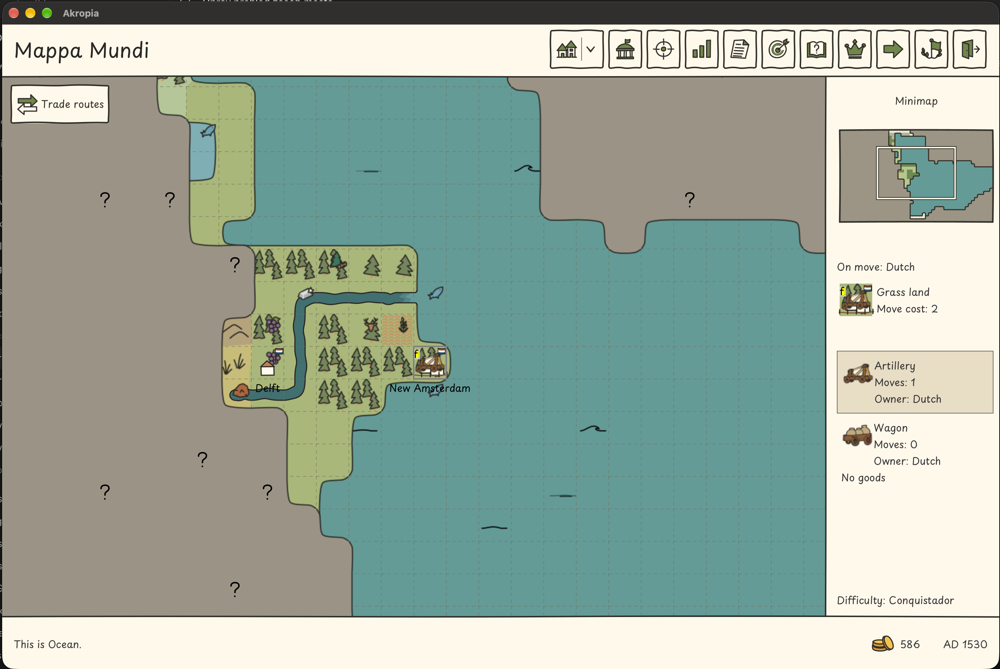

# R-0401 — Výběr jednotky kliknutím v pravém panelu hlavní mapy

1. Status: new
2. Updated: 2026-11-03
3. Related: UC-011/114/119, kategorie Hra, v [katalogu use cases](../use-cases.md); [příkazy jednotky na mapě](../ux.md#prikazy-jednotky-primo-na-mape-r-0272).
4. Dependencies: existující seznam jednotek v pravém panelu, společný výběr jednotky a příkazy mapy z [R-0272](done/R-0272.md).
5. Primary area: [A03](areas.md#a03), výběr a ovládání jednotky.
6. Related areas: [A05](areas.md#a05), dostupnost rozkazů a pohybu podle stavu jednotky; pravidla těchto akcí se nemění.
7. Origin: uživatel 2. listopadu 2026 požádal o zachycení a push změny pravého panelu hlavní mapy podle přiloženého snímku. Implementace tímto požadavkem není zahájena.

## 1. Summary

1. Hráč chce kliknutím na konkrétní jednotku v pravém panelu hlavní mapy vybrat právě ji a následně jí zadávat instrukce, bez hledání stejné jednotky mezi ikonami na mapě.
2. Dosavadní [UX pravidlo R-0272](../ux.md#prikazy-jednotky-primo-na-mape-r-0272) popisuje pravý panel jako pouze informační bez výběru kliknutím. Tento požadavek nahrazuje právě toto omezení; zachovává existující cesty zadávání příkazů na mapě.
3. Uživatelský snímek z 2. listopadu 2026 ukazuje dělostřelectvo a vůz na stejném místě. Je referencí zadání, nikoli důkazem ověření aktuálního běhu hry.

## 2. Behavior

1. Na hlavní mapě hráč jedním levým kliknutím na kartu vlastní jednotky v pravém panelu vybere tuto konkrétní jednotku. Kliknutí na její ikonu nebo text má stejný výsledek; není nutný dvojklik ani přechod do kolonie.
2. Panel viditelně zvýrazní vybranou jednotku a výběr na mapě i kontext dostupných příkazů odpovídají téže jednotce. Při více jednotkách na políčku nelze zaměnit jejich identitu ani automaticky vybrat první jednotku seznamu.
3. Následující příkaz pro vybranou jednotku, včetně klávesové zkratky nebo vyvolání její stávající kontextové nabídky, se vztahuje právě k ní. Například po kliknutí na vůz příkaz neovládá dříve vybrané dělostřelectvo. Kontextová nabídka nad jinou jednotkou na mapě nadále respektuje svůj explicitní cíl.
4. Samotné kliknutí pouze mění výběr: neprovede pohyb, nespotřebuje pohybové body, neotevře město, nepřidělí nový rozkaz ani nezruší stávající dlouhodobý rozkaz. Opětovné kliknutí ponechá stejnou jednotku vybranou; kliknutí na jinou vlastní jednotku výběr přepne.
5. Vybrat lze i vlastní jednotku s nulovým pohybem, například vůz na snímku. Výběr neobchází omezení příkazů, tahu, vlastnictví ani modelových pravidel. Nedostupné akce zachovají stávající vysvětlení; cizí jednotka nezíská ovládání vlastních jednotek.
6. Kliknutí v panelu nesmí potvrdit rozpracovaný pohyb předchozí jednotky. Při změně výběru se jeho nepotvrzený náhled zruší bez provedení akce; zrušení následného příkazu zachová výběr a nezmění svět. Pokud jednotka mezitím zmizí nebo přestane být ovladatelná, panel nesmí ponechat příkazy mířící na neplatný cíl.
7. Zachovat stávající zobrazení názvu, vlastníka, pohybu, nákladu a stavu cesty. Změna výběru nemění uložený herní stav ani pravidla přepravy. Režim obchodních tras a ostatní obrazovky tento požadavek nerozšiřuje.

8. Návaznost z 2026-11-03: [R-0405](R-0405.md) přidává viditelné a volitelné pracovníky kolonie na hlavní mapě. Společný výběr musí zachovat jejich identitu a směrovat příkazy na daného pracovníka; první výnos při Next turn, zachovaný pohyb při zadání práce a omezený návrat vlastní [pracovní pravidlo](../gap-analysis.md#workers-on-world-map). Tento požadavek tato pravidla neurčuje ani neobchází; jeho status se nemění.

## 3. Implementation steps

1. Při výběru k vývoji projít obsluhu karet pravého panelu, společný stav výběru mapy a všechny vstupy příkazů podle [mapy odpovědností](../architecture.md). Napojit kliknutí na existující společný výběr; nevytvářet druhý stav aktivní jednotky pouze pro panel. Model ponechat vlastníkem validace rozkazů.
2. Upřesnit zpracování fokusu, zvýraznění, zrušení nepotvrzeného náhledu a obnovu panelu při změně herního stavu. Znovu použít existující ovládací prvky, dostupné akce a EN/CS texty; podrobný návrh doplnit při refinementu.
3. Navázat na `TC_11_F11_skip_to_next_unit_test`, zejména TC11_07, jehož dosavadní očekávání pouze informačních karet je třeba změnit. Doplnit konkrétní scénáře pro výběr druhé jednotky na témže políčku a rozkaz správnému cíli, jednotku v kolonii bez otevření města, nulový pohyb, cizí jednotku, opakované přepnutí a zrušení náhledu pohybu. Zachovat ostatní herní kontroly TC11_07 a mapové příkazy TC11_08/09. Přesné nové identifikátory určit při refinementu.
4. Implementaci ověřit model/JUnit, cílenými Docker/Xvfb scénáři a smoke/support podle [lokální přejímky](../publishing.md#local-acceptance-policy). Ověřit shodu zvýraznění a skutečného cíle příkazu, EN/CS a podporované velikosti okna. Zachycení tohoto požadavku vyžaduje jen dokumentační kontroly a strict MkDocs.
5. Aktuální výsledek: požadavek zachycen, implementace a herní ověření nezahájeny. Historickou implementaci a evidence R-0272 tento zápis nepřepisuje.

6. Pro integraci R-0405 prověřit výběr pracovních umístění mimo běžný seznam mapových jednotek. Model zůstává zdrojem dostupnosti pohybu a práce; seznam panelu nesmí vytvářet druhou instanci člověka ani obcházet zákaz dalšího pole v témže tahu.

## 4. Open questions

1. None.
