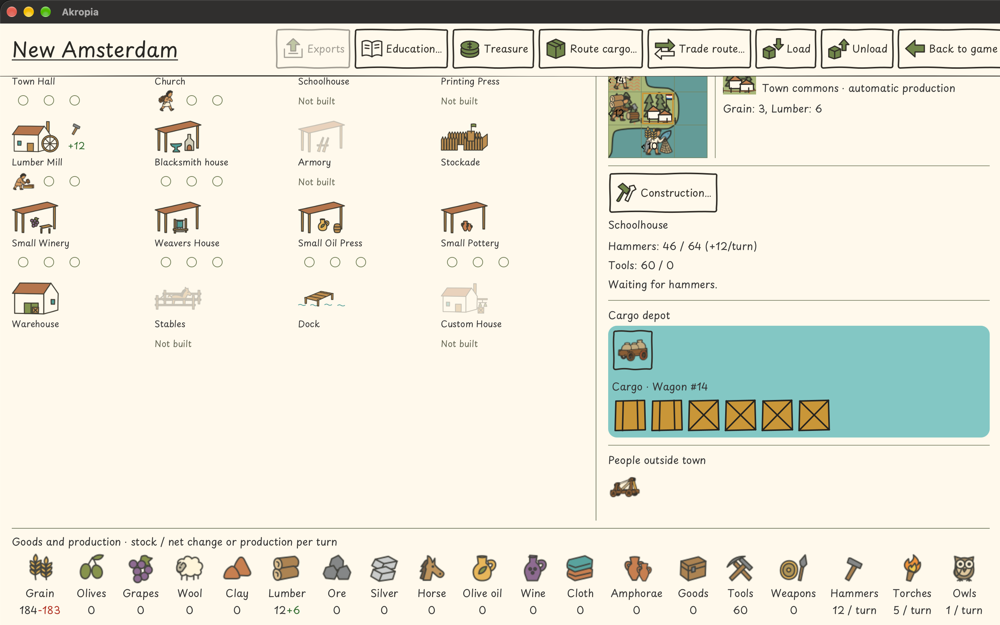

# R-0400 — Zásoby a změna za kolo ve spodní liště města

1. Status: done
2. Updated: 2026-11-03
3. Related: UC-114/119, kategorie Hra, v [katalogu use cases](../../use-cases.md); [UX pravidla](../../ux.md).
4. Dependencies: existující lišta z [R-0372](R-0372.md) a současné názvosloví z [R-0394](R-0394.md).
5. Primary area: [A03](../areas.md#a03), čitelné zobrazení stavu města.
6. Related areas: [A07](../areas.md#a07), zásoby a čistá změna z výroby a spotřeby; [A06](../areas.md#a06) a [A10](../areas.md#a10), stávající celkové počítání pochodní a sov napříč koloniemi.
7. Origin: požadavek uživatele z 2. listopadu 2026 a přiložený snímek níže; zadáno zachycení požadavku a push, nikoli implementace.

## 1. Summary

1. Hráč ve spodní liště města okamžitě rozliší aktuální množství jednotlivých druhů zboží ve městě a jejich čistý přírůstek nebo úbytek za kolo.
2. Na uživatelském snímku z 2. listopadu 2026 jsou některé zásoby a změny těsně vedle sebe (například obilí `184-183`), nulové položky ukazují jen jednu hodnotu a kladiva pouze výrobu za kolo. Snímek je podklad zadání, nikoli nové ověření běžící hry.
3. Rozsah je spodní lišta existující obrazovky města. Výpočty výroby, spotřeby, přepravy ani pravidla hromadění zdrojů se nemění.

## 2. Behavior

1. Po otevření vlastního města zobrazí každá položka spodní lišty aktuální celkové množství daného zboží v tomto městě a samostatně čitelnou čistou změnu za kolo. Nejde o součet zásob všech kolonií ani o součet zásob a nákladu vozidel.
2. Kladná změna má znaménko `+` a zelenou barvu; záporná změna znaménko `−` a červenou barvu. Barva se vztahuje ke změně, nikoli k aktuální zásobě. Znaménko zachová srozumitelnost i bez rozlišení barev. Změna zahrnuje spotřebu podle stávajících pravidel, nikoli jen hrubou výrobu.
3. Pouze pochodně (uživatelem označené jako louče) a sovy ukazují jen příspěvek otevřeného města za kolo. Jejich nahromaděné hodnoty se počítají napříč koloniemi, proto se v této liště jako zásoba města neuvádějí. I jejich změna používá stejné znaménko a barevné rozlišení.
4. Kladiva nejsou výjimkou: zobrazí místní nahromaděný stav i změnu za kolo. Příklad podle snímku: zásoba kladiv `46` a přírůstek `+12` za kolo; obilí `184` a změna `−183`; dřevo `12` a změna `+6`. Pochodně zobrazí pouze `+5` a sovy pouze `+1` za kolo.
5. Návrh prezentace pro implementační refinement: jasné oddělení ve tvaru `184 (−183/kolo)`, nulová změna `0/kolo` v neutrální barvě a zobrazení obou hodnot i při nulové zásobě. V EN použít odpovídající označení za kolo; zachovat čitelnost ve všech podporovaných velikostech okna.
6. Po změně práce, zásob či kola se údaje aktualizují podle aktuálního modelového stavu; přepnutí mezi městy nesmí ponechat hodnoty předchozího města. Zobrazení samo stav nemění, nevyžaduje potvrzení ani zrušení a zachová dosavadní možnosti manipulace se zbožím. Kladiva, pochodně a sovy zůstávají nepřepravitelné.

7. Návaznost z 2026-11-03: [R-0405](../R-0405.md) mění zadání práce z hlavní mapy a první výnos při Next turn. Lišta zobrazuje stejný modelový výhled po příkazu z mapy i města; pouhé zadání práce nezvýší zásobu. Příjemce společného pole a spotřebu nepracujících obyvatel určí R-0405, nikoli prezentace této lišty.

## 3. Implementation steps
1. Refinement 2026-11-03: uživatel vybral implementaci. `PanelColonyGood` čte zásobu a čistou změnu z `Colony.getGoodsStats()`; pochodně a sovy mají pouze místní příspěvek. Výpočty a přeprava zůstávají ve stávajícím modelu.
2. Oddělit zásobu a změnu v závorkách s lokalizovaným `/kolo` a `/turn`. V úzké položce jsou hodnoty pod sebou; změna může zalomit text. Zachovat varování před hladem a nepřepravitelnost kladiv, pochodní a sov.
3. Rozšířit `TC_106_F97_quick_cargo_test.TC_03` o zásoby, znaménka, nulové hodnoty, barvy a čitelnost v EN/CS ve dvou velikostech. Zachovat kontroly přepravy a ověřit změny práce a kola existujícími scénáři.
4. Spustit model/JUnit, cílené Docker/Xvfb UI a na konci společné smoke/support pro R-0400/0401/0404. Dokumentaci ověřit kontrolami a strict MkDocs; skutečné výsledky patří do [evidence](../../functional-tests.md).
5. R-0405 zůstává samostatnou změnou modelového výhledu práce; tento požadavek jeho pravidla neimplementuje.
6. Implementováno a lokálně přijato 2026-11-03; model/JUnit, cílené UI i společný smoke prošly. Skutečné výsledky a uchovaný neúspěšný pokus uvádí [přejímka](../../functional-tests.md#r-0400r-0401r-0404-local-acceptance-2026-11-03). Publikace distribuce tím není ověřena.

## 4. Open questions

1. None.
