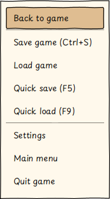
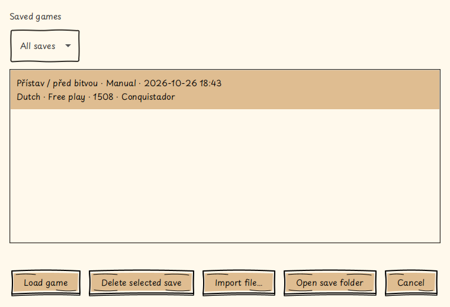
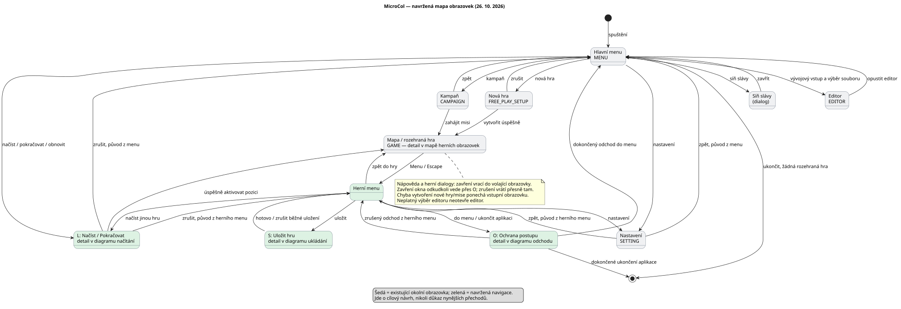
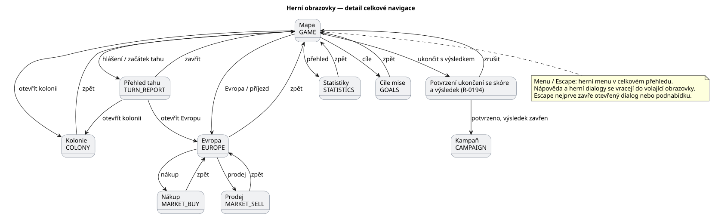
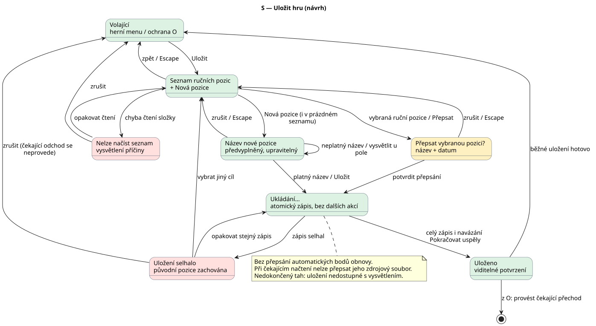
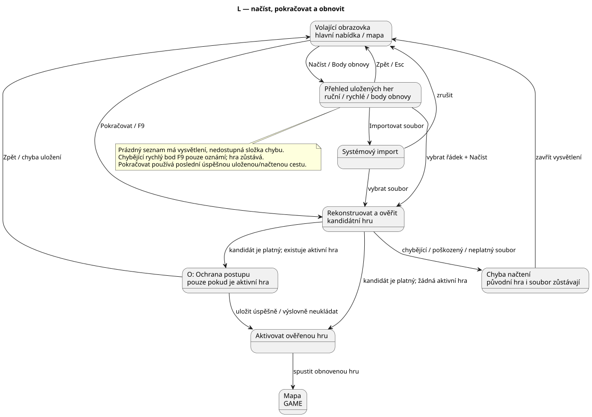
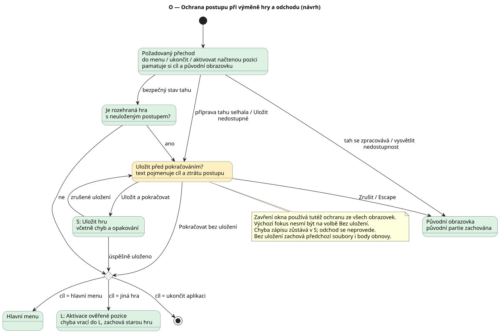

# Ukládání, načítání a herní nabídka

**Implementováno a lokálně ověřeno 26. října 2026.**
[R-0298](requirements/done/R-0298.md) navazuje na původní návrh z tohoto dne.
Níže je smlouva implementovaného chování. Výsledky testů patří do
[funkční evidence](functional-tests.md), původní prohlídka zdrojů a kontrola
návrhových diagramů zůstává v [publikační evidenci](publishing.md#r-0298-save-load-navigation-2026-10-26).

**Zachycená změna z 31. října 2026:** [R-0376](requirements/R-0376.md)
požaduje odstranit samostatnou položku Body obnovy z hlavní nabídky. Obnova
zůstane dostupná přes Načíst hru a stávající filtr; ukládání bodů se nemění.
Požadavek je ve stavu `new`, dosud není implementován. Níže popsaná současná
navigace proto tuto položku stále obsahuje.

## Co už existuje

1. MicroCol již má serializaci, atomický zápis a tři body obnovy: poslední
   pozici, poslední tah a předchozí desetiletí. [R-0068](requirements/done/R-0068.md)
   nadále určuje jejich četnost a nastavení automatického ukládání.
2. Načtení musí ověřit celý nový stav před výměnou rozehrané hry podle
   [R-0067](requirements/done/R-0067.md). Pouhé prohlížení ani otevření soubor
   nepřepisuje. Současná vývojová politika nevyžaduje migrace historických uložených her.
3. Nová nabídka využívá stejné JavaFX popup prvky a společné styly jako výběr
   kolonií. Poslední ovládací prvek hlavní herní lišty otevírá **Nabídku**.
   Menu se otevře také klávesou **Esc**, pokud se právě neruší rozpracovaný
   příkaz na mapě. Zavření nabídky vrátí hráče do mapy.

## Podoba rozhraní

Snímky z Docker/Xvfb scénáře TC191 dne 26. října 2026 ukazují skutečné
rozhraní v angličtině; nejde o maketu. České ovládací texty pokrývá také TC43.

## 1. Celková navigace

[Zdroj PlantUML](diagrams/save-load/navigation.puml)

1. Hlavní nabídka zachovává Pokračovat, Načíst, Novou neomezenou hru, Kampaň,
   Síň slávy, Nastavení a Ukončit. Body obnovy jsou zkratkou do stejného
   seznamu jako Načíst, s předvoleným filtrem automatických pozic.
2. Herní nabídka obsahuje Zpět do hry, Uložit, Načíst, Rychle uložit, Rychle
   načíst, Nastavení, Hlavní nabídku a Ukončit. V kampani navíc nabízí
   **Začít misi znovu**, která po potvrzení otevře původní scénář mise.
3. Nová hra a výběr mise zůstávají samostatnými vstupy hlavní nabídky.
   Pokračování z uložené pozice obnovuje stav rozehrané mise; restart
   zahajuje původní misi a není pokračováním uložené pozice.
4. Z Nastavení se tlačítkem Zpět i klávesou Esc vrací hráč do stále rozehrané
   hry, pokud z ní přišel; jinak do hlavní nabídky. Návrat sám hru neukládá.

## 2. Okolní herní obrazovky

[Zdroj PlantUML](diagrams/save-load/game-screens.puml)

1. Přehled zahrnuje všech 13 hodnot současného
   [výčtu Screen](../microcol-game/src/main/java/org/microcol/gui/screen/Screen.java).
   Kolonie, Evropa, nákup/prodej, statistiky, hlášení tahu a cíle zachovávají
   své návraty; nejde o nové uložené hry. Herní dialogy zůstávají uvnitř
   volající obrazovky. Vývojový editor používá samostatný systémový výběr.
2. Zavření hlavního okna z libovolné obrazovky prochází společnou ochranou
   rozehrané hry. Zrušení ponechá otevřené okno a původní obrazovku.
3. Odchod a ukončení nejsou odchodem do důchodu a nezapisují skóre;
   [R-0194](requirements/done/R-0194.md) zůstává samostatnou herní akcí.

## 3. Uložit hru

[Zdroj PlantUML](diagrams/save-load/save.puml)

1. **Uložit / Ctrl+S** otevře přehled s názvem nového uložení. Potvrzení
   vytvoří nový soubor; shodný název sám o sobě nic nepřepíše. Okrajové
   Unicode mezery se oříznou, vnitřní mezery, diakritika a interpunkce zůstanou.
   Název musí mít 1–64 Unicode znaků bez řídicích znaků. Název není cesta.
2. Vybrané ruční uložení lze výslovně přepsat nebo smazat. Obě operace mají
   potvrzení s názvem cíle. Rychlé a automatické pozice takto přepsat ani
   smazat nelze. Chyba zápisu ponechá starý soubor a nabídne další pokus.
3. **F5 / Rychle uložit** zapíše jeden rychlý bod dané rozehrané hry. Nová
   hra dostane vlastní identitu; načtení uložené hry ji zachová. Jména a
   identita přehledu jsou metadata obálky, nikoli náhrada povinných identit
   hráčů, kolonií či jednotek. Autorské scénáře je nemusejí mít.
4. Spravované soubory jsou v `~/.microcol/saves/<identita-hry>/`;
   rychlý soubor se jmenuje `quick.microcol`, ruční názvy souborů generuje
   hra. Starší ruční soubory a body obnovy v `~/.microcol` jsou viditelné
   ve stejném přehledu. Export umožní zvolit vlastní soubor.
5. **Otevřít složku uložení** otevře `~/.microcol` systémovým správcem souborů.
   Pokud to prostředí nepodporuje, hra oznámí chybu a zachová přehled.
6. Ukládání a rychlé akce jsou běžně dostupné během připraveného lidského
   tahu. Model stále odmítá neúplnou přípravu tahu. Potvrzený zápis zobrazí
   zprávu ve stavovém řádku; zápisy jsou synchronní a dialog brání opakované akci.

## 4. Načíst a pokračovat

[Zdroj PlantUML](diagrams/save-load/load.puml)

1. Jeden seznam nabízí filtr Všechna uložení / Ruční / Rychlé / Body obnovy.
   Řádky jsou od nejnovějšího a ukazují název, typ, skutečný čas zápisu,
   misi, rok, obtížnost, jméno hráče a jeho národ.
   Chybějící soubory se nevypisují; prázdný filtr má vlastní vysvětlení.
2. Poškozené údaje nezablokují prohlížení ostatních řádků. Výběr souboru
   je pouze čtení. Až Načíst rekonstruuje a ověří celý kandidátní stav;
   chyba vrací do volající obrazovky a zachová původní hru i zdroj.
3. **Importovat soubor** otevírá systémový výběr. Zrušení přehledu,
   systémového výběru či potvrzení nic neaktivuje.
4. **Pokračovat** používá poslední úspěšně uloženou nebo načtenou cestu.
   Po konci hry zůstává tato starší rozehraná pozice dostupná; samotný konec
   ji nepřepíše ukončenou hrou.
   Úspěšný automatický checkpoint ji také aktualizuje. **F9 / Rychle načíst**
   obnovuje rychlý bod aktuální rozehrané hry; chybějící bod ohlásí bez změny hry.
5. Před aktivací jiné pozice se u živé hry použije ochrana postupu. Kandidát
   je ověřený před potvrzením, takže neplatný soubor nevyvolá zbytečnou výzvu
   k opuštění hry.

## 5. Ochrana postupu a odchod

[Zdroj PlantUML](diagrams/save-load/leave.puml)

1. Načtení jiné pozice, restart mise, návrat do hlavní nabídky, ukončení i
   zavření okna používají **Uložit a pokračovat / Odejít bez uložení / Zpět**.
2. Uložit a pokračovat zapíše současný stav do bodu obnovy poslední pozice.
   Teprve úspěch provede původní přechod. Chyba nebo neúplný tah zachová
   rozehranou hru; hráč může později výslovně odejít bez uložení nebo obnovit bod.
3. Zpět a Esc ruší přechod. Odchod bez uložení vyžaduje samostatnou výslovnou
   volbu. Bez rozehrané hry se ochrana neukazuje.
4. První implementace se ptá vždy, když existuje aktivní hra. Rozpoznávání
   nezměněného stavu je odložené vylepšení; nevydáváme pohyb kamery za změnu
   herního postupu ani netvrdíme, že sledování změn už existuje.
5. Cloud, náhledové obrázky, grafické seskupování podle rozehrané hry a
   dodatečná rotace checkpointů nejsou součástí této implementace.
