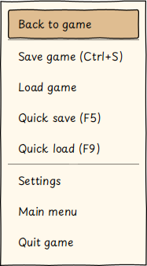
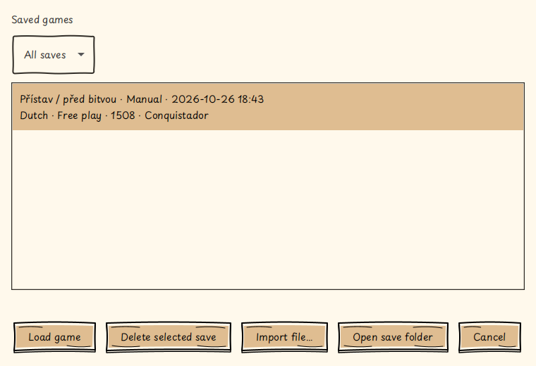
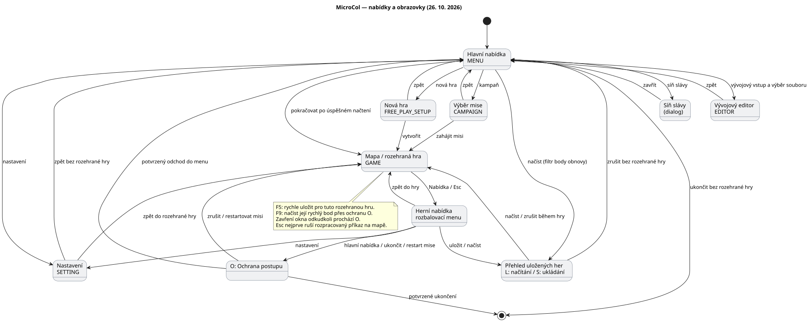
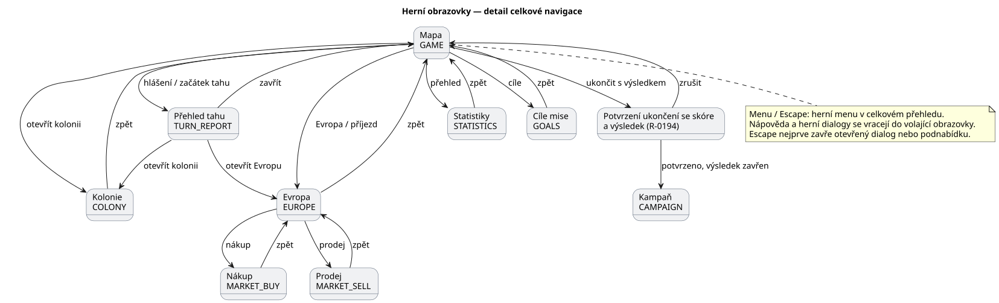
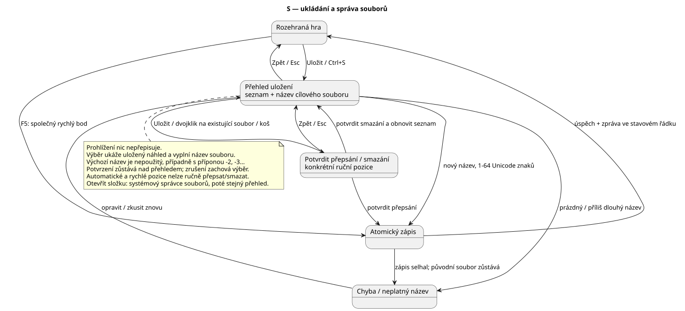
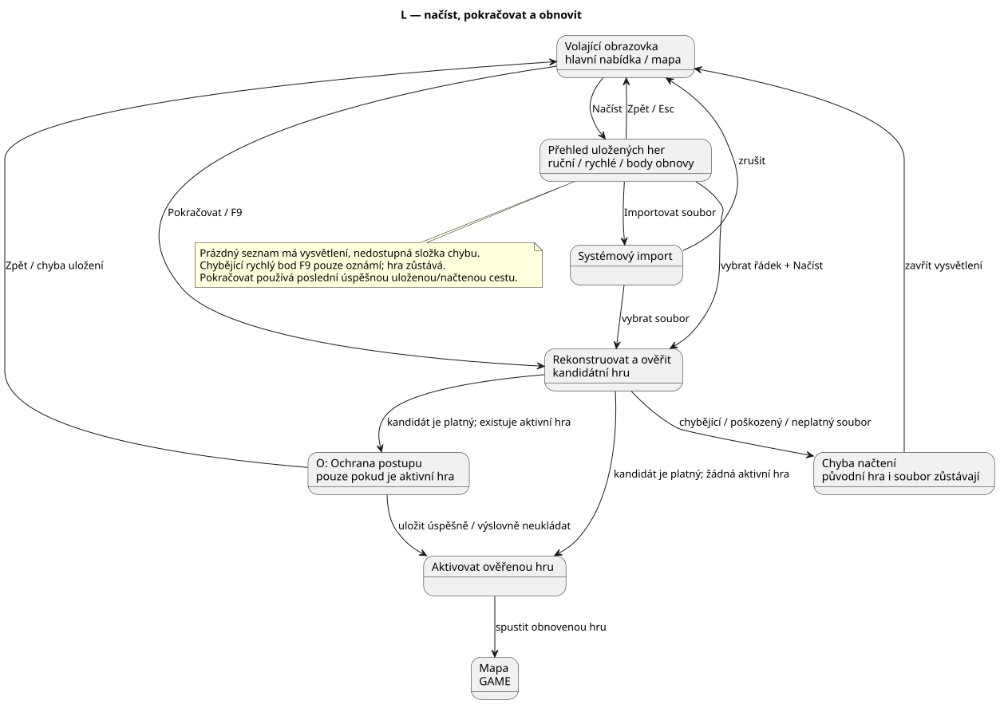
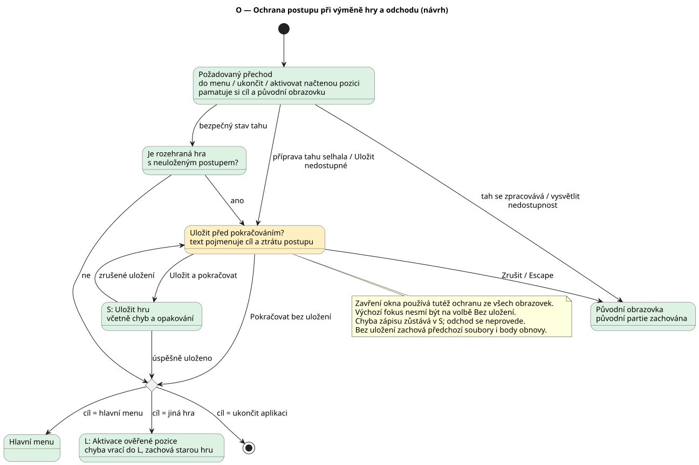

# Ukládání, načítání a herní nabídka

Seznamy Uložit a Načíst podtrhují název také při najetí myší; odjetí
myší ponechá podtržený pouze vybraný soubor. Najetí nemění výběr ani
náhled. Od 11. listopadu 2026 mají řádky mírně menší svislé odsazení
(7 místo 10 logických pixelů nahoře i dole).

Čitelné názvy souborů a deset společných kruhových autosavů z 8. listopadu
2026 vlastní [R-0432](requirements/done/R-0432.md). Nová pravidla jsou v kapitole
[Názvy a adresáře](#nazvy-a-adresare-schvalene-8-listopadu-2026); aktuální stav
přejímky je v požadavku a jeho funkční evidenci.

**Implementováno a lokálně ověřeno 26. října 2026.**
[R-0298](requirements/done/R-0298.md) navazuje na původní návrh z tohoto dne.
Níže je smlouva implementovaného chování. Výsledky testů patří do
[funkční evidence](functional-tests.md), původní prohlídka zdrojů a kontrola
návrhových diagramů zůstává v [publikační evidenci](publishing.md#r-0298-save-load-navigation-2026-10-26).

**Implementováno 1. listopadu 2026; závěrečný smoke série čeká:**
[R-0376](requirements/done/R-0376.md) odstraňuje samostatnou položku Body obnovy
z hlavní nabídky. Obnova je dostupná přes Načíst hru; změna R-0436 ze
9. listopadu 2026 odstraňuje filtr typů. Ukládání bodů, nastavení autosave
a Pokračovat se nemění. Navigace
níže už tuto položku neobsahuje.

**Implementováno 1. listopadu 2026; závěrečný smoke série čeká:**
[R-0377](requirements/done/R-0377.md) vkládá Nastavení a Načíst hru do hlavního
okna. Obrazovka, která je otevřela, určuje hostitele (mořská oblast menu nebo
herní rám) i návrat tlačítkem Zpět a klávesou Esc. Načíst otevírá také ⌘O na
macOS a Ctrl+O jinde; ⌘S / Ctrl+S na mapě otevírá dosavadní dialog Uložit.
Hlavní menu i herní nabídka uvádějí zkratku platformy v textu položky.
Chyba načtení, zrušený výběr souboru i zrušená ochrana postupu ponechají
stránku otevřenou. Zkratky nereagují při psaní do textového pole, při
otevřeném dialogu, nabídce či výběru souboru ani během souborové operace.

Cílené Docker/Xvfb scénáře a prohlídka snímků prošly; modelové ověření má pouze známé selhání kontrastu FRIGATE, pro které uživatel schválil [výjimku pro tuto sérii](publishing.md#local-acceptance-policy). Nativní macOS ověření je pouze volitelné ruční ověření. Přesné výsledky vlastní [funkční evidence](functional-tests.md). Historické snímky a diagramy z 26. října zachycují předchozí dialogový přehled.

## Ručně kreslené ovládání souborů — 11. listopadu 2026

1. Pole názvu souboru používá společný papírový rám s černou linkou
   přibližně 2 logické pixely, stejně jako název obchodní trasy.
2. Vybraný soubor označuje pouze nepravidelné černé podtržení názvu;
   pozadí řádku zůstává papírové. Koše nemají rámeček, zachovávají
   přístupný název, zvýraznění při zaměření a potvrzení odstranění.
3. Mezi koši, posuvníkem a detailem je volné místo. Uložit ani vybraný
   soubor v Načíst nezobrazuje titulek nad minimapou. Prázdný výběr
   v Načíst zachovává nápovědu. Psaní názvu, výběr, dvojklik, zrušení
   a potvrzení přepsání se nemění.
4. Schválený návrh a implementace nejsou hráčskou studií. Ověření vlastní
   [funkční evidence](functional-tests.md#save-browser-paper-controls-2026-11-11).

## Jednotný rámec Uložit a Načíst — 10. listopadu 2026

1. [R-0444](requirements/done/R-0444.md) sjednocuje herní Uložit a Načíst jako samostatné obrazovky v hlavním okně: nadpis a návrat nahoře, posuvný obsah uprostřed a společné zápatí se zlatem a rokem dole. Celý podklad používá stejný krémový papír jako záhlaví a zápatí.
2. Zpět do hry a Escape vracejí původní obrazovku. Uložit a pokračovat stále čeká na úspěšný zápis; zrušení nic neukládá. Načíst z hlavní nabídky zachovává její rámec a místo návratu. Texty přehledu nepoužívají „Please“.
3. Lokálně ověřeno 10. listopadu 2026; [funkční evidence](functional-tests.md#r-0444-saveload-screen-consistency-2026-11-10) uvádí přesný rozsah a výsledky.

## Správa souborů a vzhled — 11. listopadu 2026

1. Uložit i Načíst řadí soubory abecedně podle názvu souboru bez rozlišení
   velikosti písmen, nikoli podle času uložení. Datum zůstává v detailu.
2. Ruční, automatické i rychlé pozice lze po potvrzení smazat nebo přepsat.
   Potvrzení přepsání upozorňuje na ztrátu původní pozice. U názvu používaného
   automatikou nebo rychlým uložením je navíc viditelné upozornění, že další
   automatické či rychlé uložení může tuto pozici nahradit. Zrušení potvrzení
   soubor zachová; chyba se oznámí a prohlížeč zůstane otevřený.
3. Vnější panely seznamu a detailu ani náhled světa nemají viditelný rámeček.
   Náhled nemá vlastní barevné pozadí a je zarovnaný vlevo s textem detailu.
   Scrollbar, zvýraznění výběru a rámečky ovládacích prvků zůstávají zachované.
4. Při prvním otevření se výška řádků odvozuje od dostupné šířky; krátké
   názvy nesmějí vytvářet prázdné vysoké řádky a vytlačovat další soubory
   mimo viditelný seznam. Stejné rozložení používají Uložit i Načíst.
5. UC-114/119 pokrývá scénář
   `TC_191_F224_session_menu_test.TC_12_save_browser_allows_managed_files_and_uses_borderless_details`;
   stav ověření vlastní [funkční evidence](functional-tests.md#save-browser-file-management-2026-11-11).

## Názvy a adresáře schválené 8. listopadu 2026

1. Schválený cíl [R-0432](requirements/done/R-0432.md): hra automaticky ukládá
   připravený začátek lidského tahu včetně nové partie do deseti společných
   kruhových slotů `autosave-000.akropia` až `autosave-009.akropia`.
   Po 009 následuje bezpečné přepsání 000, potom 001 a dále bez potvrzení.
   Číslo 000 neoznačuje vždy nejnovější pozici. Nastavení autosave zůstává účinné.
2. Všechny nové spravované pozice jsou v `~/.akropia/saves/`, bez podsložek
   partií. Uživatel potvrdil příponu `.akropia`, přijal návrh a autorizoval
   implementaci 8. listopadu 2026. Nastavení zůstává v nadřazeném `~/.akropia`.
   Upřesnění 9. listopadu ([R-0436](requirements/done/R-0436.md)): katalog
   čte pouze přímé soubory této složky a nepoužívá filtr typů.
3. Ruční uložení jsou nezávislá. Výchozí název je národnost a rok
   (například `dutch-1600.akropia`); vlastní jméno má přednost, například
   `Před útokem.akropia`. Zachovat Unicode a vnitřní mezery, oříznout okolní
   Unicode mezery, dodržet limit 64 kódových bodů. Nepovolené či rezervované
   názvy odmítnout s vysvětlením. Existující jméno vyžaduje potvrzení
   přepsání, také při shodě bez ohledu na velikost písmen a normalizaci Unicode.
4. Kruh pokračuje po restartu dalším slotem a nesmí se vracet podle herního
   roku. Nová partie ho neresetuje; postupně nahrazuje autosavy předchozí.
   Načtení, prohlížení nebo opakované oznámení stejného tahu nic nezapisuje.
   Trvalé zachování řeší ruční pozice mimo kruh.
5. Samostatné kopie `latest-turn.akropia` a `previous-decade.akropia` se
   nově nezapisují. Rychlé uložení zůstává výslovným příkazem hráče do
   společného `quick.akropia`, mimo automatickou historii. Automatika nikdy
   nepřepisuje ruční ani rychlé pozice. Staré soubory se automaticky nemažou.
6. Pořadí úspěšných automatických zápisů je součástí metadat stejného archivu;
   není potřeba pomocný soubor ani adresář. Atomické nahrazení při chybě
   zachová původní pozici, další slot a Pokračovat. Pokračovat nadále vede
   na poslední úspěšně uloženou nebo načtenou pozici, ne na nejnižší číslo.
7. Implementace a lokální přejímka jsou vedené v R-0432 a jeho funkční evidenci.
   Následující kontrola zdrojů i starší pravidla popisují předchozí řešení;
   pro nový formát organizace mají přednost body výše.

## Současné automatické zápisy — kontrola zdrojů 8. listopadu 2026

1. Kontrola zdrojů revize `596540bc`, nikoli nový běhový test:
   `RecoveryCheckpointPolicy`, `TurnStartedListener`, `PersistingService`
   a `GameModelDao` ukládají při zapnutém autosave připravený začátek nové
   hry a každý další čerstvě připravený lidský tah po zpracování světa/AI,
   před akcemi hráče. Opakované oznámení téhož tahu další kopii nevytvoří.
2. V každém takovém bodě nyní vzniká snímek v historii dané partie
   (`saves/<UUID>/turn-NNNNNNNNNN.akropia`, posledních pět úspěšných zápisů)
   a jeho kopie `~/.akropia/latest-turn.akropia`.
3. Při přechodu do roku dělitelného deseti od roku 1500 se navíc obnoví
   `~/.akropia/previous-decade.akropia`. Je to stav na začátku právě
   dosaženého desetiletí, ne snímek vytvořený zpětně o deset let dříve.
   Pouhé zahájení nové hry tento druhý soubor nevytváří.
4. Načtení, prohlížení seznamu, pohyby jednotek a plynutí skutečného času
   samy neukládají. S vypnutým autosave nevznikají ani uvedené body obnovy.
   Odchod do menu, zavření okna či nahrazení partie neukládají potichu:
   při neuložených změnách volba Uložit a pokračovat otevře ruční ukládání.
5. Rychlé uložení zapisuje `quick.akropia` pouze na příkaz hráče; ruční
   uložení a export také vyžadují jeho akci. `autosave.akropia` je dosavadní
   označení starého slotu poslední pozice a záložní cesta pro starou hodnotu
   Pokračovat; současný tok uvedený výše ho automaticky nezapisuje.
   Předvolby nejsou herní pozice a ukládají se samostatně.

## Pravidla ukládání schválená 1. listopadu 2026

1. Uživatel přijal návrh [R-0387](requirements/done/R-0387.md): při opuštění nebo
   nahrazení partie se ptát jen tehdy, kdy by se ztratil neuložený herní stav.
   Úspěšné ruční, rychlé i automatické uložení aktuálního stavu odstraní potřebu
   výzvy až do další herní změny. Neúspěšný zápis ani zrušení ji neodstraní.
2. Prohlížení mapy, výběr jednotky a otevření/zavření nastavení nejsou změnou
   herního postupu. Předvolby se ukládají samostatně. Herní akce, rozkazy,
   obchod a zpracování tahu změnou jsou; nestačí sledovat pohyb jednotek.
3. Odchod nabídne Uložit a pokračovat / Odejít bez uložení / Zpět, pouze je-li
   to potřeba. **Upřesnění uživatele 1. listopadu 2026:** Ano / Uložit a pokračovat
   otevře běžný ruční dialog Uložit, kde hráč vybere cílovou pozici nebo potvrdí
   její přepsání. Platí i pro ⌘Q, zavření okna a ostatní opuštění živé partie.
   Tichý autosave ani zápis poslední pozice tuto volbu nenahrazuje. Původní
   odchod pokračuje až po úspěšném uložení; Zrušit, Escape, zavření dialogu
   nebo chyba zápisu ponechá hru i okno otevřené. Zůstávají oddělené ruční
   pozice, rychlý slot a body obnovy. Zdroj načtené hry se nikdy nepřepíše potichu.
4. Při zapnutém autosave vznikne počáteční bezpečný checkpoint a potom
   uložení každého připraveného lidského tahu po dokončení zpracování světa.
   Nejde o každý pohyb jednotky. Pokud nová partie dosud nemá uloženou kopii
   (autosave vypnuto nebo selhalo), odchod nabídne její zachování i bez prvního
   herního kroku. Po načtení nezměněné uložené hry se výzva neukáže.
5. Uživatel 1. listopadu 2026 schválil [R-0388](requirements/done/R-0388.md):
   při zapnutém autosave uchovat pět posledních úspěšných snímků tahu každé
   partie včetně počátečního bezpečného stavu. Desetiletý bod, quick save,
   ruční uložení a poslední záchranné uložení při odchodu jsou mimo tento limit.
   Načtení starší pozice nic nezapisuje ani nemaže; další bezpečné začátky tahů
   přidávají snímky do stejné historie podle pořadí úspěšných zápisů, ne podle
   herního roku. Nový snímek se bezpečně zapíše před odstraněním nejstaršího.
   Chyba zápisu zachová předchozí soubory a cíl Continue; chyba mazání se oznámí
   a může dočasně ponechat více než pět snímků, s dalším pokusem o úklid při
   příštím úspěšném autosave. Vypnutí autosave zachová historii; zapnutí pokračuje
   na příští bezpečné hranici tahu bez doplňování minulosti. Podrobná akceptace
   a zobrazení výsledku jsou v R-0388. Jde o schválené chování, ne ověřený běh.
6. Kandidátní implementace (1. listopadu 2026, `ready for development` do
   závěrečné dávkové akceptace): uloženým stavem je produkční JSON herního stavu
   z posledního úspěšného uložení nebo ověřeného a spuštěného načtení,
   porovnávaný strukturně; vyjmuté jsou jen název uložení a zaměřené pole mapy.
   Stav chrání jen tehdy, když jeho soubor stále existuje se stejnou velikostí
   a časem změny. Snímky tahů leží v `saves/<id-partie>/turn-NNNNNNNNNN.akropia`;
   pořadí určuje číslo zápisu ze jmen souborů. Nejnovější snímek se kopíruje do
   bodu Poslední tah, případně Předchozí desetiletí. Testy jsou připravené, ale
   tato kandidátní změna je dosud nespustila; viz kapitolu 3 obou požadavků.

## Náhledy a soubor uložené hry — schváleno 31. října 2026

**Implementováno 1. listopadu 2026; cílené testy a závěrečná přejímka dávky
čekají:** R-0382 a R-0383 jsou zapracované v kódu podle bodů níže. Až
zaznamenané výsledky ve [funkční evidenci](functional-tests.md) jsou ověřením;
samotná implementace jím není.

1. Každá hráčská pozice (ruční, rychlá, bod obnovy, uložení při odchodu
   i export) je ZIP s položkami `metadata.json`, `game.json` a volitelným
   `preview.png`. `game.json` je beze změny JSON současného datového modelu.
   Metadata nesou verzi formátu 1, verzi hry, název, druh, čas uložení v UTC,
   identitu rozehrané hry a souhrn lidského hráče (jméno, národ, obtížnost,
   rok a období, zlato, podporu nezávislosti, počty osob, kolonií a lodí,
   kampaň a misi). Souhrn slouží jen k zobrazení; načtení ho nepoužije.
2. Čtení odmítá jiné, zdvojené či adresářové položky, chybějící metadata nebo
   hru, nepodporovanou verzi a překročení limitů 1 MiB metadat, 64 MiB hry,
   8 MiB obrázku a 80 MiB souboru, počítané podle skutečně přečtených bajtů.
   Náhled nad 960 × 540 px či vadný náhled se ignoruje bez zneplatnění pozice.
3. Načíst, Importovat, Pokračovat i rychlé načtení přijímají jen úplný archiv
   s platnými metadaty: verzí, neprázdnou identitou sestavení, názvem, druhem,
   časem, platnou identitou rozehrané hry a úplným souhrnem. Identita a klíče
   kampaně/mise v metadatech musí odpovídat hernímu JSONu. Prostý JSON není
   hráčská pozice; přehled ho ukáže jako neplatný. Autorské scénáře a editor
   používají samostatné čtení a zápis prostého JSONu stejného datového modelu.
   Pozice bez ručního názvu dostane čitelný název ze jména hráče a data hry;
   povinný je i u bodů obnovy a exportu. Volitelný je jen náhled.
4. Náhled kreslí GUI bez scény JavaFX z prozkoumaných polí lidského hráče
   v barvách minimapy; jednotky, kolonie ani dialogy neobsahuje. Souhrn
   a náhled vznikají ze stejného stavu jako `game.json`.
5. Načíst hru má seznam vlevo a detail vpravo v poměru přibližně 1 : 2.
   Řádek ukazuje celý název souboru včetně přípony, bez dalších údajů; dlouhý
   název se zalomí. Každý řádek má koš se stejným potvrzením mazání jako
   Uložit hru. Nad seznamem není další nadpis. Detail začíná náhledem nebo
   „Náhled není k dispozici“, pod ním jsou souhrn a čas; název se
   nad náhledem neopakuje. Import souboru ani samostatné tlačítko mazání
   se nenabízejí; Otevřít složku zůstává dostupné. Bez výběru vyzve k volbě a Načíst hru je
   neaktivní; zmizení pozice detail
   vymaže. Nečitelná či nepodporovaná pozice ukáže důvod a nelze ji potvrdit.
6. Uložit při otevření ukáže aktuální hru a nepoužitý název. Výběr souboru
zobrazí jeho uložený náhled a souhrn a přenese název souboru bez přípony do
pole názvu. Jediné tlačítko Uložit hru i dvojklik na název souboru ukládají
aktuální hru; existující cíl vždy vyžaduje potvrzení nad otevřenou stránkou.
Podrobný kontrakt je v [kapitole Uložit hru](#3-ulozit-hru).
7. [R-0383](requirements/done/R-0383.md), stav `ready for development`, vlastní schválený seznam
   uložených pozic vlevo a náhled mapy se souhrnem vpravo. Výběr pouze zobrazí
   detail; Načíst hru nebo dvojklik ověří a aktivuje pozici. Souhrn obsahuje národ,
   zlato, rok, podporu nezávislosti a počty vlastních osob, kolonií a lodí.
   Náhled respektuje znalost mapy v uloženém okamžiku.
8. [R-0382](requirements/done/R-0382.md), stav `ready for development`, vlastní ukládání a formát souboru.
   Výslovně zachovat osvědčený postup: herní stav se převede na perzistenční
   datový model a ten do JSONu; načtení provede opačný převod s modelovou
   validací. Nový `.akropia` je pouze ZIP obálka pro `metadata.json`, dosavadní
   herní JSON v `game.json` a `preview.png`. Seznam čte samostatná metadata;
   údaje pro hru nadále určuje úplný datový model. Zachová se atomický zápis,
   ochrana rozpracované hry a zákaz změny souboru pouhým otevřením.
9. Na žádost uživatele je načítací obrazovka samostatným rozsahem R-0383;
   R-0382 nadále vlastní význam uložených počtů, tvorbu náhledu, ukládání a formát.
   Vložení do stránek a návraty vlastní R-0377. Četnost autosave se nemění.

## Co už existuje

1. Akropia již má serializaci, atomický zápis a tři body obnovy: poslední
   pozici, poslední tah a předchozí desetiletí. [R-0068](requirements/done/R-0068.md)
   nadále určuje jejich četnost a nastavení automatického ukládání.
2. Načtení musí ověřit celý nový stav před výměnou rozehrané hry podle
   [R-0067](requirements/done/R-0067.md). Pouhé prohlížení ani otevření soubor
   nepřepisuje. Současná vývojová politika nevyžaduje migrace historických uložených her.
3. Nová nabídka využívá stejné JavaFX popup prvky a společné styly jako výběr
   kolonií. Poslední ovládací prvek hlavní herní lišty otevírá **Nabídku**.
   Menu se otevře také klávesou **Esc**, pokud se právě neruší rozpracovaný
   příkaz na mapě. Zavření nabídky vrátí hráče do mapy.

## Podoba rozhraní

Snímky z Docker/Xvfb scénáře TC191 dne 26. října 2026 ukazují skutečné
rozhraní v angličtině; nejde o maketu. České ovládací texty pokrývá také TC43.





## 1. Celková navigace



[Zdroj PlantUML](diagrams/save-load/navigation.puml)

Po změně zdroje (naposledy nadpis v R-0389) se SVG obnovuje opakovatelně
z kořene repozitáře; druhý příkaz obnoví vložený font stejně jako u ostatních
diagramů této stránky:

```sh
plantuml -tsvg docs/diagrams/save-load/navigation.puml
target/graphics-venv/bin/python scripts/graphics/svg-font.py docs/diagrams/save-load/navigation.svg
```

1. Hlavní nabídka zachovává Pokračovat, Načíst, Novou neomezenou hru, Kampaň,
   Síň slávy, Nastavení a Ukončit. Samostatná položka Body obnovy již
   není (R-0376); body obnovy jsou součástí společného seznamu na stránce Načíst.
2. Herní nabídka obsahuje Zpět do hry, Uložit, Načíst, Rychle uložit, Rychle
   načíst, Nastavení, Hlavní nabídku a Ukončit. V kampani navíc nabízí
   **Začít misi znovu**, která po potvrzení otevře původní scénář mise.
3. Nová hra a výběr mise zůstávají samostatnými vstupy hlavní nabídky.
   Pokračování z uložené pozice obnovuje stav rozehrané mise; restart
   zahajuje původní misi a není pokračováním uložené pozice.
4. Z Nastavení a Načíst se tlačítkem Zpět i klávesou Esc vrací hráč na
   obrazovku, ze které je otevřel: do menu, na mapu se stejným pohledem a
   výběrem, do stejné kolonie, Evropy, přehledu nebo Nastavení (R-0377).
   Existence hry na pozadí hostitele nemění. Návrat sám hru neukládá.

## 2. Okolní herní obrazovky



[Zdroj PlantUML](diagrams/save-load/game-screens.puml)

1. Diagram z 26. října 2026 zachycuje 13 tehdy popsaných hodnot
   [výčtu Screen](../akropia-game/src/main/java/org/akropia/gui/screen/Screen.java).
   Výčet má nyní 16 hodnot; kandidát R-0377 přidává `LOAD` pro stránku
   Načíst hru, kterou diagram zatím neukazuje.
   Kolonie, Evropa, nákup/prodej, statistiky, hlášení tahu a cíle zachovávají
   své návraty; nejde o nové uložené hry. Herní dialogy zůstávají uvnitř
   volající obrazovky. Vývojový editor používá samostatný systémový výběr.
2. Zavření hlavního okna z libovolné obrazovky prochází společnou ochranou
   rozehrané hry. Zrušení ponechá otevřené okno a původní obrazovku.
3. Odchod a ukončení nejsou odchodem do důchodu a nezapisují skóre;
   [R-0194](requirements/done/R-0194.md) zůstává samostatnou herní akcí.

## 3. Uložit hru



[Zdroj PlantUML](diagrams/save-load/save.puml)

1. **Uložit / ⌘S na macOS, Ctrl+S jinde** otevře přehled s názvem nového uložení. Potvrzení
   vytvoří pojmenovaný soubor; shodný název vyžaduje potvrzení přepsání. Okrajové
   Unicode mezery se oříznou, vnitřní mezery, diakritika a interpunkce zůstanou.
   Název musí mít 1–64 Unicode znaků a být platným názvem souboru. Cesty,
systémové názvy (například CON nebo NUL) a neplatné znaky se odmítnou.
2. Vybrané ruční, rychlé i automatické uložení lze výslovně přepsat nebo smazat.
   Obě operace mají potvrzení s názvem a časem cíle; přepsání upozorní na ztrátu
   původní pozice. Chyba zápisu ponechá starý soubor a nabídne další pokus.
   Upřesnění schválené 10. listopadu 2026: stránka nemá pomocný nadpis
   „Saved games“, samostatné Přepsat ani Exportovat. Pole „Save file name“
   má viditelný popisek. Jedním kliknutím se vybere soubor, zobrazí jeho
   uložený náhled a údaje a aktualizuje pole názvu; úprava pole určuje cíl
   následného Uložit hru. Dvojklik na název vybírá tento soubor a vyvolá
   stejné uložení s potvrzením přepsání. Potvrzení je modální nad stránkou
   Uložit hru; zrušení ponechá výběr i název. Po úspěchu se hráč vrátí do hry
   (nebo pokračuje v dříve vyžádaném odchodu).
   Každý řádek má vpravo obdélníkové tlačítko s ikonou koše a
   přístupným názvem, také pro automatické a rychlé pozice. Koš
   vyžaduje potvrzení smazání a nespouští ukládání. Otevřít složku je pod seznamem souborů vlevo. Chyby a zrušení ponechávají hru i existující soubory.
3. **F5 / Rychle uložit** přepíše společný rychlý bod `quick.akropia`,
mimo deset automatických slotů. Nová
   hra dostane vlastní identitu; načtení uložené hry ji zachová. Jména a
   identita přehledu jsou metadata obálky, nikoli náhrada povinných identit
   hráčů, kolonií či jednotek. Autorské scénáře je nemusejí mít.
4. Nové spravované soubory jsou v `~/.akropia/saves/`, bez podsložek partií.
   Ruční názvy odpovídají zadaným jménům; předvyplněný název tvoří národnost
   a rok. Při kolizi se doplní první volná přípona `-2`, `-3` atd.;
   výsledek má nejvýše 64 Unicode znaků. Automatické sloty 000–009 se kruhově přepisují. Katalog čte jen soubory přímo v této složce. Starší soubory mimo ni
   ani v podsložkách nevypisuje, nic automaticky nemaže ani nepřesouvá.
   Hráč je může do této složky zkopírovat systémovým správcem souborů.
5. **Otevřít složku uložení** otevře `~/.akropia/saves/` systémovým správcem souborů.
   Pokud to prostředí nepodporuje, hra oznámí chybu a zachová přehled.
6. Ukládání a rychlé akce jsou běžně dostupné během připraveného lidského
   tahu. Model stále odmítá neúplnou přípravu tahu. Potvrzený zápis zobrazí
   zprávu ve stavovém řádku; zápisy jsou synchronní a dialog brání opakované akci.
7. **Potvrzeno 2. listopadu 2026:** čekající volbu přistěhovalce ani daně nelze
   ručně uložit. Při odchodu bez uložení se **Pokračovat** vrátí k poslednímu
   úspěšně uloženému stavu; nepotvrzené ani již provedené volby v neuloženém
   rozpracovaném tahu se nepřenášejí. Výjimka pro odloženou volbu skóre zůstává.
   [R-0399](requirements/done/R-0399.md) upravuje starší regresní scénáře podle
   tohoto rozhodnutí.

## 4. Načíst a pokračovat



[Zdroj PlantUML](diagrams/save-load/load.puml)

1. Podle [R-0436](requirements/done/R-0436.md), schváleného 9. listopadu 2026,
   seznam nemá filtr a čte jen soubory přímo v `~/.akropia/saves/`.
   Řádky zachovávají dosavadní pořadí katalogu a zobrazují celý název souboru
   včetně přípony a koš s potvrzením mazání. Seznam nemá nadpis „Saved games“.
   Detail vybrané pozice začíná náhledem, pod ním ukazuje herní souhrn, typ
   a skutečný čas; název nad náhledem neopakuje. Prázdný seznam má vlastní vysvětlení.
2. Poškozené údaje nezablokují prohlížení ostatních řádků. Výběr souboru
   je pouze čtení. Nečitelnou nebo nepodporovanou pozici nelze potvrdit.
   Tlačítko Načíst i dvojklik levým tlačítkem na soubor rekonstruují a ověří
   celý kandidátní stav;
   chyba se ohlásí nad stránkou Načíst, která zůstane otevřená pro jinou
   volbu, a zachová původní hru i zdroj (R-0377). Dvojklik funguje z hlavní
   nabídky i ze hry a zachovává ochranu neuloženého postupu. Jednoduchý
   klik pouze vybírá; dvojklik na koš ani prázdné místo nenačítá hru.
3. Formulář nenabízí import souboru ani samostatné tlačítko smazání.
   Otevřít složku zpřístupňuje adresář uložených her. Zrušení potvrzení
   mazání zachová soubor; Zpět nebo Esc vrátí hráče na původní obrazovku.
4. **Pokračovat** používá poslední úspěšně uloženou nebo načtenou cestu.
   Po konci hry zůstává tato starší rozehraná pozice dostupná; samotný konec
   ji nepřepíše ukončenou hrou.
   Úspěšný automatický checkpoint ji také aktualizuje. **F9 / Rychle načíst**
   obnovuje rychlý bod aktuální rozehrané hry; chybějící bod ohlásí bez změny hry.
5. Před aktivací jiné pozice se u živé hry použije ochrana postupu. Kandidát
   je ověřený před potvrzením, takže neplatný soubor nevyvolá zbytečnou výzvu
   k opuštění hry.

## 5. Ochrana postupu a odchod



[Zdroj PlantUML](diagrams/save-load/leave.puml)

1. Načtení jiné pozice, restart mise, návrat do hlavní nabídky, ukončení i
   zavření okna sdílejí jedno pravidlo: je-li současný herní stav bezpečně
   uložen, přechod proběhne bez výzvy; jinak nabídne **Uložit a pokračovat /
   Odejít bez uložení / Zpět**. Hotová hra se dál opouští bez výzvy (R-0374).
2. Uložit a pokračovat otevře týž ruční dialog Uložit jako herní nabídka:
   nové pojmenované uložení, nebo potvrzené přepsání vybraného ručního uložení.
   Teprve úspěšný zápis provede původní přechod; u načtení se ověřená pozice
   použije až potom. Zrušit, Esc, zavření dialogu, chyba zápisu, nepoužitelná
   složka nebo neúplný tah zachová rozehranou hru, okno, stránku Načíst s výběrem
   i neuložený stav; žádný bod obnovy se místo toho nezapíše. Hráč může později
   výslovně odejít bez uložení.
3. Zpět a Esc ruší přechod. Odchod bez uložení vyžaduje samostatnou výslovnou
   volbu. Bez rozehrané hry se ochrana neukazuje. Nová partie, která nikdy nebyla
   uložena, to ve výzvě vysvětlí.
4. Kandidátní implementace R-0387 porovnává herní stav s posledním úspěšným
   uložením či načtením (viz pravidlo 6 výše); pohyb kamery, výběr ani nastavení
   stav nemění. Do závěrečné akceptace jde o neověřený kandidát.
5. Cloud a grafické seskupování podle rozehrané hry nejsou součástí této
   implementace. Rotaci snímků tahů popisuje [R-0388](requirements/done/R-0388.md).
   Náhledy a souhrny popisuje
   [oddíl R-0382/R-0383](#nahledy-a-soubor-ulozene-hry-schvaleno-31-rijna-2026).


## Import uložené hry do editoru map (R-0440)

1. Vývojářský editor přijímá přes Otevřít i vývojářskou cestu Načíst jak autorské scénáře v JSON, tak současné archivy uložené hry. Formát rozpozná podle obsahu, nikoli přípony `.akropia`; archiv projde stejnou kontrolou metadat a identity jako běžné načítání hry.
2. Archiv se otevře jako samostatný návrh scénáře bez přiřazeného cílového souboru. Uložit nabízí `scenario.akropia` a exportuje JSON scénáře. Otevření ani úpravy nepřepisují původní uloženou hru. Běžné načítání hry nadále vyžaduje archiv.
3. Editor podporuje rozměry 10 až 120 polí na každé straně, včetně uložené mapy 120 × 80. Neplatný nebo nepodporovaný soubor zachová dosavadní návrh a zobrazí stávající lokalizované vysvětlení.
4. Rozsah a ověření: [R-0440](requirements/done/R-0440.md), `TC_210_F241_map_editor_lifecycle_test` (včetně dodaného souboru jako fixture `F241-saved-game.akropia`).


## Rozložení a přehled pozice — 11. listopadu 2026

1. Načíst i Uložit zarovnávají levý okraj seznamu ke společnému okraji
   nadpisu a status baru. Při rozšíření okna obsah zachovává jejich
   vystředěný limit 1440 logických pixelů.
2. Seznam vyplňuje dostupnou výšku mezi horním a spodním pruhem.
   Tlačítko Otevřít složku uložení zůstává pod seznamem vlevo.
3. Náhled uvádí typ hry jako Free play nebo Campaign (s názvem mise),
   nikoli název obtížnosti. Řádek typu souboru (například Recovery points)
   se nezobrazuje. Gold a Rebel support mají samostatné řádky; za rokem
   je AD. Uložená obtížnost a typ souboru zůstávají v datech beze změny.
4. Výběr, potvrzení načtení či přepsání, zrušení i chyby zachovávají výše
   popsané chování. Technické ověření uvádí
   [funkční evidence](functional-tests.md#save-load-resizing-2026-11-11).
